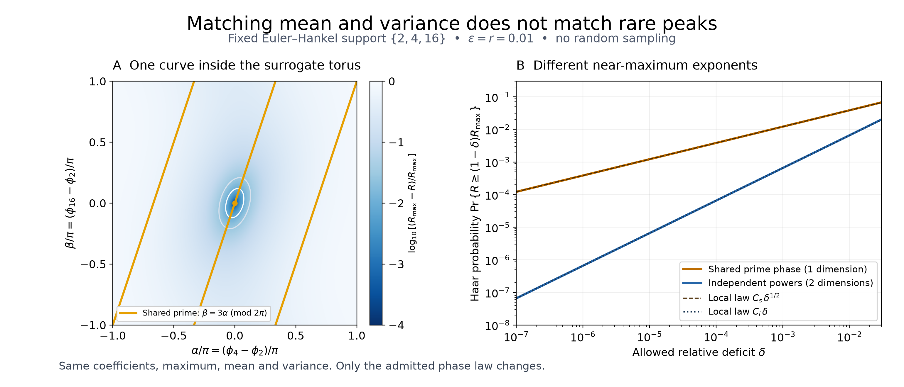

# Matching two Euler–Hankel moments does not calibrate rare peaks

## Question

Can the independent-prime-power surrogate pass both mean and variance
checks and still misrepresent the rare peaks of a finite Euler–Hankel
response?

The earlier [ratio-fiber calibration](euler-hankel-phase-fibers.md)
detects a variance excess when different pairs of retained prime powers
have the same ratio. This view deliberately removes that diagnostic:
the sparse support is **\(S=\{2,4,16\}\)**, whose positive exponent
differences are the distinct integers \(1,2,3\). The phase models then
have identical mean, variance, and maximum, but different local
near-maximum exponents. The example tests the adequacy of the surrogate,
not an unexplained arithmetic residual.

## Construction

For \(n\in S\), put \(x_n=\log n\),
\(c_n=(\log2)n^{-1-\varepsilon}\), and retain the positive Hankel
kernel used in the preceding visualization:
\[
 K_{nm}=\frac{c_nc_m}{2r}
 \left(e^{-r|x_n-x_m|}-e^{-r(x_n+x_m)}\right),
 \qquad \varepsilon,r>0.
 \tag{1}
\]
It is the Gram matrix of
\(c_n e^{-r(x_n-u)}1_{[0,x_n]}(u)\) in \(L^2(du)\). Define
\[
 R(Z)=\sum_{n,m\in S}K_{nm}Z_n\overline{Z_m},\quad
 M=\operatorname{tr}K,\quad R_{\max}=\sum_{n,m\in S}K_{nm}.
 \tag{2}
\]
All entries are strictly positive, so the maximum requires all three
phases to agree. This is a **sparse three-term source**, not the full
prime-power prefix through 16, and not an approximation claim about an
infinite Euler series. Multiplication by the full Euler normalizer or
the common factor \(2r\) cancels from the relative deficit below.

Compare the following Haar laws, using exactly the same coefficients:

- Shared prime: \((Z_2,Z_4,Z_{16})=(z,z^2,z^4)\), with \(z\)
  uniform on the circle. This is also the exact one-period height law
  for this source, with period \(2\pi/\log2\).
- Independent powers: all three \(Z_n\) are independent uniform
  circle variables. Removing their common phase leaves independent
  uniform relative angles \((\alpha,\beta)\) on the two-torus.

Write \(a=K_{2,4}\), \(b=K_{2,16}\), \(c=K_{4,16}\), and
\(\alpha=\phi_4-\phi_2\), \(\beta=\phi_{16}-\phi_2\). Then
\[
 D(\alpha,\beta):=R_{\max}-R
 =2\{a(1-\cos\alpha)+b(1-\cos\beta)
                  +c(1-\cos(\beta-\alpha))\}.
 \tag{3}
\]
The shared law is the curve \((\alpha,\beta)=(\theta,3\theta)\)
modulo \(2\pi\). Its uniform measure is \(d\theta/(2\pi)\);
it is not area measure in the surrounding torus.

Both panels fix \(\varepsilon=r=0.01\). Panel A uses a
\(1001\times1001\) angle grid on \([-\pi,\pi]^2\), colors
\(\log_{10}(D/R_{\max})\), and clips colors below \(-4\).
The two light contours are relative deficits 0.01 and 0.03; the orange
curve is split at periodic chart seams. Its apparent three pieces
are one closed curve, not three independent components.

Panel B plots \(P(\delta)=\Pr\{D\le\delta R_{\max}\}\) at
91 geometrically spaced values in \([10^{-7},0.03]\), by deterministic
integration described below. Both axes are logarithmic. Dashed/dotted
curves are the derived leading asymptotics, not fitted slopes or
independent confirmations. No observed zeta heights, fitted parameters,
Monte Carlo draws, or confirmation data are used. The figure is
3080 by 1320 pixels, rendered at 14 by 6 inches and 220 dpi with
NumPy 2.5.4 and Matplotlib 3.11.2.

## Observation

Circle orthogonality gives, **exactly under either law**,
\[
 \mathbb E R=M,\qquad
 \operatorname{Var}(R)=2(a^2+b^2+c^2).                 \tag{4}
\]
For the shared model the centered response is
\(2(a\cos\theta+b\cos3\theta+c\cos2\theta)\): its three
frequencies are distinct. For the independent model the three
characters in (3) are distinct up to sign. Thus the previous
variance-collision test returns zero even though the laws differ.

The relative-angle torus has a unique maximum at \((0,0)\).
Near that point,
\[
 D(\alpha,\beta)
 =\begin{pmatrix}\alpha&\beta\end{pmatrix}
 H\begin{pmatrix}\alpha\\\beta\end{pmatrix}
   +O(\|(\alpha,\beta)\|^4),\qquad
 H=\begin{pmatrix}a+c&-c\\-c&b+c\end{pmatrix}.
 \tag{5}
\]
Here \(\det H=ab+ac+bc>0\). The Hessian is \(2H\), not
\(H\). On the shared curve,
\[
 D(\theta,3\theta)=h\theta^2+O(\theta^4),
 \qquad h=a+9b+4c>0.                                 \tag{6}
\]
Because \(a>0\), zero deficit on this curve also requires
\(\theta=0\) modulo \(2\pi\). Compactness excludes other
contributions when the deficit tends to zero. Rescaling a shrinking
interval or ellipse in (5)–(6), with their respective normalized
Haar measures, proves
\[
 \boxed{P_s(\delta)\sim
 C_s\sqrt\delta,\quad C_s=\frac{\sqrt{R_{\max}}}{\pi\sqrt h};
 \qquad
 P_i(\delta)\sim C_i\delta,\quad
 C_i=\frac{R_{\max}}{4\pi\sqrt{ab+ac+bc}}.}          \tag{7}
\]
In particular \(P_s/P_i\sim(C_s/C_i)\delta^{-1/2}\).
Agreement of these first two moments does not bound the relative
near-peak probability error. The exponent difference is the dimension
of the admitted phase space near the maximum, not a new prime anomaly.

For the displayed parameters,
\[
 M\simeq0.1262658522,\quad
 \operatorname{Var}(R)\simeq0.003613543407,\quad
 R_{\max}\simeq0.2456628787,
\]
\[
 C_s\simeq0.3860066800,\qquad C_i\simeq0.6595403815.
\]
At \(\delta=10^{-5}\), direct integration gives
\(P_s\simeq0.001220664723\) and
\(P_i\simeq0.000006595446\), a ratio about 185.1.
These are finite-model probabilities, not empirical frequencies or
certified interval enclosures.

## Robustness

The numerical construction can be reproduced without rare-event
sampling. Set \(t=\delta R_{\max}\). For every displayed threshold
\(t<a\). Since the first summand of (3) is at least \(a\) when
\(\pi/3\le|\theta|\le\pi\), the shared event is contained in
\(|\theta|<\pi/3\). Within that interval its deficit is strictly
increasing with \(|\theta|\), since all three terms have positive
derivatives for \(0<\theta<\pi/3\). If \(\theta_t\in(0,\pi/3)\)
solves
\[
 4\{a\sin^2(\theta_t/2)+b\sin^2(3\theta_t/2)
                         +c\sin^2\theta_t\}=t,
\]
then \(P_s=\theta_t/\pi\).

For the independent model, fix \(\alpha\) and set
\[
 v(\alpha)=\sqrt{b^2+c^2+2bc\cos\alpha},\qquad
 w(\alpha)=\frac{a+b+c-t/2-a\cos\alpha}{v(\alpha)}.
\]
Integrating the cosine in \(\beta\) gives exactly
\[
 P_i=\frac1{2\pi^2}\int_{-\pi}^{\pi}
       \arccos(\operatorname{clip}(w(\alpha),-1,1))\,d\alpha.
 \tag{8}
\]
For these coefficients \(b>c>0\), so \(v\) never vanishes.
The nonzero integrand lies in \(|\alpha|\le\alpha_t\), where
\(2\{a(1-\cos\alpha_t)+b+c-v(\alpha_t)\}=t\).
Use \(\alpha=\alpha_t\sin u\) on \([0,\pi/2]\) to smooth
the endpoint. Evaluate cosine deficits through squared sines,
\(b+c-v=4bc\sin^2(\alpha/2)/(b+c+v)\), and
\(\arccos(1-z)=2\arcsin\sqrt{z/2}\) to avoid cancellation.
The plot uses SciPy 1.18.1 quadrature with relative tolerance
\(2\cdot10^{-12}\) and absolute tolerance \(10^{-20}\).

Independent checks and representation controls are:

- A 64-point shared circle and a \(64^2\)-point relative-angle grid
  integrate the first two moments exactly in exact arithmetic, since
  no surviving nonconstant Fourier mode aliases to zero. Evaluated
  mean/variance discrepancies from (4) were at most
  \(2.8\cdot10^{-17}\).
- A separate polar-area integral solves (3) radially in the
  \((\alpha,\beta)\) plane. At deficits \(10^{-5},10^{-3},10^{-2}\),
  1024 and 2048 equally spaced midpoint angles agree with (8) to
  relative error below \(1.4\cdot10^{-15}\). This checks constants
  and integration, not a second probabilistic experiment.
- Repeating the small-deficit calculation at
  \((p,\varepsilon,r)=(2,.001,.001),(2,.1,.1),
  (3,.01,.1),(3,.1,.01)\), with support \(\{p,p^2,p^4\}\),
  preserves both exponents. At \(\delta=10^{-7}\), every checked
  probability divided by its leading term differs from one by less
  than \(1.7\cdot10^{-7}\). Equation (7), rather than these finite
  checks, establishes the asymptotic for all positive parameters.
- Phase rotations of the base prime reparameterize the shared circle;
  ordering, color, and a common positive response normalization do
  not change either probability. An arbitrary area-preserving redraw
  must still transport the correct circle measure.
- With only \(\{p,p^2\}\), the sole relative phase is uniform
  under either law, so the **entire** response distributions agree.
  With three distinct primes the shared-prime law is already the
  independent law. These controls isolate the lost power constraint.

Floating-point quadrature and raster decoding are not formal or
directed-rounding proofs. The derivations (3)–(8) supply the exact
finite-model interpretation independently of the image resolution.

## Research consequence

Retain this pair as a calibration counterexample: even exact agreement
of mean and variance can miss a divergent relative rare-peak error
when a prime tower is replaced by independent phases. A simulation
intended to reproduce a shared-prime source must preserve that law;
moment matching alone cannot validate the replacement.

The construction is classical. Ihara,
[*On “M-Functions” Closely Related to the Distribution of L'/L-Values*](https://ems.press/journals/prims/articles/2161),
*Publications of RIMS* 44 (2008), 893–954, §1.5, supplies the prime-torus
framework. The local-volume mechanism is the nondegenerate quadratic
minimum of Milnor, [*Morse Theory*](https://math.stanford.edu/~ralph/math215b/Milnor.pdf),
Princeton University Press (1963), Lemma 2.2; here its needed
interval/ellipse asymptotics are derived directly. Locally,
[VIS-164](../findings/VIS-164-anchored-heldout-prime-collision-haar-tail.md)
already records dimension-coded torus tails for another observable,
and [VIS-068](../findings/VIS-068-shared-prime-phase-third-order-harmonic-resonances.md)
records higher harmonic information beyond covariance. This picture
specializes those established mechanisms to an explicit Hankel
surrogate that passes the previous two-moment checks; it makes no
general novelty claim.

This pair is supporting research context, not a canonical finding or
a new clue. It supplies no full-prefix or infinite-support tail law,
no uniformity as \(r,\varepsilon\) or the support change with
\(\delta\), and no finite-height estimate for a multiprime model.
In particular it does not refine the full-source doubly exponential
scale of
[WI-458](../../weil_inertia/findings/WI-458-euler-hankel-peaks-have-exponentially-small-height-density.md),
whose order of limits is different. The zero-ordinate alignment
problem in
[WI-457](../../weil_inertia/findings/WI-457-normalized-euler-hankel-symbols-have-local-blindness-and-recurrent-peaks.md)
remains untouched. No RH consequence follows.
