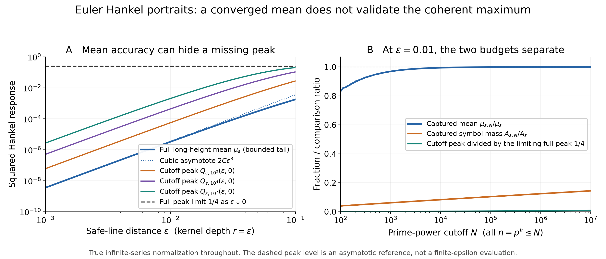

# Euler Hankel portraits: mean convergence can hide a missing maximum

## Question

Can convergence of a finite Euler-sum portrait's long-height mean validate
its depiction of the strongest Hankel response? The new source family in
[WI-457](../../weil_inertia/findings/WI-457-normalized-euler-hankel-symbols-have-local-blindness-and-recurrent-peaks.md)
has both compact-height blindness and recurrent coherent maxima. This
view tests whether an apparently well-converged finite representation
can erase the latter.

The answer is negative: the mean has a rapidly summable diagonal
budget, whereas the maximum depends on coherent mass much farther out
in the Euler series. The relevant limit orders differ.

## Construction

Use WI-457's conventions, with
\[
 L(s)=-\zeta'(s)/\zeta(s),\qquad
 A_\varepsilon=L(1+\varepsilon),\qquad
 a_{\varepsilon,n}=\frac{\Lambda(n)n^{-1-\varepsilon}}{A_\varepsilon},
 \quad \omega_n=\log n,\quad \varepsilon>0.
\]
Here \(\Lambda(p^k)=\log p\), and it vanishes elsewhere. The coefficients
are nonnegative and sum to one. For the anti-analytic symbol
\(\varphi_\varepsilon(t)=\sum_n a_{\varepsilon,n}e^{-it\omega_n}\),
let \(Q_\varepsilon(r,\gamma)\) be its squared Hankel response on the
unit positive-Hardy kernel of depth \(r>0\) and center \(\gamma\).
WI-457 derives the absolutely convergent expression
\[
 Q_\varepsilon(r,\gamma)=\sum_{n,m\ge2}a_{\varepsilon,n}a_{\varepsilon,m}
 B_r(\omega_n,\omega_m)\cos\bigl(\gamma(\omega_n-\omega_m)\bigr),
 \quad
 B_r(x,y)=e^{-r|x-y|}-e^{-r(x+y)}.                         \tag{1}
\]
Its nonnegative coefficient kernel also has the Gram representation
\[
 B_r(x,y)=2r\int_0^{\min(x,y)}e^{-r(x+y-2u)}\,du.          \tag{2}
\]
Thus (1) is nonnegative, and its maximum is attained at \(\gamma=0\).

Define \(Q_{\varepsilon,N}\) by restricting both indices in (1) to
\(n,m\le N\). **Keep the full normalizer \(A_\varepsilon\).**
Renormalizing the truncated coefficients to sum to one would change
the symbol and the operator budget. For positive coefficients,
\(Q_{\varepsilon,N}(r,0)\) increases to \(Q_\varepsilon(r,0)\)
as \(N\to\infty\) at fixed \(\varepsilon,r\).

The exact long-height mean is
\[
 \mu_\varepsilon(r):=
 \lim_{T\to\infty}\frac1T\int_T^{2T}Q_\varepsilon(r,\gamma)\,d\gamma
 =\frac1{A_\varepsilon^2}
   \sum_{n\ge2}\frac{\Lambda(n)^2}{n^{2+2\varepsilon}}
                  (1-n^{-2r}).                            \tag{3}
\]
Write \(\mu_{\varepsilon,N}(r)\) for the truncated diagonal sum.
The same mean results from independent uniform **base-prime** phases,
with powers of each prime sharing that phase. Independence of all
prime-power phases is neither assumed nor needed.

Both panels set \(r=\varepsilon\).

- **A:** 81 geometrically spaced values of \(\varepsilon\) from
  \(10^{-3}\) to \(10^{-1}\). Plot (3), its cubic asymptote below,
  and the exact finite-sum maxima at \(N=10^2,10^4,10^7\).
  Both axes are logarithmic. The horizontal line \(1/4\) is the
  **small-\(\varepsilon\) limit** of the full maximum from WI-457,
  not a numerical evaluation of that maximum at finite \(\varepsilon\).
- **B:** fix \(\varepsilon=0.01\). At 180 integer cutoffs obtained
  by rounding down a geometric grid from \(10^2\) to \(10^7\),
  plot the captured fraction \(\mu_{\varepsilon,N}/\mu_\varepsilon\),
  the captured coefficient mass
  \(A_{\varepsilon,N}/A_\varepsilon=\sum_{n\le N}a_{\varepsilon,n}\),
  and \(4Q_{\varepsilon,N}(\varepsilon,0)\). The last curve compares
  with the limiting full peak, not with its finite-parameter value.
  Only the cutoff axis is logarithmic; joining segments guide the eye.

For reproducing the finite maximum without a dense matrix, order the
prime powers by \(n\), put
\[
 d_n=a_n^2(1-e^{-2r\omega_n}),\quad
 u_n=a_ne^{-r\omega_n},\quad
 v_n=a_ne^{r\omega_n}(1-e^{-2r\omega_n}),
\]
and use
\[
 Q_{\varepsilon,N}(r,0)=\sum_{n\le N}d_n
                +2\sum_{n\le N}u_n\sum_{m<n}v_m.           \tag{4}
\]
The implementation uses `-expm1(-2*r*log(n))` for the small differences,
a sieve including every prime power through \(10^7\), and 60-decimal
precision for \(-\zeta'/\zeta\) before conversion to double precision.
The resulting image is 3080 by 1320 pixels, rendered at 14 by 6 inches
and 220 dpi with NumPy 2.5.4, Matplotlib 3.11.2 and mpmath 1.4.1.

## Observation

For every fixed \(q>0\),
\[
 \mu_\varepsilon(q\varepsilon)\sim2qC\varepsilon^3,
 \qquad
 C=\sum_{n\ge2}\frac{\Lambda(n)^2\log n}{n^2}\in(0,\infty).
                                                               \tag{5}
\]
To verify (3), average the absolutely convergent double series. Every
term with \(n\ne m\) has a nonzero frequency and zero limiting mean;
the diagonal gives (3). This is ordinary Fourier orthogonality, not
prime cancellation. To verify (5), use
\(\varepsilon A_\varepsilon\to1\) from the pole at one and
\[
 0\le \frac{1-n^{-2q\varepsilon}}{2q\varepsilon}\le\log n.
\]
The dominating series is summable because \(\Lambda(n)\le\log n\).
Dominated convergence proves the stated constant and exponent.

In contrast, WI-457's pole-scale calculation gives
\[
 Q_\varepsilon(q\varepsilon,0)\longrightarrow
 \frac{q}{(1+q)^2}.                                       \tag{6}
\]
For a fixed finite cutoff, expansion of (2) gives instead
\[
 \frac{Q_{\varepsilon,N}(q\varepsilon,0)}{\varepsilon^3}
 \longrightarrow
 2q\sum_{n,m\le N}\frac{\Lambda(n)\Lambda(m)}{nm}
                         \min(\log n,\log m)<\infty.       \tag{7}
\]
Consequently the finite-cutoff peak vanishes, while the full peak
persists. In particular,
\[
 \lim_{\varepsilon\downarrow0}\lim_{N\to\infty}
 Q_{\varepsilon,N}(\varepsilon,0)=\frac14,
 \qquad
 \lim_{N\to\infty}\lim_{\varepsilon\downarrow0}
 Q_{\varepsilon,N}(\varepsilon,0)=0.                       \tag{8}
\]
Meanwhile,
\[
 \frac{\mu_{\varepsilon,N}(q\varepsilon)}
      {\mu_\varepsilon(q\varepsilon)}\longrightarrow\frac{C_N}{C},
 \quad C_N=\sum_{n\le N}\Lambda(n)^2\log n/n^2,
 \quad C_N\uparrow C.                                    \tag{9}
\]
A fixed cutoff can therefore capture an arbitrarily large fraction of
the mean in the small-scale limit and still lose the entire persistent
maximum. This is the discriminating representation failure documented
by the image.

For example, at \(\varepsilon=0.01\), the \(10^7\) cutoff captures
more than 99.968% of the mean under the analytic tail estimate below,
but only about 14.394% of the symbol's coefficient mass. Its maximum
is approximately \(0.00204637\); the comparison value \(1/4\)
remains asymptotic. The mean is approximately
\(3.28244\cdot10^{-6}\), with omitted-tail bound
\(1.02566\cdot10^{-9}\). These are evaluations of the formulas,
not observed frequencies in a sampled height window.

## Robustness

All omitted diagonal terms are nonnegative. For \(N\ge100\),
\[
 D_N:=\frac{(\log N)^3+3(\log N)^2+6\log N+6}{N}
       =\int_N^\infty\frac{(\log x)^3}{x^2}\,dx
\]
bounds \(C-C_N\) by the integral test. For every \(r>0\),
\[
 0\le\mu_\varepsilon(r)-\mu_{\varepsilon,N}(r)
 \le\frac{2r}{A_\varepsilon^2}D_N.                         \tag{10}
\]
The plotted mean band uses the sum through \(10^7\) and (10).
Panel B brackets its fraction using both ends of that denominator
band. Here \(C_{10^7}\simeq1.77848403\) and
\(D_{10^7}\simeq0.000506946\). The dotted asymptote uses
\(C_{10^7}\); its relative constant error is below 0.029%.
These are analytic truncation bounds with floating-point evaluation,
not a directed-rounding interval certificate. The bands are thinner
than the curve width at ordinary viewing scale.

Independent checks compared (4) against a dense evaluation of (1)
and interval-by-interval integration of the feature formula (2),
using all prime powers through 100, each
\(\varepsilon\in\{0.001,0.01,0.1\}\), and each
\(q\in\{1/2,1,2\}\). The maximum absolute discrepancies were
\(6.94\cdot10^{-18}\) and \(2.09\cdot10^{-17}\), respectively.
The diagonal mean's rescaled values were also checked at these nine
parameters; the exact dominated-convergence argument, rather than a
fit to the plotted slope, establishes (5).

A separate 16-by-16 torus grid used the terms
\(2,3,4,8,9,16,27\) at \(r=\varepsilon=0.07\), keeping
\(p^k\)'s phase equal to \(k\) times its base-prime phase.
This grid integrates all nonconstant characters in that finite
quadratic response exactly in exact arithmetic. Its mean agreed with
the diagonal formula to \(5.43\cdot10^{-20}\) in floating point.
Increasing the normalizer's precision from 60 to 90 decimal digits at
\(\varepsilon=0.001,0.01,0.1\) left its double-precision values
unchanged.

The cutoff comparison is not a parameter-selected anomaly or a random
sample. Equations (5)--(9) apply to every fixed \(q>0\) and finite
cutoff. Coefficient ordering, color choice and line interpolation
cannot change those formulas. The diagonal mean discards coefficient
phases and therefore cannot certify the alignment used by the maximum.
Base-prime phase rotations themselves preserve the global supremum by
torus recurrence; they must not be presented as controls that destroy it. Uniform
convergence at fixed \(\varepsilon>0\) is intact: the obstruction
is interchanging that limit with \(\varepsilon\downarrow0\).

## Research consequence

Retain this pair as a truncation control for WI-457. A finite Euler
portrait needs a separate coherent-tail budget before its maximum can
be used to assess a shallow-defect detector. Relative accuracy of its
long-height mean does not provide that budget. The mechanism is the
standard distinction between diagonal quadratic mass and coherent
summation; no prime-specific anomaly is claimed.

For any fixed threshold \(c>0\), positivity and (3) also give
\[
 \limsup_{T\to\infty}\frac1T
 \bigl|\{\gamma\in[T,2T]:Q_\varepsilon(q\varepsilon,\gamma)\ge c\}\bigr|
 \le\frac{\mu_\varepsilon(q\varepsilon)}c.
\]
Thus persistent recurrent maxima coexist with a cubic upper bound on
long-height exceedance density as \(\varepsilon\downarrow0\), **after**
taking the height limit at each fixed \(\varepsilon\). This does not
give a sharp excursion law, a quantitative recurrence time, a bound
uniform in a prescribed joint limit \(\varepsilon=\varepsilon(T)\),
or any statement about response at zero ordinates. Sampling the zeros
is a different measure. None of these formulas implies RH or excludes
an individual exceptional zero.

The source inputs are classical: NIST DLMF
[§25.2](https://dlmf.nist.gov/25.2) supplies the Euler product and pole;
Schoolmann, [*On Bohr's theorem for general Dirichlet series*](https://arxiv.org/abs/1812.04925),
discussion preceding Corollary 3.9, supplies the almost-periodic
context; and Čolović, [*Reproducing Kernel Thesis of Hankel Operators
on Weighted Hardy Spaces*](https://arxiv.org/abs/2406.03106), §2,
records the classical Poisson-variance/Garsia framework. The mean and
cutoff calculations above are elementary consequences, with no claim
of a new general harmonic-analysis theorem. Ihara and Matsumoto,
[*On the value-distribution of logarithmic derivatives of Dirichlet
L-functions*](https://www.kurims.kyoto-u.ac.jp/preprint/file/RIMS1711.pdf),
provide relevant value-distribution context, not a result about this
particular quadratic Hankel observable or a transfer to zero sampling.

This visualization and its derivation are supporting context. WI-457
remains the canonical source-family finding. No new canonical finding,
clue disposition, or arithmetic alignment claim is promoted here.
