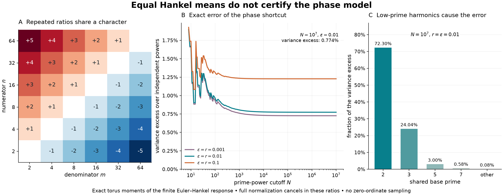

# Equal Euler–Hankel means can conceal a different phase law

## Question

How much does replacing shared base-prime phases by independent phases at
**every prime power** distort a finite Euler–Hankel portrait, even when
its mean is exactly correct?

[WI-457](../../weil_inertia/findings/WI-457-normalized-euler-hankel-symbols-have-local-blindness-and-recurrent-peaks.md)
defines the response, and
[WI-458](../../weil_inertia/findings/WI-458-euler-hankel-peaks-have-exponentially-small-height-density.md)
uses independent prime **blocks**, with all powers of one prime kept
together. The earlier [mean–peak cutoff view](euler-hankel-mean-peak-cutoff.md)
shows that mean convergence does not certify the maximum. This view
asks a separate calibration question within the same source family:
whether matching that mean certifies the random-phase model.

It does not. The variance difference is computable without simulation,
and comes entirely from repeated ratios within individual prime towers.

## Construction

For prime powers in \(S_N=\{p^k\le N:k\ge1\}\), set
\[
 c_n=\Lambda(n)n^{-1-\varepsilon},\quad x_n=\log n,\quad
 A_\varepsilon=-\zeta'(1+\varepsilon)/\zeta(1+\varepsilon),
 \qquad \varepsilon,r>0,
\]
\[
 K_{nm}=\frac{c_nc_m}{2r}
 \left(e^{-r|x_n-x_m|}-e^{-r(x_n+x_m)}\right).
 \tag{1}
\]
This positive semidefinite matrix is the Gram matrix of
\(c_n e^{-r(x_n-u)}1_{[0,x_n]}(u)\) in \(L^2(du)\).
Define the real nonnegative quadratic response
\[
 R_N(Z)=\sum_{n,m\in S_N}K_{nm}Z_n\overline{Z_m},\qquad
 M_N=\sum_{n\in S_N}K_{nn},\qquad J_N=R_N/M_N.
 \tag{2}
\]
On the actual height orbit \(Z_n=n^{-i\gamma}\),
\(R_N=A_\varepsilon^2Q_{\varepsilon,N}(r,\gamma)/(2r)\).
Thus \(J_N=Q_{\varepsilon,N}/\mu_{\varepsilon,N}\), with
\(\mu_{\varepsilon,N}\) the exact long-height mean. The full Euler
normalizer cancels in \(J_N\); no truncated symbol is renormalized to
unit coefficient mass.

Compare two explicitly different probability spaces:

- **Shared prime phases:** independent uniform \(z_p\) on the circle,
  with \(Z_{p^k}=z_p^k\). This is the exact finite long-height Haar law,
  by rational independence of distinct prime logarithms.
- **Independent powers:** independent uniform \(Z_n\) for every
  \(n\in S_N\). This is a diagnostic surrogate. It cannot be the
  height-translation law because, for example, \(Z_4=Z_2^2\) on that
  orbit.

Both have \(\mathbb ER_N=M_N\) and \(\mathbb EJ_N=1\). The plotted
quantities are exact finite-torus moment formulas evaluated in floating
point, not estimated moments or p-values.

**Panel A** displays \(h=\log_2(n/m)\) for
\(n,m\in\{2,4,8,16,32,64\}\), with the constant diagonal blank.
Equal signed labels identify the same character \(z_2^h\); opposite
labels identify conjugate characters. Position and color encode the
exponents, not observed clustering or response magnitude.

**Panel B** plots the relative variance excess
\[
 \frac{\operatorname{Var}_{\rm prime}(J_N)
       -\operatorname{Var}_{\rm independent}(J_N)}
      {\operatorname{Var}_{\rm independent}(J_N)}
 =\frac{\Delta_N}{V_N}
 \tag{3}
\]
for \(r=\varepsilon\in\{0.001,0.01,0.1\}\). Cutoffs are the unique
integer floors of 220 geometrically spaced numbers from 8 to \(10^7\).
Only the horizontal axis is logarithmic; connecting segments guide the
eye between evaluated cutoffs.

**Panel C** decomposes \(\Delta_N\) by base prime at
\(N=10^7\), \(r=\varepsilon=0.01\). Its percentages are shares of
the small **variance excess**, not shares of the total variance.
The sieve retains all 665,134 prime powers through \(10^7\).
The saved figure is 3168 by 1232 pixels, rendered at 14.4 by 5.6 inches
and 220 dpi with NumPy 2.5.4 and Matplotlib 3.11.2.

## Observation

Let
\[
 V_N=\sum_{n\ne m}K_{nm}^2.
\]
Independent circle orthogonality gives
\(\operatorname{Var}_{\rm independent}(R_N)=V_N\).
For shared prime phases, unique factorization instead groups equal
rational ratios:
\[
 \operatorname{Var}_{\rm prime}(R_N)
 =\sum_{\rho\ne1}
   \left(\sum_{n/m=\rho}K_{nm}\right)^2.                 \tag{4}
\]
Indeed the coefficient of the constant character is \(M_N\), and
Parseval applied to the centered quadratic form gives (4). If \(n\)
and \(m\) have different base primes, their reduced ratio determines
the ordered pair uniquely. Repeated ratios occur only as
\((n,m)=(p^{\ell+h},p^\ell)\), and their reciprocals. Consequently
\[
 \boxed{\Delta_N=
 2\sum_p\sum_{h\ge1}
 \left[\left(\sum_{\ell:\,p^{\ell+h}\le N}
          K_{p^{\ell+h},p^\ell}\right)^2
       -\sum_{\ell:\,p^{\ell+h}\le N}
          K_{p^{\ell+h},p^\ell}^{\,2}\right]\ge0.}       \tag{5}
\]
The factor two counts the reciprocal ratios separately. Every coefficient
is positive, so a fiber containing two ordered pairs makes (5) strictly
positive. The first such collision is
\(4/2=8/4\), appearing at cutoff 8.

For the isolated support \(\{2,4,8\}\), the difference is simply
\[
 \Delta=4K_{4,2}K_{8,4}>0.                               \tag{6}
\]
In the full cutoff at \(N=10^7\), \(r=\varepsilon=0.01\),
\[
 \operatorname{Var}_{\rm independent}(J_N)
 \simeq0.5219735522,\qquad
 \operatorname{Var}_{\rm prime}(J_N)\simeq0.5260136495.
\]
The relative variance increase is about **0.774004%**. Powers of 2
supply about 72.2981% of the excess and powers of 3 supply 24.0434%.
This modest discrepancy is structural rather than sampling noise.
It must not be described as a comparably large percentage change in
standard deviation, or as an arithmetic signal beyond the correct Haar
null.

## Robustness

For an efficient reproduction, order the prime powers by size and put
\[
 f_n=\frac{1-e^{-2rx_n}}{2r},\quad
 U_n=c_n^2e^{-2rx_n},\quad W_n=c_n^2e^{2rx_n}f_n^2.
\]
Then
\[
 M_N=\sum_{n\le N}c_n^2f_n,\qquad
 V_N=2\sum_{n\le N}U_n\sum_{m<n}W_m.                    \tag{7}
\]
Evaluate \(f_n\) using `-expm1(-2*r*x_n)/(2*r)`.
For each prime tower and positive harmonic gap \(h\), accumulate the
coefficients in (5). When a new pair contributes \(k\) to a fiber
whose previous sum was \(s\), increment \(\Delta_N\) by \(4ks\).
Only primes with \(p^3\le N\) can contribute a nonzero excess.
These recurrences avoid a dense matrix at large cutoff.

Independent checks used a dense matrix from (1) and exact rational-ratio
grouping through \(N=100\), for each of the three displayed parameters.
The largest absolute discrepancy with the recurrence mean or either
variance was below \(1.4\cdot10^{-15}\). For support \(\{2,4,8\}\)
at \(r=\varepsilon=0.01\), a 16-point circle integrates the shared
law's first two moments, while a \(16^3\)-point product grid integrates
the independent law's moments. These grids integrate every relevant
Fourier mode exactly in exact arithmetic. The evaluated variance gap
was \(0.003167278674044589\), agreeing with (6) to
\(3.5\cdot10^{-18}\). This is a full finite-torus integration check,
not Monte Carlo confirmation.

At \(N=10^6\), \(r=\varepsilon=0.01\), the variance increase is
about 0.774046%, versus 0.774004% at \(10^7\). This is a cutoff
comparison, not a certified error bound for an infinite-support law.
All displayed conclusions are finite-cutoff statements. Floating-point
evaluations are not directed-rounding certificates.

As an exact control, retaining only primes removes every repeated ratio,
so \(\Delta_N=0\). More generally, (5) vanishes precisely when no
nonzero ratio has two retained ordered pairs, for these strictly
positive coefficients. Rotating any base-prime phase preserves both
Haar law and variance: all terms in one ratio fiber acquire the same
unit phase. Reordering terms, changing colors, or changing the common
normalizer cannot change (3). Arbitrary independent rotations or
resampling of prime powers change the admitted phase model.

## Research consequence

Retain this pair as a finite-response calibration control for WI-457
and WI-458. Correct mean and coefficient magnitudes do not certify a
correct fluctuation law. A finite simulation of this source must share
the phase of each base prime across all its powers, or explicitly
acknowledge the different surrogate and its moment correction.
The observed variance discrepancy is completely accounted for by the
known character collisions; it supplies no unexplained residual.

The underlying mathematics is classical. Ihara,
[*On “M-Functions” Closely Related to the Distribution of L'/L-Values*](https://ems.press/journals/prims/articles/2161),
*Publications of RIMS* 44 (2008), 893–954, §1.5, constructs the prime
torus with the powers of each prime in one local factor. Locally,
[VIS-068](../findings/VIS-068-shared-prime-phase-third-order-harmonic-resonances.md)
already identifies harmonic correlations lost by independent-power
resampling, and
[VIS-310](../findings/VIS-310-wang-hard-truncation-global-gap-quintic-horizon.md),
§2, already groups identical prime-power ratios for a different
quadratic statistic. This is their elementary specialization to the
positive Hankel kernel, with the actual finite calibration error made
explicit. No new general moment theorem or novelty claim is made.

The image and formulas are supporting exploratory context. No canonical
finding or clue is promoted. They do not establish an infinite-support
bulk distribution, a sharp excursion law, a finite-height convergence
rate, or behavior at zeta-zero ordinates. In particular, the small
second-moment discrepancy does not bound discrepancies of rare-event
probabilities. The arithmetic alignment gap in WI-457 and WI-458
remains open; no RH consequence follows.
