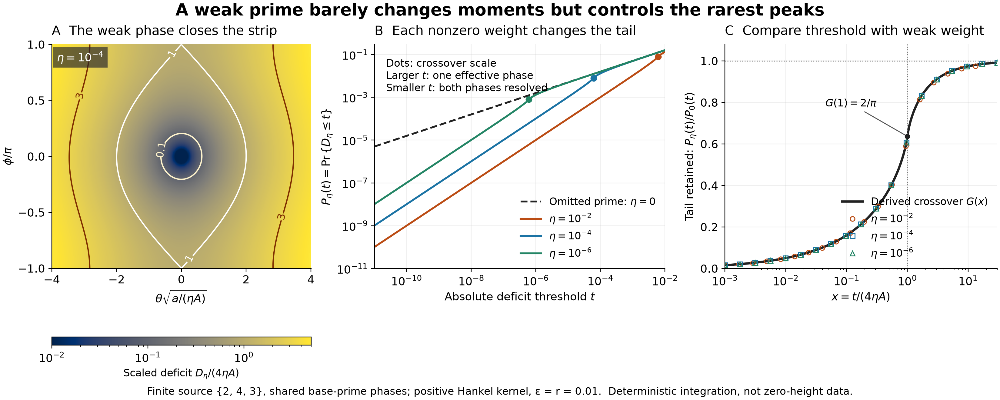

# A weak prime changes the resolved dimension of a Hankel peak

## Question

When is a small omitted coefficient harmless for a rare-peak portrait?
The [matched-moments view](euler-hankel-matched-moments-rare-peaks.md)
compared different phase laws on the same source. Here the phase law
stays correct while a coefficient tends to zero. The issue is whether
convergence of the response and its first two moments validates a
truncated model's **relative near-maximum probabilities**.

An explicit three-term source gives a threshold-dependent answer:
the weak prime matters below its coupling scale even when its effect
on both moments is quadratic in its weight. This is a finite-source
truncation control, not an experiment on observed zeta zeros.

## Construction

Use the sparse support \(S=(2,4,3)\), not the complete prime-power
prefix. For \(n\in S\), set \(x_n=\log n\),
\[
 c_2=(\log2)2^{-1-\varepsilon},\quad
 c_4=(\log2)4^{-1-\varepsilon},\quad
 c_3=(\log3)3^{-1-\varepsilon},
\]
\[
 K_{nm}=\frac{c_nc_m}{2r}
 \left(e^{-r|x_n-x_m|}-e^{-r(x_n+x_m)}\right),
 \qquad \varepsilon,r>0.                              \tag{1}
\]
These are the inner products of
\(f_n(u)=c_n e^{-r(x_n-u)}1_{[0,x_n]}(u)\) in \(L^2(du)\), so
the kernel is positive semidefinite and every entry is strictly
positive. Give the third coefficient an explicit attenuation
\(\eta\ge0\):
\[
 R_\eta(z,w)=\|z f_2+z^2 f_4+\eta w f_3\|_2^2,
 \qquad (z,w)\sim m_{\mathbb T^2}.                    \tag{2}
\]
The parameter \(\eta\) is a controlled coefficient perturbation,
not an assertion about the weights of the full Euler source. Powers
of 2 share their base-prime phase. The independent variable \(w\)
is the phase of the distinct prime 3. Unique factorization makes
\((2^{-i\gamma},3^{-i\gamma})\) equidistributed on this torus in
the infinite-height limit; no finite-height rate is used here.

Write \(z=e^{i\theta}\), \(w=e^{i(\theta+\phi)}\). This integer
shear preserves normalized Haar measure \(d\theta\,d\phi/(2\pi)^2\).
With \(a=K_{2,4}\), \(b=K_{2,3}\), \(c=K_{4,3}\), and \(A=b+c\),
the deficit from **each model's own maximum** is exactly
\[
 D_\eta=R_{\eta,\max}-R_\eta
 =4\left[a\sin^2\frac\theta2+\eta b\sin^2\frac\phi2
       +\eta c\sin^2\frac{\phi-\theta}{2}\right].       \tag{3}
\]
All probabilities below use an absolute deficit threshold:
\[
 P_\eta(t)=\Pr\{D_\eta\le t\}.                         \tag{4}
\]
The rendering fixes \(\varepsilon=r=0.01\), giving
\[
 a\simeq0.04021039821,\quad b\simeq0.08546629487,\quad
 c\simeq0.06707017568,\quad A\simeq0.15253647055.
\]

Panel A renders \(D_\eta/(4\eta A)\) at \(\eta=10^{-4}\) on
an \(801\times1001\) grid in
\((\theta\sqrt{a/(\eta A)},\phi/\pi)\in[-4,4]\times[-1,1]\).
Colors are logarithmic, clipped to \([0.01,5]\); contours are
0.1, 1, and 3. The top and bottom edges are the same circle seam.
The horizontal rescaling enlarges the narrow peak; it does not
change the Haar probability, whose Jacobian is retained analytically.

Panel B uses 181 logarithmic thresholds from \(10^{-11}\) to \(0.01\)
and \(\eta\in\{0,10^{-2},10^{-4},10^{-6}\}\). Dots mark
\(t=4\eta A\). Panel C compares the exact probability ratios at
19 logarithmic \(x=t/(4\eta A)\) values in
\([10^{-3},\min\{30,0.08/(4\eta A)\}]\) with the derived limit
curve on 161 logarithmic values in \([10^{-3},30]\). These are
deterministic integrations, not independent data or fitted slopes.
The PNG is 3300 by 1320 pixels, exported at 15 by 6 inches and
220 dpi using NumPy 2.5.4 and Matplotlib 3.11.2.

## Observation

The nearly unchanged low-order summaries are exact:
\[
 \mathbb E R_\eta=K_{2,2}+K_{4,4}+\eta^2K_{3,3},\qquad
 \operatorname{Var}(R_\eta)=2[a^2+\eta^2(b^2+c^2)].     \tag{5}
\]
The three cosine characters in (3) are distinct up to sign, so
orthogonality proves (5). Both moment changes are \(O(\eta^2)\).
Also \(\|R_\eta-R_0\|_\infty\le2\eta A+\eta^2K_{3,3}\).
Neither statement controls *relative* rare-event error uniformly
as the threshold shrinks.

For \(\eta=0\), the maximum is the whole circle \(\theta=0\), and
\[
 P_0(t)=\frac2\pi\arcsin\sqrt{\frac{t}{4a}}
 \sim\frac{\sqrt t}{\pi\sqrt a},\qquad 0\le t\le4a.    \tag{6}
\]
For any fixed \(\eta>0\), there is a unique maximum on the torus,
at \((0,0)\), and the quadratic deficit matrix is
\[
 H_\eta=\begin{pmatrix}a+\eta c&-\eta c\\-\eta c&\eta A\end{pmatrix},
 \qquad \det H_\eta=a\eta A+\eta^2bc>0.
\]
The Hessian is \(2H_\eta\). Compactness excludes distant points
from sufficiently small sublevels. The area of the local ellipse,
divided by the torus area \(4\pi^2\), gives
\[
 P_\eta(t)\sim\frac{t}{4\pi\sqrt{a\eta A+\eta^2bc}}
 \qquad(t\downarrow0,\ \eta>0\text{ fixed}).           \tag{7}
\]
Thus deleting any positive third coefficient changes the ultimate
tail exponent from 1 to \(1/2\). Equation (7) is not uniform as
\(\eta\downarrow0\); its diverging prefactor signals the missing
scale rather than an infinite probability.

There is a direct, globally valid probability bracket:
\[
 0\le D_\eta-D_0\le4\eta A,\qquad
 P_0((t-4\eta A)_+)\le P_\eta(t)\le P_0(t).            \tag{8}
\]
Here extend \(P_0(t)=1\) for \(t\ge4a\), and take \(t\ge0\).
For \(t\to0\) with \(\eta/t\to0\), (8) implies
\(P_\eta(t)/P_0(t)\to1\). The regime \(t\asymp\eta\) is resolved
by a nontrivial crossover. For every fixed \(x>0\),
\[
 \boxed{\lim_{\eta\downarrow0}
 \frac{P_\eta(4\eta A x)}{P_0(4\eta A x)}
 =G(x):=\frac2\pi\int_0^{\pi/2}
       \sqrt{\left(1-\frac{\sin^2 v}{x}\right)_+}\,dv.} \tag{9}
\]
To derive it, set \(\theta=\sqrt\eta\,u\) in (3). On bounded \(u\),
\[
 D_\eta(\sqrt\eta\,u,\phi)/\eta
 \longrightarrow au^2+4A\sin^2(\phi/2)
\]
uniformly in \(\phi\). The first term of (3) confines the event
to a bounded \(u\)-interval at each fixed \(x\). Its limiting
boundary has two-dimensional measure zero, so dominated convergence
applies to its area. Integrating over \(u\), then dividing by (6),
gives (9), including the normalization constants.

In particular,
\[
 G(x)\sim\tfrac12\sqrt x\quad(x\downarrow0),\qquad
 G(1)=\tfrac2\pi,\qquad
 G(x)=1-\frac1{4x}+O(x^{-2})\quad(x\to\infty).         \tag{10}
\]
These are limits of the crossover function. They do not by themselves
assert uniform errors for every joint path \(x=x(\eta)\).

For example, at \(\eta=10^{-4}\) and \(x=10^{-3}\),
\(t\simeq6.10146\cdot10^{-8}\) and
\(P_\eta(t)\simeq6.20014\cdot10^{-6}\). The retained probability
is only \(0.0158126\) times the omitted-prime prediction: deletion
overestimates it by about 63.2-fold, while the relative mean change
is about \(1.17\cdot10^{-8}\). The distortion is caused by a weak
phase constraint, not an arithmetic anomaly.

## Robustness

No rare-event sampling is needed. For fixed \(\theta\), put
\[
 v(\theta)=\sqrt{A^2-4bc\sin^2(\theta/2)},\quad
 z(\theta)=\frac{t-4a\sin^2(\theta/2)-2\eta(A-v(\theta))}
                  {4\eta v(\theta)}.
\]
Integrating the remaining cosine phase exactly gives, for \(\eta>0\),
\[
 P_\eta(t)=\frac1\pi\int_0^\pi
 \frac2\pi\arcsin\sqrt{\operatorname{clip}(z(\theta),0,1)}
 \,d\theta.                                         \tag{11}
\]
For these coefficients \(b>c>0\), so \(v>0\). All rendered thresholds
are below \(4a\). Locate the zero-integrand endpoint from
\(4a\sin^2(\theta/2)+2\eta(A-v)=t\); when \(t>4\eta A\), locate
the full-integrand endpoint from
\(4a\sin^2(\theta/2)+2\eta(A+v)=t\). These functions are increasing
on the relevant interval for the displayed weights. Integrate between
the endpoints using a squared-sine substitution, adding the full
interval explicitly. Evaluate \(A-v\) as
\(4bc\sin^2(\theta/2)/(A+v)\) to avoid cancellation. SciPy 1.18.1
quadrature used absolute tolerance \(10^{-20}\) and relative
tolerance \(2\cdot10^{-11}\).

Checks of the construction and numerical representation were:

- A \(64^2\)-point torus grid reproduces (5), without Fourier
  aliasing for these moments, for \(\eta=0,0.01,0.1,1\). The largest
  floating-point mean/variance error was \(3.5\cdot10^{-18}\).
- Independently whiten coordinates by \(H_\eta^{-1/2}\), solve (3)
  radially, and integrate the resulting polar area. At
  \(\eta=10^{-2},10^{-4},10^{-6}\) and \(x=0.001,0.01,0.1\),
  both 512- and 1024-angle midpoint rules agree with (11) to relative
  error below \(1.4\cdot10^{-15}\). These sublevels remain inside
  a single torus chart; no wrapped area is omitted.
- At \((\varepsilon,r)=(0.001,0.1),(0.1,0.001),(0.1,0.1)\),
  repeat \(\eta=10^{-4},10^{-6}\) and \(x=0.001,0.1,1,10\).
  All probabilities satisfy (8). At \(\eta=10^{-6}\), relative
  disagreement with (9) is below \(4.8\cdot10^{-7}\). Tightening
  the quadrature relative tolerance to \(2\cdot10^{-13}\) changes
  probabilities by less than \(4.5\cdot10^{-16}\) relatively.
- The exact derivation uses only \(a,b,c>0\), so the same mechanism
  holds for all positive kernel parameters. Consistent phase shifts,
  relabeling, color changes, and Haar-preserving coordinate changes
  leave the probabilities unchanged. The scaled horizontal plot
  coordinate is not itself a new observable.

The formulas and area limit, rather than raster resolution, establish
the interpretation. Numerical values are floating-point quadrature,
not certified interval enclosures or formal verification. Parameter
checks and the alternative integral are consistency checks, not
statistical confirmations.

## Research consequence

Retain this pair as a concrete truncation diagnostic: a cutoff needs
an error bound relative to the **deficit threshold**, not merely a
converged mean, variance, or uniformly small response error. Equation
(8) supplies a sufficient regime for the omitted model, while (9)
shows what is lost at the coupling scale. Counting all nonzero phase
directions gives the eventual exponent but can misdescribe a finite
resolution portrait when a direction is weakly weighted.

The mechanism is classical local sublevel geometry. Milnor,
[*Morse Theory*](https://math.stanford.edu/~ralph/math215b/Milnor.pdf),
Princeton University Press (1963), Lemma 2.2, supplies the
nondegenerate quadratic normal form; here the degenerating limit
and its volume are derived explicitly. Ihara,
[*On “M-Functions” Closely Related to the Distribution of L'/L-Values*](https://ems.press/journals/prims/articles/2161),
*Publications of RIMS* 44 (2008), 893–954, §1.5, anchors the
prime-torus viewpoint. Neither source is being credited with this
specific plotted crossover. The earlier
[dimension-coded Haar tail](../findings/VIS-164-anchored-heldout-prime-collision-haar-tail.md)
and [matched-moments picture](euler-hankel-matched-moments-rare-peaks.md)
already establish the local dimensional mechanism in other forms;
the additional diagnostic here is its failure to be uniform under
coefficient deletion. No literature-priority claim is made.

This PNG/Markdown pair is supporting exploratory context, not a new
canonical finding. The finite-model question is answered, so no
unresolved clue is manufactured. There is no full-Euler tail law,
no control uniform in growing support, no finite-height comparison,
and no claim about zero-ordinate selection or RH. In particular a
limit for a fixed or shrinking finite phase space cannot be substituted
for the full-source limits studied in other research lines.
