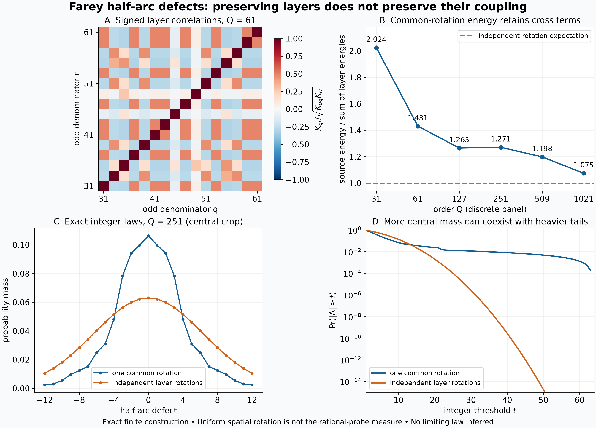

# Half-arc Farey defects under common and independent layer rotations

## Question

Does preserving each odd denominator layer preserve the half-arc rank
statistic? The [odd-shell view](farey-half-period-odd-shell.md) removed
complete antipodal pairs without changing that statistic. Here a
realizable control preserves every remaining layer up to rotation but
changes their relative phases. The comparison tests what is lost by
replacing arithmetic coupling with independent layers. It also separates
spatial probability from the rational-probe measure required by the
[accepted rank-window question](../../farey_discrepancy/clues/CLUE-half-period-joint-denominator-count.md).

## Construction

Use the cyclic Farey set
\(F_Q=\{a/q\in[0,1):(a,q)=1,\ q\le Q\}\), including \(0/1\).
For a finite circle set \(X\), let
\[
\Delta_X(u)=\#(X\cap(u,u+1/2])-|X|/2.
\]
Arcs are cyclic, open on the left and closed on the right. Put
\[
\mathcal O_Q=\{q:Q/2<q\le Q,\ q\text{ odd}\},\quad
X_q=\{a/q:0<a<q,\ (a,q)=1\},\quad d_q=\Delta_{X_q}.
\]
For \(Q\ge3\), all these \(q\) exceed one. The complementary part of
\(F_Q\) consists of antipodal pairs, so, pointwise including endpoints,
\[
D_Q(u):=\Delta_{F_Q}(u)=\sum_{q\in\mathcal O_Q}d_q(u). \tag{1}
\]
This is the preceding view's support reduction, not an additional
cancellation estimate.

Define two probability spaces explicitly:

- **Common rotation:** one uniform \(T\in[0,1)\), with
  \(Z_Q^{\rm com}(u)=\sum_q d_q(u-T)\). Its law at any fixed \(u\)
  is the spatial law of \(D_Q\).
- **Independent layer rotations:** independent uniform
  \(T_q\in[0,1)\), with \(Z_Q^{\rm ind}(u)=\sum_q d_q(u-T_q)\).
  Each labeled layer retains its cardinality, cyclic gap word and
  complete spatial defect law. The layers' relative phases change.

The latter is realized by the union of the rotated \(X_q\); accidental
cross-layer collisions have probability zero. One may also retain the
original antipodally paired complement, whose half-arc contribution is
zero. The labels \(q\) refer to the original layers: rotated points
generally are not rational with reduced denominator \(q\). This ensemble
is **not** a genuine Farey sequence, a denominator-preserving arithmetic
null, or a reflection-preserving ensemble. It is a specified diagnostic
of dependence, with no claim that its law is the correct source null.

For odd \(q\), Möbius inversion gives the exact right-continuous formula
\[
d_q(u)=\sum_{a\mid q}\mu(q/a)f_a(u),\qquad
f_a(u)=\mathbf1_{\{au\}\ge1/2}-\tfrac12. \tag{2}
\]
For odd positive \(a,b\), the square-wave Fourier series yields
\[
\int_0^1 f_a(u)f_b(u)\,du=\frac{\gcd(a,b)^2}{4ab}.
\]
Indeed, after dividing by the gcd, the common odd harmonics contribute
\((2/\pi^2)(\gcd(a,b)^2/(ab))\sum_{j\ge1,\ j\text{ odd}}j^{-2}\),
and that series is \(\pi^2/8\). Therefore
\[
K_{qr}:=\int_0^1d_qd_r
 =\frac14\sum_{a\mid q,b\mid r}
 \mu(q/a)\mu(r/b)\frac{\gcd(a,b)^2}{ab}. \tag{3}
\]
This is exactly three times the corresponding odd-denominator Gram
entry of [FD-001, §3](../../farey_discrepancy/findings/FD-001-denominator-shell-discrepancy-is-a-ramanujan-mertens-frame.md).
Equivalently, half translation kills the even Fourier modes, multiplies
the odd ones by minus two, and for odd \(q,r\) the odd-frequency portion
of the original Gram sum is three quarters of its total. No new Gram
identity or independent arithmetic information channel is claimed.

Each \(d_q\) has mean zero. Consequently
\[
\mathbb E[(Z_Q^{\rm com})^2]=\sum_{q,r}K_{qr},\qquad
\mathbb E[(Z_Q^{\rm ind})^2]=\sum_qK_{qq}. \tag{4}
\]
The second quantity is also the independent ensemble's **expected**
spatial energy, not the energy of every realization. Common rotation
preserves every Gram entry. Independence removes the off-diagonal
entries only after averaging over its product probability space.

For reproducible exact evaluation, (3) factors as
\(K_{qr}=\tfrac14\prod_\ell G_\ell(v_\ell(q),v_\ell(r))\), where
\(\ell\) runs over prime divisors of \(qr\), and
\[
G_\ell(a,b)=
\begin{cases}
1,&a=b=0,\\
2(1-\ell^{-1}),&a=b\ge1,\\
-(\ell-1)\ell^{-\max(a,b)},&\min(a,b)=0<\max(a,b),\\
-(\ell-1)^2\ell^{-(|a-b|+1)},&a,b\ge1,\ a\ne b.
\end{cases} \tag{5}
\]
The factors are those already in FD-001. Exact rational arithmetic is
used for the matrices and energy sums before conversion to plot values.

The probability mass functions need no simulation. For each \(X_q\),
put a jump \(-1\) at every \(x\in X_q\) and \(+1\) at
\(\{x-1/2\}\). Begin at \(d_q(0)=0\). Sort the exact rational
breakpoints and add each interval's rational length to its constant
integer value's probability mass. Sweeping all layers' events together
gives the common-rotation law. Convolving the individual rational mass
functions gives the independent law. Endpoints have Lebesgue measure
zero; their right-continuous values remain relevant to rational probes.

Panel A displays \(K_{qr}/\sqrt{K_{qq}K_{rr}}\) for the 16 increasing
odd denominators \(31,33,\ldots,61\), on a fixed diverging scale
\([-1,1]\), without smoothing. B plots the ratio in (4) for orders
\(31,61,127,251,509,1021\); horizontal spacing is categorical and
segments only guide the eye. C and D use \(Q=251\) and its 63 layers.
C crops the integer mass functions to \([-12,12]\), omitting total
probabilities 0.04429964 and 0.04786433 respectively. D plots the same
laws' two-sided tails at integer thresholds \(1\) through \(64\), on
a logarithmic vertical axis clipped below \(10^{-15}\). The full
supports are \([-63,63]\) and \([-100,100]\); the zero source tail at
64 is omitted from the log plot. Lines do not define probabilities at
noninteger defects. C and D are two views of the same finite laws.

The image is 12.8 by 9.2 inches at 250 dpi, or 3200 by 2300 pixels,
rendered with NumPy 2.5.4 and Matplotlib 3.11.2 and fully decoded with
Pillow 13.0.0. All mathematical calculations above use Python integers
and `fractions.Fraction`; floats are used only for rendering and an
auxiliary eigenvalue check.

## Observation

The layer correlations have both signs. Independent rotation changes
the aggregate variance at every displayed order:

| \(Q\) | Common rotation | Independent rotations | Ratio |
|---:|---:|---:|---:|
| 31 | 7.477983 | 3.693925 | 2.024400 |
| 61 | 12.541855 | 8.765158 | 1.430876 |
| 127 | 23.919062 | 18.902279 | 1.265406 |
| 251 | 50.860182 | 40.014240 | 1.271052 |
| 509 | 105.902376 | 88.374495 | 1.198336 |
| 1021 | 203.865885 | 189.720425 | 1.074559 |

The apparent narrowing of the ratio does not establish a limit or a
uniform inequality for other orders. At \(Q=251\), the common-rotation
law has **both more mass at zero and a heavier distant tail**:

| Event | Common rotation | Independent rotations |
|---|---:|---:|
| \(Z=0\) | 0.10634152 | 0.06302146 |
| \(|Z|\ge20\) | 0.02431131 | 0.00199618 |
| \(|Z|\ge40\) | 0.00795150 | \(2.83193\times10^{-10}\) |

Their total variation distance is 0.25313250. These are rounded exact
finite calculations, not frequency estimates, p-values or confidence
bounds. The tail discrepancy is not inferred from the color map.

The extreme tail has a direct phase-alignment explanation. If
\(q_{\min}=\min\mathcal O_Q\), then every layer has \(d_q(u)=1\)
on
\[
\frac1{2q_{\min}}<u<\frac1Q.
\]
Its first positive jump is at \(1/(2q)\), its first negative jump at
\(1/q\), and its next possible positive jump is at least \(3/(2q)>1/Q\).
Thus this nonempty interval has \(D_Q(u)=|\mathcal O_Q|\), regardless
of a Gaussian-looking central approximation. At 251 its length is
\(3/63754\); the reflected interval contributes equally, and the exact
sweep gives total mass \(3/31877\) at defect 63. This elementary cusp
check explains part of the finite tail, not a limiting distribution.

## Robustness

For all 225 ordered pairs of odd denominators from 3 through 31,
independent exact integration of primitive point counts on every joint
breakpoint interval agreed with both the divisor sum (3) and product
(5). For odd denominators through 61, direct half-open arc counts and
(2) agreed at every breakpoint and an interior point of every interval:
3212 exact checks. These tests include the equality convention in (2).

For all four displayed orders through 251, exact integration of the
combined step process reproduced the full Gram energy. The exact
convolution at 251 has total mass one, mean zero, symmetric support,
and second moment exactly \(\sum_qK_{qq}\). Each plotted Gram matrix
was also positive semidefinite within a \(10^{-10}\) floating tolerance;
the exact Gram representation, not that numerical tolerance, establishes
positivity. Permuting layer order only permutes the matrix, and a common
circle shift preserves its integrals by change of variables.

A separate finite check shows why the probability space matters. Keep
\(Q=251\) and the 80 reduced rational probes
\[
E=\{u\in\mathbb Q\cap[0,1):q(u)\le16,\ q(\{u+1/2\})\le32\}.
\]
With \(w(n)=\max(0,2-|n|)\), the normalized zero-window tallies are

| Averaging measure | \(\mathbb E[w(Z)]\) |
|---|---:|
| Uniform spatial phase of the genuine source | 0.41247555 |
| Independent layer rotations at any fixed probe | 0.25052513 |
| Uniform counting measure on the fixed genuine probes \(E\) | 0.57500000 |

The last row is exactly \(46/80\), computed with rational arguments in
(2). The random-rotation expectation is the same at every probe by
stationarity, but values at distinct probes in one realization are
**not** asserted independent. These rows describe different measures;
none can be substituted for another without a transfer argument.
The chosen rectangle is outside FD-348's guaranteed forcing range, so
46 is reported only as a translated rank-window tally, not as the total
half-period gap count. No untouched confirmation set or fitted law is
claimed; this is a finite construction audit.

## Research consequence

Independent layer rotations are nondegenerate and preserve full
one-layer geometry, yet fail to preserve the source covariance and
integer-window law. This makes them an explicit dependence diagnostic,
not an automatically matched null for the accepted denominator-count
problem. A variance comparison alone cannot order small-window masses:
the finite source has larger variance and larger zero-window mass here.
Rescaling a control to match variance also changes the integer-window
observable and would require a separate justification.

The remaining arithmetic obligation is still FD-348's simultaneous
anti-concentration over growing rational probe sets, together with the
nontranslation remainder outside its range. Neither the spatial Gram
kernel nor this product-rotation law supplies it. The figure does not
establish an anomaly against an admissible arithmetic null, a sector
limit, a new Möbius estimate, or an RH improvement.

For prior-art orientation, FD-001 already gives the shell/Möbius/Gram
structure and its information boundary. The classical underlying
Franel–Landau integral is stated in
[Aistleitner–Berkes–Seip, *GCD sums from Poisson integrals and systems of
dilated functions*, JEMS 17 (2015), p. 1534](https://ems.press/content/serial-article-files/32047).
The half-arc multiplier, independence calculation and finite convolution
are elementary specializations, with no theorem-level novelty claim.
The retained contribution is the exact finite control comparison and
its explicit separation of spatial and rational-probe measures. This
PNG/Markdown pair is supporting exploration, not a canonical finding.
No new clue duplicates the already accepted rank-window question.
