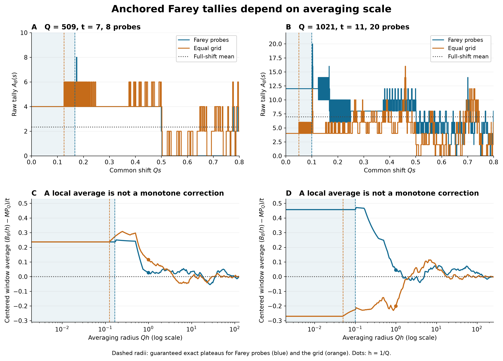

# Local averaging can change the sign of a Farey probe discrepancy

## Question

At what spatial resolution does an average around the distinguished
arithmetic phase retain its tally? The [complete-shift comparison](farey-half-arc-probe-shifts.md)
showed that a shift law forgets that phase. Here the source and the two
probe configurations stay fixed while the averaging radius changes.
This tests a possible intermediate representation between a point tally
and its full-shift mean. It does not estimate the asymptotic bound in the
[accepted rational-probe question](../../farey_discrepancy/clues/CLUE-half-arc-rational-probe-sampling-discrepancy.md).

## Construction

Let \(F_Q\subset[0,1)\) be the cyclic reduced Farey set, including \(0/1\),
with \(N_Q=|F_Q|\). Use cyclic arcs open on the left and closed on the right:
\[
D_Q(u)=\#(F_Q\cap(u,u+1/2])-N_Q/2,\qquad
 g_Q(u)=\max(0,2-|D_Q(u)|),\qquad P_Q=\int_0^1g_Q(u)\,du.
\]
For \(t\ge2\), put \(m=\lfloor t/2\rfloor\), \(n=N_m\), and \(M=2n\).
The two sets are
\[
 E_t=\{v/2,(v+1)/2:v\in F_m\},\qquad
 G_M=\{j/M:0\le j<M\}.
\]
The first is exactly the set of rational \(u\) for which both \(u\) and
\(u+1/2\) have reduced denominator at most \(t\). The grid matches its
cardinality and antipodal pairing, but not its denominator restrictions.
For either \(B\in\{E_t,G_M\}\), define
\[
 A_B(s)=\sum_{u\in B}g_Q(u+s),\qquad
 B_B(h)=\frac1{2h}\int_{-h}^{h}A_B(s)\,ds,\quad 0<h\le1/4. \tag{1}
\]
The repeated subscript in \(B_B\) indicates which probe set is averaged.
The center remains zero; every probe undergoes the same shift. This is
a geometric window average, not a random arithmetic Farey ensemble.
Since \(g_Q(u+1/2)=g_Q(u)\), both responses are half-periodic, their
full-shift mean is \(MP_Q\), and \(B_B(1/4)=MP_Q\) exactly.

The original sampling discrepancy is \(A_{E_t}(0)-MP_Q\). Only its
unaveraged tally is identified with the diagonal gap count by
[FD-348](../../farey_discrepancy/findings/FD-348-small-denominator-half-period-pairs-are-exact-rational-translates.md),
under \(2t^2(2/Q+1/N_Q)<1\). Larger windows and grid tallies have no
such identification unless equality with the unaveraged tally is
separately established.

**Guaranteed exact windows.** The [odd-shell reduction](farey-half-period-odd-shell.md)
expresses \(D_Q\) using only odd denominators \(Q/2<q\le Q\).
Its jumps lie at \(a/q\) and \(a/q-1/2\). Folding by the half period,
\(f_Q(v)=g_Q(v/2)\) is a circle step function whose possible jumps
have reduced odd denominator \(q\) in that shell: doubling either
location gives \(2a/q\bmod1\). Applying the integer weight can delete
jumps but cannot add new ones.

For reduced \(v=a/d\in F_m\), a distinct such jump has circular
distance at least \(1/(dq)\ge1/(mQ)\). In the displayed regime
\(m<Q/2\), coincidence is impossible. As a shift \(s\) of the original
probes becomes a shift \(2s\) after folding, every summand is constant
through
\[
 |s|<h_E:=\frac1{2mQ}.
\]
Consequently \(B_{E_t}(h)=A_{E_t}(0)\) for \(0<h\le h_E\).
The equality at \(h_E\) concerns an integral; possible endpoint jumps
have measure zero. The same argument for the folded grid
\(\{j/n\}\), when \(n<Q/2\), guarantees
\[
 B_{G_M}(h)=A_{G_M}(0)\quad(0<h\le h_G:=1/(2nQ)=1/(MQ)). \tag{2}
\]
These are sufficient radii, not universal formulas for the first actual
jump or for the largest radius that accidentally reproduces the anchor.
They depend on denominators after folding, not just on \(M\).

As a check on interpretation, ordinary box convolution has multiplier
\(\sin(2\pi kh)/(2\pi kh)\) on frequency \(k\), with value one at zero.
Thus averaging attenuates Fourier modes but is not a sharp spectral
cutoff. Positivity of the spatial kernel does not make its anchored
value monotone in \(h\). This is classical Fourier integration; see
[DLMF §1.8(iii)](https://dlmf.nist.gov/1.8.iii).
No Fourier truncation is used in the calculations.

**Exact evaluation and rendering.** Set \(L=\operatorname{lcm}(1,\ldots,2Q)\).
For every reduced \(a/q\) in the odd shell, place a jump \(-1\) at the
integer coordinate \(La/q\) and \(+1\) at \(La/q-L/2\bmod L\).
Start with \(D_Q(0)=0\), aggregate coincident jumps, and apply
\(w(z)=\max(0,2-|z|)\) to each step value. Integer prefix sums of
interval length times value give the exact piecewise-linear primitive
\(J_Q(x)=\int_0^xg_Q(u)\,du\), extended by
\(J_Q(x+1)=J_Q(x)+P_Q\). Then evaluate
\[
 B_B(h)=\frac1{2h}\sum_{u\in B}
       [J_Q(u+h)-J_Q(u-h)]. \tag{3}
\]
All breakpoints, radii, integrals and reported comparisons use integers
and rational arithmetic. Floating values are used only for display.

The order panel is \(Q=127,251,509,1021\), always with
\(t=\lfloor\sqrt{Q/8}\rfloor\); all satisfy the strict FD-348 condition.
These orders are inherited exploratory data, not untouched confirmation.
The image displays 509 and 1021, where the probe sets differ. A and B
retain every response jump in the local crop \(0\le Qs\le4/5\);
vertical scales differ and neither crops tally values. C and D plot
\((B_B(h)-MP_Q)/t\) at the rational radii
\[
 h=\min\{1/4,(1+i/16)2^k/Q\},\quad
 -9\le k\le8,\quad 0\le i\le15,
\]
plus \(1/4\), removing duplicates. Connecting segments guide the eye;
they do not certify extrema between sampled radii. Dashed lines show
(2), blue shading the Farey guarantee, and dots the exact \(h=1/Q\)
values. Colors encode only probe geometry. The PNG is 12.8 by 9.2
inches at 250 dpi, or 3200 by 2300 pixels, rendered with NumPy 2.5.4
and Matplotlib 3.11.2 and fully decoded with Pillow 13.0.0.

## Observation

Window averages need not interpolate monotonically between the anchor
and the full-shift mean. Exact values, rounded here, are:

| \(Q,t,M\) | Probes | Anchor \(A_B(0)\) | Full-shift mean | \(B_B(1/Q)\) | \(B_B(4/Q)\) |
|---|---|---:|---:|---:|---:|
| 127, 3, 2 | Farey = grid | 4 | 1.34526462 | 2.01600000 | 0.50400000 |
| 251, 5, 4 | Farey = grid | 6 | 1.64990219 | 4.76550602 | 2.21893293 |
| 509, 7, 8 | Farey | 4 | 2.34341465 | 2.53690810 | 2.48705432 |
| 509, 7, 8 | Grid | 4 | 2.34341465 | 3.15894499 | 2.28884338 |
| 1021, 11, 20 | Farey | 12 | 6.97389114 | 7.47442160 | 6.54744053 |
| 1021, 11, 20 | Grid | 4 | 6.97389114 | 4.76332426 | 7.44538477 |

At 1021 the Farey anchor is above the mean and the grid anchor below
it; at radius \(4/Q\), both signs are reversed. At \(1/Q\), the Farey
centered discrepancy has already decreased from 5.02610886 to
0.50053045. This is a finite scale comparison, not an asymptotic rate.
At the first two orders the sets coincide, so their agreement is a
degenerate control.

The first positive **nonzero aggregate response jumps** occur at:

| \(Q\) | Farey actual radius | Farey guaranteed radius | Grid actual = guaranteed radius |
|---:|---:|---:|---:|
| 127 | \(1/254\) | \(1/254\) | \(1/254\) |
| 251 | \(1/1004\) | \(1/1004\) | \(1/1004\) |
| 509 | \(1/2982\) | \(1/3054\) | \(1/4072\) |
| 1021 | \(1/10090\) | \(1/10210\) | \(1/20420\) |

Reflection makes the negative-side radii the same. The actual Farey
plateau can exceed its guaranteed radius; equality for the grid here
does not prove sharpness in other parameter families.

## Robustness

For every \(3\le Q\le32\), a separate sorted reduced-fraction
construction evaluated the half-arc ranks and integrated their rational
step intervals, without using the shell or common-denominator algorithm.
It checked 10,932 source values and primitive values, including
breakpoints and interior points. For \(2\le t\le\min(Q,10)\), 242
Farey plateau tests passed. Both probe sets, five radii and centers
zero and \(1/7\) gave 4,840 exact window-integral comparisons.
A second integration of the complete translated response at small
orders checked another 1,452 window averages.

At the four displayed orders, direct Farey ranks independently checked
8,422 response tallies, including every local-crop jump, the intervals
between them and deterministic pseudorandom shifts (Python seed 94017).
Sixteen integrations of the local response sweep reproduced (3) at
the guaranteed radii and at \(1/Q\). Exact checks also verified the
half-period mean, reflection integrals and equality on the guaranteed
windows. The signs in the table use exact rational comparisons.

No mesh estimates an integral; increasing raster resolution cannot
change the reported values. Fine jumps may merge visually, so the
image is not used to count events. Reordering probes has no effect.
A common translation of all probes preserves the complete-shift law
but changes where (1) is centered on that response. The observed
anchored scale dependence therefore cannot be inferred from that law
alone. No independence, Gaussian approximation, fitted cutoff, p-value
or confirmation claim is used.

## Research consequence

A local-window approach can preserve the genuine Farey tally exactly
on the explicit radius \(1/(2mQ)\). In these finite examples, replacing
it by a radius of order \(1/Q\) changes the discrepancy substantially
and can reverse its sign. The arithmetic obligation is therefore to
control the anchored window at a justified radius, or to bound the
error from enlarging it. Substituting a convenient broader average
without that error changes the quantity being estimated.

The support reduction, rational separation and box-filter calculation
are elementary or classical; no new harmonic-analysis theorem or
asymptotic obstruction is claimed. The retained contribution is the
exact scale comparison, its nonmonotone signed behavior, and the
explicit distinction between guaranteed and observed plateau radii.
It is supporting exploration, not a canonical finding. It neither
proves nor refutes the accepted \(O(t)\) sampling bound, supplies the
separate spatial small-window estimate, nor advances RH. No new clue
duplicates the existing sampling question, and no clue disposition changes.
