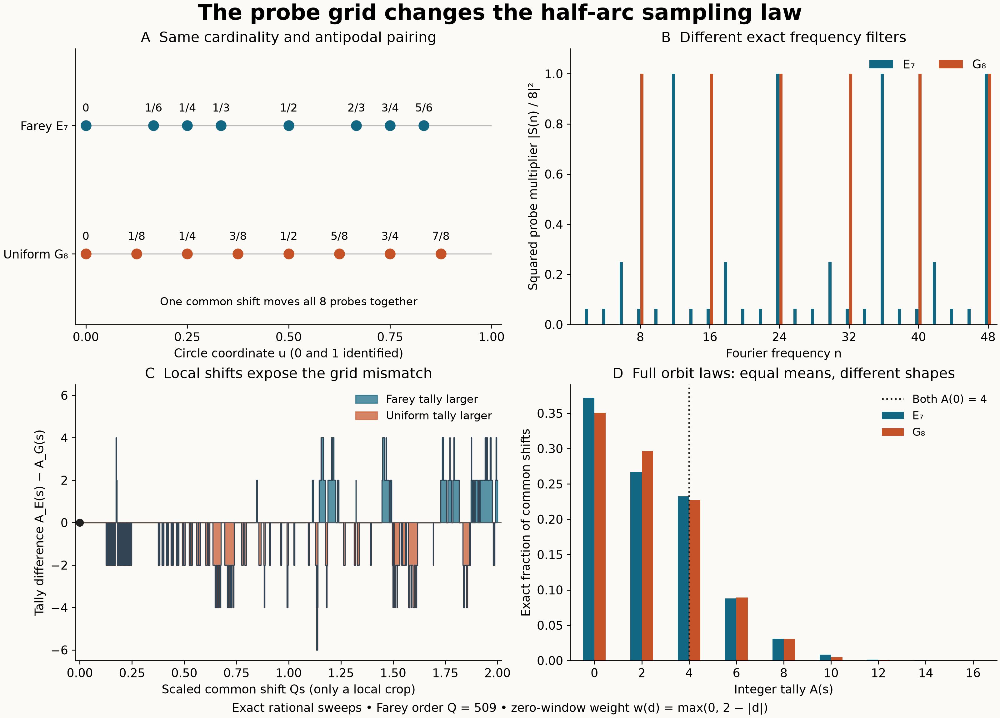

# Common shifts reveal the Farey probe filter

## Question

How much of a half-arc sampling discrepancy is retained by the complete
law under a common shift of the probes? Does matching cardinality and
antipodal pairing match that law? The
[layer-rotation view](farey-half-arc-layer-rotations.md) changed the
source's denominator coupling. This view keeps the genuine source fixed
and changes only where a rigid probe configuration samples it. The
[accepted rational-probe question](../../farey_discrepancy/clues/CLUE-half-arc-rational-probe-sampling-discrepancy.md)
already identifies the missing spatial-to-arithmetic transfer; this is
a finite diagnostic of what averaging over shifts forgets.

## Construction

For \(Q\ge3\), let \(F_Q\subset[0,1)\) be the cyclic reduced Farey set, including
\(0/1\), let \(N_Q=|F_Q|\), and define
\[
D_Q(u)=\#\bigl(F_Q\cap(u,u+1/2]\bigr)-N_Q/2,\qquad
g_Q(u)=\max(0,2-|D_Q(u)|).
\]
All arcs and shifts are cyclic. Counts are right-continuous. Write
\(P_Q=\int_0^1g_Q(u)\,du\). The identity
\(D_Q(u+1/2)=-D_Q(u)\) makes \(g_Q\) half-periodic.

Write \(q(u)\) for the reduced denominator of a rational circle point
\(u\in\mathbb Q/\mathbb Z\). For an integer \(t\ge2\), let
\[
E_t=\{u:q(u)\le t,\ q(u+1/2)\le t\},\qquad
m=\lfloor t/2\rfloor,\qquad M=|E_t|.
\]
The accepted clue's elementary doubling dictionary is
\[
E_t=\{v/2,(v+1)/2:v\in F_m\},\qquad M=2N_m. \tag{1}
\]
Indeed, for reduced \(v=a/d\), the maximum denominator of the two
preimages is \(2d\): their denominators are \(d,2d\) for odd \(d\),
and both \(2d\) for even \(d\). This also covers \(v=0\).

Compare \(E_t\) with \(G_M=\{j/M:0\le j<M\}\). Both have \(M\)
distinct points and exact antipodal pairing; the equally spaced grid
does **not** preserve denominator restrictions or the Farey gap word.
For either fixed configuration \(B\), define the integer step function
\[
A_B(s)=\sum_{u\in B}g_Q(u+s),\qquad 0\le s<1. \tag{2}
\]
Its law below is the pushforward of Lebesgue measure in the single
common shift \(s\). Every probe moves together. The values at the
different probes are not independent. For almost every shift the
translated points are not rational, so this is a geometric calibration,
not an admissible random arithmetic Farey sequence.

Both shift laws have the same mean \(MP_Q\), by translation invariance.
Only \(A_{E_t}(0)\) is the original rational-probe tally. In the strict
range
\[
2t^2(2/Q+1/N_Q)<1,
\]
[FD-348](../../farey_discrepancy/findings/FD-348-small-denominator-half-period-pairs-are-exact-rational-translates.md)
identifies it with the diagonal half-period gap count \(C_{Q,0}(t,t)\).
The grid tally and shifted tallies are not identified with that count.

The exact frequency filters make the dependence on probe geometry
explicit. With
\(\widehat g(n)=\int_0^1g_Q(u)e^{-2\pi inu}\,du\) and
\(S_B(n)=\sum_{u\in B}e^{2\pi inu}\), translation of each summand gives
\(\widehat A_B(n)=\widehat g(n)S_B(n)\). Thus Parseval yields
\[
\operatorname{Var}_s A_B
=\sum_{n\ne0}|\widehat g(n)|^2|S_B(n)|^2. \tag{3}
\]
This is an \(L^2\) identity; no absolute convergence or pointwise
Fourier reconstruction at jumps is assumed. Equation (1) gives
\[
S_{E_t}(n)=
\begin{cases}
0,&n\text{ odd},\\
2\sum_{d\le m}c_d(k),&n=2k,
\end{cases}
\qquad
S_{G_M}(n)=M\,\mathbf1_{M\mid n}, \tag{4}
\]
where \(c_d(k)=\sum_{a\mid(d,k)}a\mu(d/a)\) is the classical
Ramanujan sum. Cardinality and antipodal symmetry specify neither of
these even-frequency filters. For \(t=7\),
\[
S_{E_7}(2k)=2[1+(-1)^k+2\cos(2\pi k/3)],\qquad M=8.
\]
The squared filter in panel B has period 12 for \(E_7\) and period 8
for \(G_8\). The displayed frequencies 1 through 48 show two periods
of their joint pattern. They are not a truncated estimate of (3).

All probabilities and moments were computed by exact rational sweeps,
not a sampling mesh. Use the odd shell
\(Q/2<q\le Q\): for each reduced \(x=a/q\) put a jump \(-1\) at
\(x\) and \(+1\) at \(x-1/2\bmod1\), aggregating coincident jumps.
Starting with \(D_Q(0)=0\), sweep these rational breakpoints and apply
the integer function \(g_Q=w(D_Q)\). If its net jump at \(b\) is
\(J_b\), the net jump of (2) at \(s\) is
\(\sum_{u\in B}J_{s+u}\). Start at the direct rational value
\(A_B(0)\), sort the translated breakpoints \(b-u\bmod1\), and
add each interval's exact length to its integer tally's probability.
The initial value already includes any jump at zero. This completely
specifies the finite calculations without Monte Carlo or a Fourier cutoff.

The figure uses \((Q,t)=(509,7)\). A shows the two probe sets on the
circle, B their normalized squared filters, C the exact step difference
\(A_{E_7}(s)-A_{G_8}(s)\) on the **local crop** \(0\le s\le2/509\),
and D the full shift laws on \([0,1)\). C includes every breakpoint
in that crop, without interpolation or smoothing. D includes the entire
support; odd tallies are impossible because \(g_Q\) and the probes
both have half-period symmetry. Color indicates probe geometry or the
sign of the difference, not a fitted classification.

The auxiliary orders are \(127,251,509,1021\), with the predetermined
rule \(t=\lfloor\sqrt{Q/8}\rfloor\); all satisfy the operative strict
condition. These orders come from the preceding finite exploration,
not an untouched confirmation set. All comparisons remain descriptive.
The PNG is 12.8 by 9.2 inches at 250 dpi: 3200 by 2300 pixels.
Rendering uses NumPy 2.5.4 and Matplotlib 3.11.2; Pillow 13.0.0 fully
decodes the saved file. Sweeps use Python integers and `fractions.Fraction`.

## Observation

At \(Q=509\), both unshifted tallies equal 4 and both shift means are
2.34341465, but the complete shift laws differ. Their total variation
distance is 0.03118525. The grid does not reproduce the Farey-probe
law even though the point counts, antipodal symmetry, orbit means and
unshifted tallies all agree.

The finite comparison across the prescribed orders is:

| \(Q,t,M\) | \(A_E(0)\) | \(A_G(0)\) | Common mean | \(\operatorname{Var}A_E\) | \(\operatorname{Var}A_G\) | TV of shift laws |
|---|---:|---:|---:|---:|---:|---:|
| 127, 3, 2 | 4 | 4 | 1.34526462 | 2.44281735 | 2.44281735 | 0 |
| 251, 5, 4 | 6 | 6 | 1.64990219 | 3.35294452 | 3.35294452 | 0 |
| 509, 7, 8 | 4 | 4 | 2.34341465 | 5.53449697 | 5.14093439 | 0.03118525 |
| 1021, 11, 20 | 12 | 4 | 6.97389114 | 15.07919858 | 14.95936501 | 0.00907073 |

At the first two orders \(E_t=G_M\) exactly. Their agreement is a
degenerate control, not evidence for a transfer. At 1021 the laws are
close in TV while the fixed arithmetic phase has tallies differing by
8. There is no inferred monotonicity, limit, or asymptotic counterexample.

Neither discrepancy is an endpoint-convention effect. At 509 the first
jumps at positive shifts of \(A_E\) and \(A_G\) occur at \(1/2982\) and
\(1/4072\); at 1021 they occur at \(1/10090\) and \(1/20420\).
All four functions are constant in a neighborhood of zero. For the
Farey probes, this also follows from the accepted clue's rational
separation argument: both ends of the half arc lie in \(F_Q\), and
their jumps cancel. The equal grid has the same endpoint cancellation
at the displayed orders because \(M\le Q\).

## Robustness

Every shift law has exact total mass one and exact mean \(MP_Q\);
variances and TV distances use the full rational mass functions.
Direct generation of sorted reduced fractions independently reproduced
the probe sets in (1), every displayed unshifted tally, and the four
original half-period gap counts. Rank-based evaluation at deterministic
breakpoints and interior points checked 4,848 shifted tally values
across the four orders and both configurations.

An exhaustive small-order audit for every \(3\le Q\le32\) compared
the odd-shell construction against direct Farey ranks at all source
breakpoints and midpoints, and both eight-probe shift sweeps at all
of their breakpoints and midpoints: 46,332 exact comparisons. This
includes composite orders, coincident jumps and cyclic seams.

Independently evaluated complex exponential sums agreed with the
divisor formula (4) for \(2\le t\le30\), \(1\le n\le128\): 3,712
comparisons with maximum floating error below \(1.4\times10^{-12}\).
The plotted filters themselves use the exact integer formula, so the
numerical check does not define a zero threshold. The formulas, not
these finite checks, establish the Fourier dictionary.

Reordering probes leaves (2) unchanged. A common translation of a
probe set merely translates its entire response curve and preserves
the law and \(|S_B(n)|\), while moving the location of the distinguished
phase. Fine jumps may merge visually at browser scale; all numerical
conclusions use exact interval lengths rather than rendered pixels.
The controls address sampling geometry only. No independent-height,
independent-probe, Gaussian, or arithmetic-randomness model is assumed.

## Research consequence

The shift law is an explicit, nondegenerate diagnostic of the probe
geometry, but it discards the distinguished arithmetic phase. Even its
full distribution can be close for two specified configurations while
their fixed-phase tallies differ substantially in a finite example.
A proof of the accepted bound on
\(A_{E_t}(0)-MP_Q\) must retain a source-to-phase argument; an averaged
variance or distributional match alone does not supply that argument.
This does not refute either the absolute or one-sided transfer bound
for the genuine Farey probes.

The mechanisms are classical. Random common shifts and Fourier variance
formulas are standard in randomized quadrature; see Lemieux–L'Ecuyer,
[*Using lattice rules for variance reduction in simulation*, WSC 2000,
§2, Proposition 1](https://www.informs-sim.org/wsc00papers/070.PDF).
Their proposition is for lattice rules. Equation (3) above is derived
directly for arbitrary finite probe sets, so it does not assume that
\(E_t\) is a lattice. The Ramanujan definitions and divisor identity
are [DLMF §27.10, equations 27.10.4–5](https://dlmf.nist.gov/27.10).
No new quadrature theorem or novel Ramanujan representation is claimed.

The retained contribution is the exact finite comparison of the two
probe responses, including the small-TV/fixed-phase mismatch and the
explicitly degenerate low-order controls. This pair is supporting
exploration, not canonical mathematical evidence. It adds no new clue
duplicating the accepted sampling question, changes no clue disposition,
and supplies no uniform sampling estimate, spatial small-window bound,
sector limit, or RH improvement.
