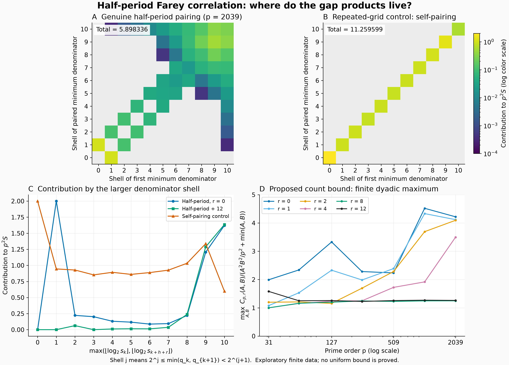

# Half-period Farey gaps through joint denominator shells

## Question

Which denominator scales carry the half-period correlation in the
[existing sector test](../../farey_discrepancy/clues/CLUE-half-period-gap-decorrelation.md)?
A small total at finitely many orders does not explain why its logarithmic
self-correlation counterpart is absent. This view resolves the positive
summands by their two minimum denominators and suggests a sufficient
counting estimate. The estimate is unproved; no finding is promoted.

## Construction

For prime order \(p\), generate the genuine Farey sequence
\(0=x_0<\cdots<x_N=1\), with denominator list \(q_0,\ldots,q_N\),
\(N=\sum_{q\le p}\varphi(q)=2h\). Extend the gap and minimum-denominator
words periodically with period \(N\):

\[
g_k=\frac1{q_kq_{k+1}},\qquad s_k=\min(q_k,q_{k+1}),\qquad
j_k=\lfloor\log_2s_k\rfloor.
\]

The scalar and its shell matrix are

\[
S_{h+r}=\sum_{k=0}^{N-1}g_kg_{k+h+r},\qquad
M_{ab}^{(r)}=p^2\!\sum_{j_k=a,\ j_{k+h+r}=b}g_kg_{k+h+r}.
\]

Every summand is included; the matrix total is \(p^2S_{h+r}\).
Shell \(a\) means \(2^a\le s<2^{a+1}\), so small shell indices
identify large-gap cusp contributions. Adjacent Farey denominators obey
\(q_k+q_{k+1}>p\). Their maximum lies in \((p/2,p]\), hence

\[
\frac1{s_k}\le p g_k<\frac2{s_k}. \tag{1}
\]

This makes the denominator representation faithful to gap amplitude
within a factor two. It does not assert independence of successive or
half-period denominators.

Panels A and B use \(p=2039\). A shows \(M^{(0)}\). B shows
\(M^{\mathrm{self}}_{ab}=\mathbf1_{a=b}p^2\sum_{j_k=a}g_k^2\).
The self-pairing matrix is the half-period matrix of the
[repeated-grid control](farey-half-period-gap-control.md): its gaps are
\((g/2,g/2)\), its period is \(2N\), and we retain the original source
shell labels on both copies. Multiplying its correlation by \(2p^2\)
gives exactly \(p^2S_0\). These labels are inherited, not the reduced
fraction denominators of the artificial grid; the normalization is an
explicit comparison, not a new Farey order. The diagonal is imposed by
repetition.

Both heatmaps use the same logarithmic color range \([10^{-4},2.0001]\);
gray cells are exactly empty. There is no spatial smoothing. Panel C
sums each matrix over \(\max(a,b)=j\), adding the genuine offset
\(r=12\). It uses a linear vertical scale, so total contributions can
be compared independently of the color encoding.

For Panel D define the integer count

\[
C_{p,r}(A,B)=\#\{0\le k<N:s_k\le A,\ s_{k+h+r}\le B\}.
\]

At each \(p=31,61,127,251,509,1021,2039\), plot

\[
K^{\mathrm{dyad}}_{p,r}=
\max_{A,B\in\mathcal A_p}
\frac{C_{p,r}(A,B)}{A^2B^2/p^2+\min(A,B)},\qquad
\mathcal A_p=\{1,2,4,\ldots,2^{\lfloor\log_2p\rfloor},p\},
\]

for \(r=0,1,2,4,8,12\). The denominator is a **proposed sufficient
bound**, comprising a bulk term and a linear allowance for small-scale
overlap. It is not a fitted expectation, a variance, or a consequence of
mixing. Lines join discrete values; no limit, rate, significance test or
uniform constant is estimated. All these data are exploratory, including
the selection of this count diagnostic; there is no untouched confirmation
panel or claim of preregistration.

For reproduction, start \((a,b,c,d)=(0,1,1,p)\), append \(c/d\), and
iterate \(t=\lfloor(p+b)/d\rfloor\),
\((a,b,c,d)\leftarrow(c,d,tc-a,td-b)\), through \(1/1\).
Use denominator products for gaps, integer cyclic shifts for the partner,
and weighted integer-bin counts for \(M\). Count \(C\) with two-dimensional
prefix sums, including both inequalities' endpoints. The PNG is 12.8 by
9.2 inches at 250 dpi, 3200 by 2300 pixels. The numerical tools were
NumPy 2.5.4 and Matplotlib 3.11.2; Pillow 13.0.0 decoded the complete PNG.

## Observation

At \(p=2039\), the genuine matrix total is 5.898335775, versus
11.259599091 for self-pairing. The source has conspicuous off-diagonal
small-denominator pairs and a broad large-denominator contribution;
absence of a diagonal alone would not bound their total. The control
instead pays a substantial contribution in every occupied diagonal shell.
For \(r=12\), the source total is 3.297863684, with much less weight in
the first few shells. Neither offset is a random ensemble.

For every odd prime, the four directed pairs with
\(k\in\{0,h-1,h,N-1\}\) contribute exactly two to \(p^2S_h\): the
endpoint gaps are \(1/p\) and the gaps adjacent to \(1/2\) are
\(1/(2p)\). The two off-diagonal cells between denominator shells zero
and one show this fixed contribution. Thus the sought decorrelation is
on the \(\log p/p^2\) scale; it need not remove bounded cusp effects.

The finite count diagnostic is not visibly settled to a constant:

| \(p\) | \(K^{\mathrm{dyad}}_{p,0}\) | maximizing \((A,B)\) | \(K^{\mathrm{dyad}}_{p,12}\) |
|---:|---:|---:|---:|
| 31 | 1.991710 | (1, 2) | 1.579293 |
| 61 | 2.339075 | (4, 8) | 1.249391 |
| 127 | 3.327488 | (8, 16) | 1.256645 |
| 251 | 2.281639 | (16, 32) | 1.224757 |
| 509 | 2.233741 | (16, 32) | 1.255961 |
| 1021 | 4.517955 | (64, 128) | 1.269327 |
| 2039 | 4.217537 | (64, 128) | 1.261200 |

Symmetric maximizing pairs are represented in increasing coordinate
order. These maxima do not bound larger orders or all fixed offsets.

## Robustness

An independent exact enumeration of all reduced fractions for every
\(3\le Q\le80\) matched the recurrence's denominator word. Rational
arithmetic checked the gap identity, (1), and 468 correlations at the
six named offsets; float64 totals differed by at most
\(1.8\cdot10^{-15}\). Every tested dyadic threshold-pair count agreed
with independent direct enumeration. The exact four-pair contribution
was checked at every odd prime in this interval.

At \(p=2039\), cyclic origin changes by 1, 19 and \(\lfloor N/7\rfloor\)
and rank reversal preserved the total correlation to \(10^{-17}\) in
unscaled units. Rebinning by powers of three preserved the weighted
sum to \(1.6\cdot10^{-14}\) or better. Changing bins moves individual
cells and cannot itself confirm a count estimate. The self-control is
computed directly from \(g^2\); its diagonal support follows algebraically
from replication. Log colors reveal small positive cells, while the
linear profile and printed totals expose their actual weight.

## Research consequence

A narrower [proposed counting lemma](../../farey_discrepancy/clues/CLUE-half-period-joint-denominator-count.md) supplies the sufficient test

\[
C_{p,r}(A,B)\ll_r A^2B^2/p^2+\min(A,B)\quad(1\le A,B\le p). \tag{2}
\]

Dyadic decomposition and (1) would make (2) imply
\(S_{h+r}=O_r(p^{-2})\): the bulk shell sum is bounded by a constant
multiple of \(p^{-2}(\sum_{a\le\log_2p}2^a)^2\), and the overlap
shell sum by \(\sum_{a,b\ge0}2^{-\max(a,b)}=6\). The detailed
conditional argument and weaker sublogarithmic variant are in the
[counting clue](../../farey_discrepancy/clues/CLUE-half-period-joint-denominator-count.md).
A growing maximum would refute this particular strong count route only
if no uniform constant exists; it would not refute the original weaker
correlation goal. No bound in (2) is proved here.

The parent correlation clue is accepted. Its
[FD-347 control](../../farey_discrepancy/findings/FD-347-finite-half-period-tests-miss-reflected-gap-sector-bias.md)
passes any prescribed finite offset window while retaining sector bias.
This strengthens the warning: the six-offset panel cannot certify the
all-fixed-offset condition, and the new proposal requires that quantifier.
The count bound concerns actual denominator labels, which the artificial
controls do not preserve.

The closest arithmetic anchor remains
[Dong–Nguyen–Nguyen–Zaharescu, Theorem 2.3](https://arxiv.org/html/2606.12907v1),
whose lag-dependent hypotheses do not cover \(h+r\). The denominator
word is also a periodic orbit of the classical BCZ map; see
[Athreya–Cheung, Section 1.3.3](https://arxiv.org/pdf/1206.6597).
[Artiles–Best–Bordignon, Theorem 1.1](https://arxiv.org/html/2610.07347v1)
proves strong mixing for normalized Lebesgue measure. That statement does
not supply a uniform shrinking-cusp count on these changing periodic
orbits. Transferring to the orbit measures and controlling the unbounded
gap/roof observable remain separate requirements. Targeted prior-art
orientation found no supplied estimate (2); this is not an exhaustive
novelty claim. The pair is supporting exploration, not canonical
mathematical evidence, a calibrated null, a sector limit or an RH bound.
