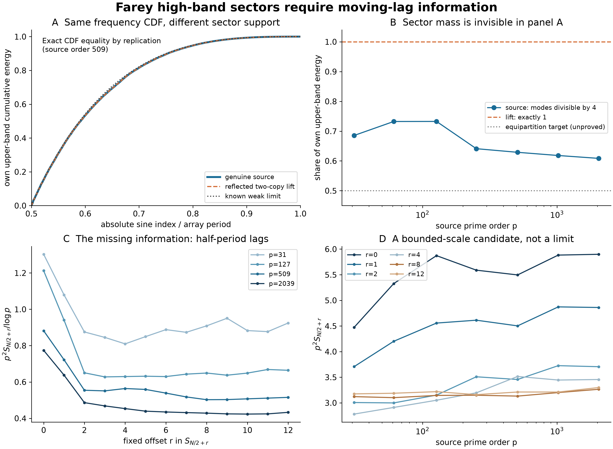

# Farey half-period gaps and frequency-sector blindness

## Question

Can a smooth high-band frequency profile distinguish the alternating
sectors left unresolved by
[FD-346](../../farey_discrepancy/findings/FD-346-classical-gap-correlations-separate-high-band-farey-transport.md)?
The view compares a deterministic repetition control with the genuine
source, then exposes the moving-lag statistic missing from the classical
fixed-lag argument. This is exploratory context for a proposed source
estimate, not a new asymptotic finding.

## Construction

For prime order \(p\), let \(0=x_0<\cdots<x_N=1\) be the genuine Farey
sequence, \(N=\sum_{q\le p}\varphi(q)=2h\),
\(D_k=x_k-k/N\), and \(g_k=x_{k+1}-x_k\), periodically extended with
period \(N\). Define the **uncentered** correlation

\[
S_r(p)=\sum_{k=0}^{N-1}g_k g_{k+r}.
\]

Centering the gaps would subtract \(1/N\) at every lag. In particular,
the baseline is not zero on the \(p^2 S_r\) scale. All logarithms below
are natural. Use the orthonormal DST-I
\(d_m=\sqrt{2/N}\sum_{k=1}^{N-1}D_k\sin(\pi mk/N)\), with **absolute**
indices \(1\le m<N\). The upper band is \(B=\{m:m/N\ge1/2\}\).
The source is antisymmetric, so its odd coefficients vanish.

The control consists of two scaled copies of the entire source grid:

\[
\widetilde x_k=x_k/2\ (0\le k\le N),\qquad
\widetilde x_{N+k}=1/2+x_k/2\ (0\le k\le N).
\]

The common midpoint is counted once. Its period is \(\widetilde N=2N\),
its gaps are \((g/2,g/2)\), and its discrepancy is
\((D/2,D/2)\), with endpoints handled in the same convention. This is
an increasing rational grid with exact reflection. It is **not a genuine
Farey sequence**. It preserves the empirical distribution of normalized
gaps \(N g_k\) after doubling multiplicities, but not the original rank
count, denominator labels, or Farey cutoff. Its coefficients satisfy

\[
\widetilde d_{2m}=d_m/\sqrt2,\qquad
\widetilde d_{2m+1}=0.
\]

Thus every nonzero control coefficient has index divisible by four.
The frequency locations \(2m/(2N)=m/N\) agree exactly, and each band
energy is halved. Separately normalized frequency CDFs are therefore
identical, even at finite order. This equality is construction-induced;
it is not independent confirmation of the source law.

Panel A uses \(p=509\), plots both upper-band CDFs, and overlays FD-346's
known weak-limit CDF, obtained by integrating
\(\cot^2(\pi x/2)/(2/\pi-1/2)\) from \(1/2\) to \(x\).
Panel B plots the source fraction
\(\sum_{m\in B,4\mid m}d_m^2/\sum_{m\in B}d_m^2\), together with
the control's exact value one and the unproved equipartition target
one-half. This source denominator is not VIS-468's reassembled energy.

Panels B and D use exactly \(p=31,61,127,251,509,1021,2039\).
Panel C shows \(p^2S_{h+r}/\log p\) for integer \(0\le r\le12\), at
\(p=31,127,509,2039\). Panel D removes the logarithmic divisor and shows
\(p^2S_{h+r}\) for \(r=0,1,2,4,8,12\). Prime-order axes in B and D
are logarithmic. Lines join discrete observations; there is no fitted
trend, interpolation claim, smoothing, random ensemble or significance
test. The entire panel is exploratory, with no held-out confirmation.

For reproduction, generate Farey pairs from
\((a,b,c,d)=(0,1,1,p)\), append \(c/d\), and iterate
\(t=\lfloor(p+b)/d\rfloor\),
\((a,b,c,d)\leftarrow(c,d,tc-a,td-b)\), through \(1/1\).
If the denominator list including endpoints is \(q_0,\ldots,q_N\),
compute gaps as \(1/(q_kq_{k+1})\) to avoid subtractive cancellation.
Compute every sine mode. Correlations can be computed directly by cyclic
dot products or by the inverse Fourier transform of the complete gap
power spectrum. NumPy 2.5.4, SciPy 1.18.1 and Matplotlib 3.11.2 were used.
The saved figure is 12 by 8.8 inches at 250 dpi: 3000 by 2200 pixels.

## Observation

The two frequency CDFs coincide although sector masses differ. The
source's upper-band mass in indices divisible by four is 0.628931 at
\(p=509\) and 0.608571 at \(p=2039\); the control's value is one.
The finite moving-lag values suggest testing a bounded \(p^2S_{h+r}\)
scale, but do not establish boundedness or even logarithmic negligibility.
For example:

| \(p\) | \(N\) | \(p^2S_h\) | \(p^2S_{h+1}\) | \(p^2S_{h+12}\) |
|---:|---:|---:|---:|---:|
| 31 | 308 | 4.473284 | 3.706886 | 3.174490 |
| 61 | 1162 | 5.326644 | 4.200532 | 3.187233 |
| 127 | 4958 | 5.872360 | 4.556394 | 3.217833 |
| 251 | 19274 | 5.588726 | 4.612542 | 3.159596 |
| 509 | 79036 | 5.495624 | 4.501489 | 3.211270 |
| 1021 | 317420 | 5.882902 | 4.872267 | 3.210297 |
| 2039 | 1264770 | 5.898336 | 4.860426 | 3.297864 |

## Robustness

Exact rational arithmetic checked positive gaps, endpoint one, reflection,
the repeated discrepancy, and 377 identities
\(\widetilde S_r=S_r/2\), for every \(3\le Q\le31\) and
\(0\le r\le12\). Independent direct sine matrices at \(p=31,61\)
agreed with the DST within \(2\cdot10^{-13}\).

Across the displayed panel, direct cyclic dot products agreed with the
full Fourier correlation identity within \(2.3\cdot10^{-18}\). The
signed identity extracting \(S_{h+r}\) agreed within
\(1.8\cdot10^{-18}\). The gap-difference multiplier and independently
computed sine powers agreed within \(1.2\cdot10^{-17}\). Building the
lift by cumulative gaps, independently of the coefficient placement,
agreed within \(1.2\cdot10^{-11}\) in coefficients; this larger error
records cumulative floating-point rounding.

Band edges \(1/4,1/2,3/4\) all gave the same exact replication identity;
normalized numerical CDF differences were below \(4\cdot10^{-16}\).
Nonzero scaling and rank reversal preserve the normalized laws. These
are algebra/normalization controls, not independent estimates of a prime
limit. No extrapolation from twelve offsets to all fixed offsets is made.

## Research consequence

The proposed
[half-period gap-decorrelation test](../../farey_discrepancy/clues/CLUE-half-period-gap-decorrelation.md)
asks whether \(S_{h+r}=o(\log p/p^2)\) for every fixed integer \(r\),
with \(O_r(p^{-2})\) as a stronger candidate. The signed Fourier measure
in that clue explains why this would imply upper-band sector
equipartition; neither condition has been proved here.

This addresses the residual sector split, not the projected-transport
matching route already excluded by FD-346. Its primary arithmetic source,
[Dong–Nguyen–Nguyen–Zaharescu, equation (2.2) and Theorem 2.3](https://arxiv.org/html/2606.12907v1),
controls fixed lags and cannot be applied at \(h+r\). The repetition
identity is classical discrete Fourier algebra; see
[McFee's DFT shift theorem](https://brianmcfee.net/dstbook-site/content/ch06-dft-properties/Shifting.html).
No general Fourier novelty, asymptotic sector law, calibrated arithmetic
null, or RH improvement is claimed. The figure is supporting exploration,
not canonical mathematical evidence.
