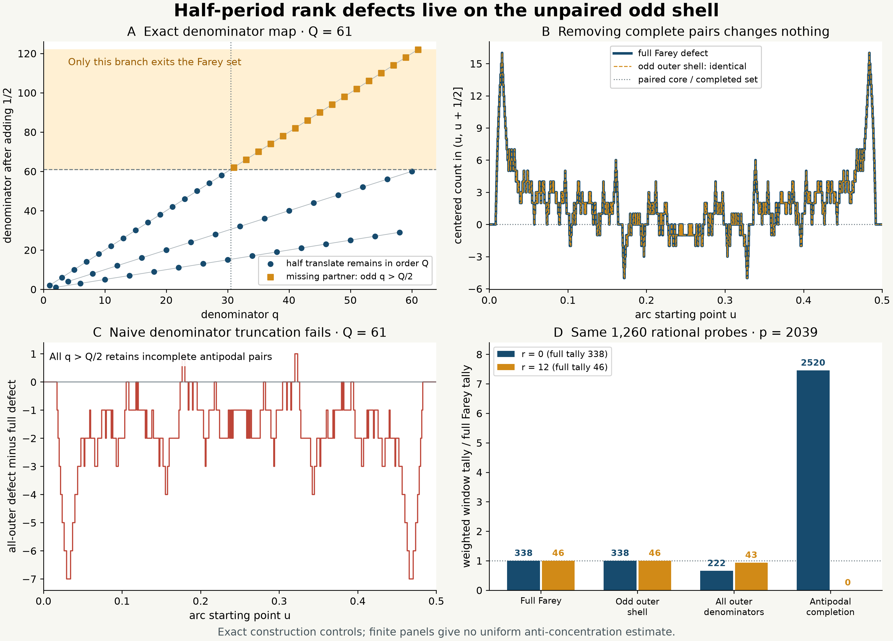

# Half-period Farey rank defects on the unpaired odd shell

## Question

Which part of the Farey set actually carries the rank-window statistic
in the [preceding view](farey-half-period-rank-windows.md)? Can low
denominators be deleted, or half-translation symmetry imposed, without
changing that statistic? These are different operations. This view
isolates the exact cancellation and shows why two tempting controls
would alter or erase the remaining anti-concentration question.

## Construction

Work on the circle with
\[
F_Q=\{a/q\in[0,1):0\le a<q\le Q,\ (a,q)=1\},\quad Q\ge3,
\qquad \tau(x)=\{x+1/2\},\quad N_Q=|F_Q|.
\]
Thus \(0/1\) is included and \(1/1\) is identified with it. For any
finite circle set \(X\), define the centered half-arc count
\[
\Delta_X(u)=\#\bigl(X\cap(u,u+1/2]\bigr)-|X|/2. \tag{1}
\]
The arc is cyclic, open on the left and closed on the right. Each set
uses **its own cardinality** for centering. For the full Farey set this
is \(R_Q(u+1/2)-R_Q(u)-N_Q/2\), with the periodic rank convention of
[FD-348](../../farey_discrepancy/findings/FD-348-small-denominator-half-period-pairs-are-exact-rational-translates.md).
At eligible rational probes it is that finding's integer rank defect.
Equation (1) also defines the step process at arbitrary real \(u\).

The reduced denominator after translation is
\[
q(\tau(x))=
\begin{cases}
2q,&q\text{ odd},\\
q/2,&q\equiv2\pmod4,\\
q,&4\mid q.
\end{cases} \tag{2}
\]
Define the unpaired shell and its complement by
\[
U_Q=\{x\in F_Q:q(x)\text{ odd},\ Q/2<q(x)\le Q\},
\qquad P_Q=F_Q\setminus U_Q.
\]
Equation (2) gives \(U_Q=F_Q\setminus\tau(F_Q)\) and
\(\tau(P_Q)=P_Q\). Since \(\tau\) is a fixed-point-free involution,
each pair in \(P_Q\) contributes exactly one point to every half-open
half arc, including when an endpoint is on a point. Consequently
\[
\boxed{\Delta_{F_Q}(u)=\Delta_{U_Q}(u),\quad
\Delta_{P_Q}(u)=0\quad\text{for every real }u.} \tag{3}
\]
This is the algebra behind the representation, not an inference from
matching curves. The shell is an exact support reduction of the
centered count; it is not a smaller Farey sequence or a new mixing law.

Two controls distinguish the operations:

- \(T_Q=\{x\in F_Q:q(x)>Q/2\}\) deletes all low denominators.
  It generally cuts through antipodal pairs, so (3) does not apply.
- \(F_Q^+=F_Q\cup\tau(F_Q)=F_Q\sqcup\tau(U_Q)\) completes all
  missing pairs. It has \(N_Q+|U_Q|\) points and
  \(\Delta_{F_Q^+}(u)=0\) identically. Its added denominators exceed
  \(Q\); it is not an admissible genuine-order-\(Q\) Farey counterexample.

Panel A shows the denominator map (2) for \(Q=61\). Lines connect the
three residue classes separately and only guide the eye. The shaded
region marks partners beyond the order cutoff. Panels B and C use
the same \(Q\) and show exact step values on \(0\le u\le1/2\), with
knots at every point of \(F_Q\cup\tau(F_Q)\) in that interval.
B overlays the identical full and shell counts; C shows
\(\Delta_{T_Q}-\Delta_{F_Q}\). Values are computed rationally before
converting coordinates for plotting; there is no grid interpolation
or smoothing.

Panel D uses \(p=2039\) and the same fixed probe set as the preceding
view:
\[
E=\{u\in F_p:q(u)\le64,\ q(\tau(u))\le128\},\qquad |E|=1260.
\]
For each displayed configuration \(X\), form
\[
W_X(r)=\sum_{u\in E}\max(0,2-|\Delta_X(u)-r|),\qquad r\in\{0,12\}.
\tag{4}
\]
Bars show \(W_X(r)/W_{F_p}(r)\); their labels give the unnormalized
tallies. The probes stay fixed even when absent from a control set.
Thus control bars are half-arc window diagnostics, not asserted gap
counts of a new Farey word. For the genuine source, direct gap counting
also gives \(W_{F_p}(0)=338\) and \(W_{F_p}(12)=46\) at this rectangle.
That finite agreement does not extend FD-348's guaranteed forcing range.

For reproduction, generate the cyclic Farey list by starting with
\(0/1\), then iterating
\((a,b,c,d)=(0,1,1,Q)\), appending \(c/d<1\), and updating
\((a,b,c,d)\leftarrow(c,d,tc-a,td-b)\) with
\(t=\lfloor(Q+b)/d\rfloor\). Filter by the denominator predicates
above. For sorted \(X\subset[0,1)\), \(u\in[0,1)\), and
\(v=u+1/2\), the arc count is
\[
\operatorname{bisect\_right}(X,\{v\})
+|X|\mathbf1_{v\ge1}
-\operatorname{bisect\_right}(X,u).
\]
For B and C use the exact union of breakpoints and right-continuous
steps; for D sum (4) on reduced rational probes. The PNG is 12.8 by
9.2 inches at 250 dpi, hence 3200 by 2300 pixels. The rendering uses
NumPy 2.5.4 and Matplotlib 3.11.2; Pillow 13.0.0 fully decodes it.

## Observation

At \(Q=61\), the full set has 1162 points, the odd outer shell 606,
and the paired complement 556. The displayed full defect ranges from
\(-5\) to \(16\). Deleting the paired complement preserves every step;
deleting all low denominators instead produces an error from \(-7\)
to \(1\) on the displayed half-circle.

At \(p=2039\), the full set has 1264770 points, the shell 632482,
and the paired complement 632288. The finite probe-window tallies are:

| Configuration \(X\) | \(W_X(0)\) | \(W_X(12)\) |
|---|---:|---:|
| Full Farey set | 338 | 46 |
| Odd outer shell | 338 | 46 |
| All outer denominators | 222 | 43 |
| Antipodal completion | 2520 | 0 |

The completion counts are forced by its zero defect: each of the 1260
probes contributes two at offset zero and nothing at offset twelve.
The two equality bars are algebraically redundant, not independent
confirmations. All finite panels are exploratory construction checks;
there is no untouched confirmation data or fitted limiting law.

## Robustness

For every integer \(3\le Q\le80\), including composite orders, an
independent sorted enumeration of reduced `Fraction` objects matched
the Farey recurrence. The denominator rule identified exactly those
points whose half translates were missing. The paired complement and
completed set were checked for closure under \(\tau\).

At all 80774 breakpoints of \(F_Q\cup\tau(F_Q)\), and at one midpoint
in each intervening cyclic interval, exact rational checks verified
(3), the completion's zero defect, and
\(\Delta_{F_Q}(u+1/2)=-\Delta_{F_Q}(u)\): 161548 tested positions
in total. These positions exhaust the step values and boundary values
for those orders. Naive truncation disagreed with the full defect at
122164 of the tested positions; this pooled tally is a construction
check, not a probability estimate.

At \(p=2039\), exact rational arc counting reproduced the complete
1260-probe defect histogram from the full set using the shell alone,
with range \([-32,32]\). Independent integer gap masks reproduced
the genuine counts 338 and 46. Origin shifts by \(1/7,2/13,1/2\)
at \(Q=61\) preserved the full/shell equality at corresponding arc
starts in 5304 exact checks. Rotation is applied to the point sets
after selecting the shell; recomputing reduced denominators after an
arbitrary rotation would define a different object.

## Research consequence

The [accepted joint-denominator question](../../farey_discrepancy/clues/CLUE-half-period-joint-denominator-count.md)
still requires a uniform bound on small integer rank windows. This
view identifies their carrier as a primitive-point imbalance in a
single odd denominator shell. It does not bound how many growing
rational probes land in those windows, or the nontranslation remainder
outside FD-348's range. A bound on the magnitude of the shell
discrepancy would not by itself be the required anti-concentration
estimate.

The control consequence is concrete: deleting complete antipodal
pairs is harmless for this diagnostic, deleting by a denominator
cut alone is not, and imposing exact antipodal symmetry makes the
test degenerate. Reflection \(x\mapsto1-x\), already present in the
genuine Farey set, is different from half translation. The figure
does not reject reflection-matched controls as a class, nor infer a
source anomaly merely because a deliberately symmetrized set has
zero defect.

For prior-art orientation, (2) and the pair cancellation are elementary
specializations of the rational-circle algebra in
[Haynes–Homma, *The group ring of Q/Z and an application of a divisor
problem*, §2, Lemmas 1–2](https://arxiv.org/pdf/0907.0158).
No new group-ring identity is claimed. Odd-denominator primitive-point
counts are classical: [Haynes, *A note on Farey fractions with odd
denominators*, §3, Lemma 1](https://arxiv.org/pdf/0907.2168) supplies
an area term with an \(O(Q\log Q)\) error for convex regions. Applying
such a count to the relevant shell wedges is not a small-integer-window
anti-concentration theorem. These sources orient the representation;
they do not establish the accepted count conjecture.

The retained contribution is the explicit shell/control comparison
for the existing diagnostic. This paired artifact is supporting
exploration, not a canonical finding, a calibrated random null, a new
cancellation estimate, a sector limit, or an RH improvement. No new
clue duplicates the already accepted rank-window question.
