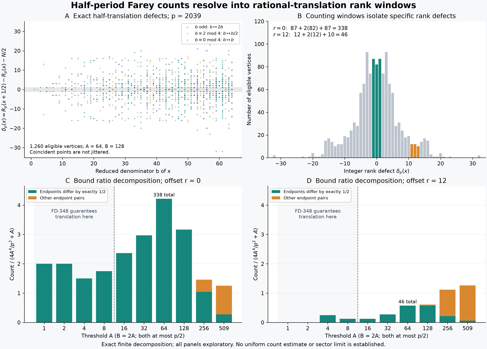

# Half-period Farey counts through rational rank windows

## Question

How much of the finite joint-denominator count is carried by endpoints
separated by exactly one half, including outside the range where
[FD-348](../../farey_discrepancy/findings/FD-348-small-denominator-half-period-pairs-are-exact-rational-translates.md)
forces that separation? The [earlier shell view](farey-half-period-denominator-shells.md)
locates large count ratios but does not identify the individual endpoint
pairs. This view distinguishes exact translations from other pairs and
shows which integer rank defects the count selects.

The [joint-denominator clue](../../farey_discrepancy/clues/CLUE-half-period-joint-denominator-count.md)
is accepted for investigation. Neither its uniform bound nor its weaker
sublogarithmic target is proved by this visualization.

## Construction

For prime order \(p\), use the genuine Farey sequence
\(0=x_0<\cdots<x_N=1\), \(N=\sum_{q\le p}\varphi(q)=2h\).
Identify the endpoint \(1\) with \(0\) for cyclic vertex indexing, and
write \(q_k\) for reduced denominators. Set

\[
s_k=\min(q_k,q_{k+1}),\qquad
C_{p,r}(A,B)=\sum_{k=0}^{N-1}
 \mathbf1_{s_k\le A}\mathbf1_{s_{k+h+r}\le B}.
\]

All thresholds in this view satisfy \(2\max(A,B)\le p\). Since adjacent
denominators sum to more than \(p\), each selected gap has exactly one
endpoint at most its threshold. For \(v_A(i)=\mathbf1_{q_i\le A}\), this gives
\(\mathbf1_{s_k\le A}=v_A(k)+v_A(k+1)\). Thus, with cyclic indices,

\[
H_\ell(A,B)=\sum_i v_A(i)v_B(i+\ell),\qquad
C_{p,r}=2H_{h+r}+H_{h+r-1}+H_{h+r+1}. \tag{1}
\]

This elementary incidence identity explains the weights; it asserts no
mixing or independence. Equivalently each ordered pair of eligible
vertices contributes the periodic kernel

\[
w_N(t)=2\mathbf1_{t\equiv0\pmod N}
 +\mathbf1_{t\equiv1\pmod N}+\mathbf1_{t\equiv-1\pmod N}
\]

at \(t=R_p(v)-R_p(u)-h-r\). Here \(R_p(x_i)=i\),
\(R_p(0)=0\), and \(R_p(x+1)=R_p(x)+N\).

Let \(\tau(u)=\{u+1/2\}\) and
\(\delta_p(u)=R_p(u+1/2)-R_p(u)-h\). Define the translated contribution

\[
C^{\mathrm{tr}}_{p,r}(A,B)=
\sum_{\substack{u\in\mathbb Q\cap[0,1)\\
 q(u)\le A,\ q(\tau(u))\le B}}
 w_N(\delta_p(u)-r). \tag{2}
\]

The remainder \(C^{\mathrm{off}}=C-C^{\mathrm{tr}}\) is nonnegative
and counts all other endpoint pairs. For the displayed offsets and
rank defects the periodic kernel is simply
\(w(t)=\max(0,2-|t|)\). The reduced denominator of the translate is
\(2b\) for odd \(b=q(u)\), \(b/2\) for \(b\equiv2\pmod4\), and
\(b\) for \(4\mid b\). These three classes determine the colors in A.

FD-348 proves \(C^{\mathrm{off}}=0\) under the stronger condition

\[
2AB\left(\frac2p+\frac{|r|+1}{N}\right)<1. \tag{3}
\]

Our decomposition (1)–(2) remains a finite counting instrument outside
(3), where the remainder need not vanish. It is not a claimed extension
of the theorem's forcing range.

All four panels use \(p=2039\), \(N=1264770\). A plots reduced
denominator versus exact rank defect for all 1260 eligible vertices at
\((A,B)=(64,128)\). Points are neither jittered nor smoothed; coincident
points can overlap. B counts those vertices at each integer defect, so
multiplicity is visible independently of point overlap or color.
The windows for \(r=0\) and \(r=12\) are highlighted.

C and D split the count ratio

\[
\frac{C^{\mathrm{tr}}_{p,r}+C^{\mathrm{off}}_{p,r}}
 {4A^4/p^2+A},\qquad
B=2A,\quad A\in\{1,2,4,8,16,32,64,128,256,509\},
\]

at offsets 0 and 12. This denominator comes from the proposed bound,
not from a probability law. The equally spaced bars are discrete labeled
thresholds, not a linear horizontal scale. Both panels use the same
vertical scale. Shading and a dashed separator mark the displayed
thresholds satisfying (3): \(A=1,2,4,8\) in both panels. The theorem's
boundary does not assert that other pairs appear immediately afterward.

For reproduction, initialize numerator/denominator arrays with \(0/1\),
then use
\((a,b,c,d)=(0,1,1,p)\) by appending \(c/d\) and updating
\((a,b,c,d)\leftarrow(c,d,tc-a,td-b)\),
\(t=\lfloor(p+b)/d\rfloor\), through \(1/1\). Compute the gap masks
and their cyclic shifts as integers. For each matching gap pair choose
its unique smaller-denominator endpoints \(a/b,c/d\). Classify it as
translated precisely when \(2|cb-ad|=bd\); this includes the wrap.
Independently map each eligible vertex to its reduced half translate,
read both integer ranks, and sum (2). Render at 12.8 by 9.2 inches and
250 dpi, giving 3200 by 2300 pixels. NumPy 2.5.4 and Matplotlib 3.11.2
were used; Pillow 13.0.0 fully decoded the saved PNG.

## Observation

At \((64,128)\), defects \(-1,0,1\) have multiplicities \(87,82,87\),
so the translated contribution is \(87+2(82)+87=338\), the **entire**
count at offset zero. At offset 12 the three multiplicities are
\(12,12,10\), giving 46, again the entire count. The full defect range
is \([-32,32]\). It is neither a fitted distribution nor a random sample.

| \(A\), with \(B=2A\) | \(C_{p,0}\) | \(C^{\mathrm{tr}}_{p,0}\) | \(C_{p,12}\) | \(C^{\mathrm{tr}}_{p,12}\) |
|---:|---:|---:|---:|---:|
| 8 | 14 | 14 | 1 | 1 |
| 16 | 38 | 38 | 2 | 2 |
| 32 | 98 | 98 | 9 | 9 |
| 64 | 338 | 338 | 46 | 46 |
| 128 | 1224 | 1224 | 237 | 223 |
| 256 | 6406 | 4578 | 4907 | 967 |
| 509 | 81596 | 17730 | 82260 | 4099 |

Thus exact translations exhaust several displayed rectangles beyond
(3), but fail to exhaust larger rectangles. Their share also depends
on the offset. The \(r=0\) ratio peak at \(A=64\) is entirely a count
of near-zero rank defects; it is not evidence for independent pairing.
No first nontranslation threshold is claimed between the sampled values.

The seven maximizing rectangles recorded in the earlier shell view,
at orders \(31,61,127,251,509,1021,2039\), were separately checked:
all their \(r=0\) incidences are translated, with counts
\(2,10,30,46,38,580,338\). At the additional exploratory rectangle
\((p,A,B)=(4093,128,256)\), all 544 incidences are translated too;
that rectangle is not asserted to maximize the ratio. No panel is
untouched confirmation, and no limiting rate is inferred.

## Robustness

For every integer \(3\le Q\le80\), including composite orders, an
independent enumeration of sorted reduced `Fraction` objects matched
the recurrence. Direct edge masks, the vertex-correlation formula (1),
and the translated kernel (2) agreed in 19680 exact cases: all pairs
of thresholds in \(\{1,\lfloor Q/2\rfloor\}\) together with powers of
two at most \(Q/2\), and offsets \(0,\pm1,\pm2,4,8,12\).
The cyclic kernel was used even when these offsets wrapped at small
orders. Translation classification used integer cross-products, not
a floating-point proximity tolerance.

An independent rank calculation used the classical Möbius identity

\[
R_Q(x)=\sum_{m\le Q}M(\lfloor Q/m\rfloor)\lfloor mx\rfloor,
\qquad M(y)=\sum_{n\le y}\mu(n).
\]

Subtracting ranks gives, also for the periodic extension,

\[
2\delta_Q(u)=\sum_{\substack{m\le Q\\m\text{ odd}}}
 M(\lfloor Q/m\rfloor)
 \bigl(2\mathbf1_{\{mu\}\ge1/2}-1\bigr). \tag{4}
\]

The term at equality is included. This is the same classical rank
filter derived in FD-348, in an equivalent centered form. It agreed
with 6776 eligible small-order vertex checks and all 1260 vertices
in A; the denominator-class rule was also checked on the small orders.
At \(p=2039\), all ten displayed threshold pairs and six offsets
\(0,1,2,4,8,12\) passed 240 further checks under cyclic origin changes
by \(1,19,\lfloor N/7\rfloor\) and reversal. These are algebraic and
indexing controls, not independent statistical replications.

## Research consequence

This pair supports inspection of FD-348 and the existing accepted count
question; it creates no new clue or finding. The discriminating issue
outside (3) is now explicit: how much of the count remains a small
integer rank window, and how large is the other-pair remainder? The
finite complete-translation rectangles cannot justify enlarging the
forcing range uniformly. Conversely, the nonzero remainders do not
refute the proposed total bound. Any proof must control the translated
contribution and the remainder at its required scales, with every fixed
offset retained. An absolute bound on rank defects is not a bound on
how often those defects lie in three prescribed integer cells.

For prior-art orientation, the rank/Mertens relationship is classical;
see [Pawlewicz–Pătrașcu, *Order Statistics in the Farey Sequences in
Sublinear Time and Counting Primitive Lattice Points in Polygons*, §2](https://people.csail.mit.edu/mip/papers/farey2/paper.pdf).
FD-348 supplies the rational-separation theorem and its source audit.
The incidence kernel and (4) are elementary algebra, not new general
identities. The additional content here is the exact finite partition
outside the guaranteed range and its offset dependence. This is
supporting exploration, not canonical evidence for a uniform estimate,
a calibrated null, a sector limit, a new cancellation theorem or an RH
bound.
