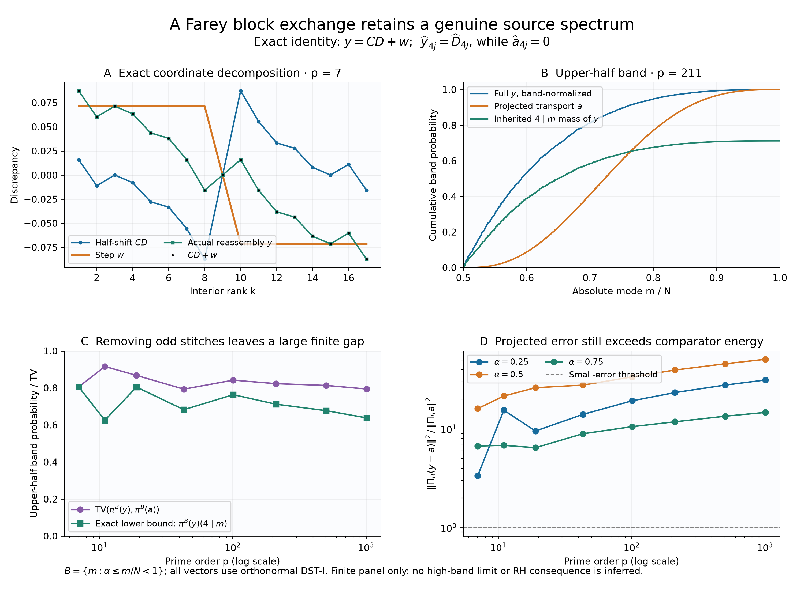

# Farey half-shift and the inherited source sector



## Question

After removing the odd stitch modes of a reflected four-defect Farey
control, does its projected transport explain the actual reassembled
discrepancy inside a high-frequency band? The view separates a known
coordinate artifact from the remaining genuine source coefficients.

## Construction

Use the increasing Farey sequence of prime order \(p\), including
zero and one, with \(N=\sum_{q\le p}\varphi(q)=2h\) gaps. Write
\(D_k=x_k-k/N\). Exchange its left and right excursion blocks around
the central two gaps as in
[FD-319](../../farey_discrepancy/findings/FD-319-four-vanishing-farey-index-defects-carry-macroscopic-energy.md).
The resulting discrepancy \(y\) satisfies the exact identity

\[
y=CD+w,\quad (CD)_k=D_{(k+h)\bmod N},\quad
w_k=\begin{cases}1/(2p)&0<k<h,\\-1/(2p)&h<k<N,\\0&k=0,h,N.\end{cases}
\]

The conventional transport \(v\) has the same two nonzero heights but
only on \(2\le k<h\) and \(h+2\le k<N\). Set
\(a_k=(v_k-v_{N-k})/2\). Apply the orthonormal DST-I to the \(N-1\)
interior entries of each vector, with absolute indices \(1\le m<N\).
All plotted full-discrepancy and projected vectors are antisymmetric,
so their odd modes vanish.

Panel A shows the exact coordinate decomposition at \(p=7,N=18\).
Lines connect discrete ranks only. Panel B uses \(p=211,N=13624\)
and \(B=\{m:m/N\ge1/2\}\). The blue and orange curves cumulatively
sum \(|\widehat y_m|^2\) and \(|\widehat a_m|^2\), each divided by
its **own** energy in \(B\). The green curve sums only
\(4\mid m\) contributions, divided by the **full \(y\)-energy in \(B\)**;
it is a subprobability, not another independently normalized law.

Panels C and D use exactly \(p=7,11,19,43,101,211,503,1009\), in
increasing order. C compares upper-half conditional TV with its event
lower bound

\[
\frac{\sum_{m\in B,\ 4\mid m}|\widehat D_m|^2}
     {\sum_{m\in B}|\widehat y_m|^2}.
\]

D plots \(R_B=\sum_{m\in B}|\widehat y_m-\widehat a_m|^2/
\sum_{m\in B}|\widehat a_m|^2\) at
\(B=\{m:m/N\ge\alpha\}\), \(\alpha=1/4,1/2,3/4\).
Prime order is logarithmic in C and D; the ratio axis is logarithmic
in D. No mode smoothing, resampling, random ensemble expectation or
truncated transform is used. Joined panel points do not interpolate
uncomputed prime orders. This reused finite panel is exploratory.

For reproduction, generate Farey numerator/denominator pairs by
starting \((a,b,c,d)=(0,1,1,p)\), appending \(c/d\), then using
\(t=\lfloor(p+b)/d\rfloor\) and
\((a,b,c,d)\leftarrow(c,d,tc-a,td-b)\), through \(1/1\).
For a zero-based genuine gap array \(g_0,\ldots,g_{N-1}\), the
reassembly order is

```
[0] + [h+1,...,N-2] + [h-1,h] + [1,...,h-2] + [N-1].
```

Cumulative gap sums reconstruct \(x^\dagger\) independently. For
floating evaluation without cumulative rounding, use
\(x_k^\dagger=x_{k+h}-(p-1)/(2p)\) on \(2\le k<h\),
\(x_k^\dagger=x_{k-h}+(p-1)/(2p)\) on \(h+2\le k<N\),
and the original \(x_k\) elsewhere. NumPy 2.5.4 and SciPy 1.18.1
produced the finite data; Matplotlib 3.11.2 rendered a \(12\times8.8\)
inch figure at 250 dpi, yielding 3000×2200 pixels.

## Observation

Removing the symmetric stitches leaves substantial conditional
separation in this finite panel. At \(p=211\), the inherited
\(4\mid m\) sector accounts for 0.711952 of the upper-band energy,
the actual TV distance is 0.822922, and \(R_B=39.5276\). At \(p=1009\)
these quantities are 0.638069, 0.794060 and 50.8084. The comparator
contains none of the inherited sector. The figure does not establish
that these fractions have nonzero limits.

## Robustness

Exact rational gap reconstruction checked every coordinate at all
22 primes from 7 through 97. All-mode transforms over the full panel
agreed with the signed coefficient dictionary to
\(5.2\cdot10^{-15}\); direct sine matrices checked the first four
orders. Both alternate fixed band edges are shown. Rank reversal
and nonzero scalar multiplication leave the normalized laws unchanged.
Anchor-matched antisymmetric non-Farey arrays obey the same dictionary,
so the representation identity is not itself an arithmetic signature.

The lower bound uses a specified residue-class event and exact
coefficients, not color, apparent curve shape, or a fitted trend.
Its denominator is the actual band energy. The classical
[Fourier shift theorem](https://brianmcfee.net/dstbook-site/content/ch06-dft-properties/Shifting.html)
explains the half-period phase; the new source-specific identification
and all finite checks are documented in the finding below.

## Research consequence

[VIS-468](../findings/VIS-468-four-defect-farey-reassembly-preserves-source-sector.md)
proves \(\widehat y_{4j}=\widehat D_{4j}\),
\(\widehat a_{4j}=0\), the remaining coefficient formula, and the
conditional TV lower bound. It makes the required source-band
estimate explicit after stitch removal. The visualization is
supporting inspection; the finding contains the canonical evidence.
No source-natural null, asymptotic high-band law, genuine-Farey
anomaly, or RH improvement follows from this finite comparison.
