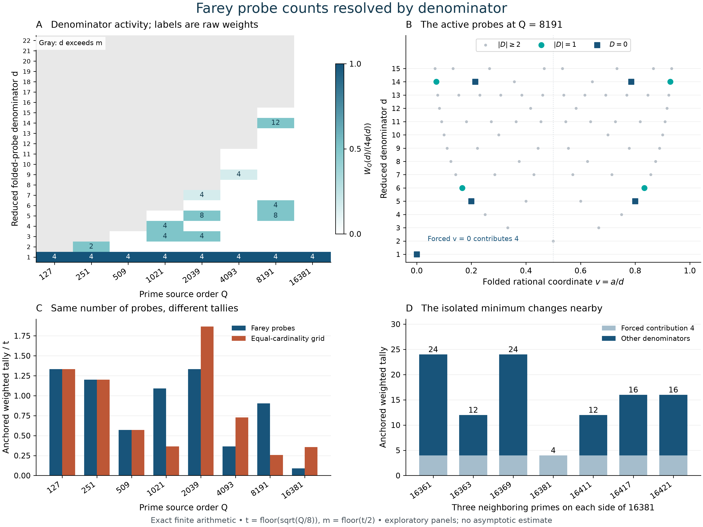

# Farey probe counts resolved by denominator

## Question

Which rational denominators supply the small half-arc rank defects in
an anchored Farey probe count? Can a small total at one source order be
read as a stable depletion of the nontrivial denominator layers?
The [local-average view](farey-half-arc-local-averages.md) changed spatial
resolution. This view keeps the probes anchored and resolves their
individual contributions, then perturbs the source order.

The relevant unresolved question is the
[simultaneous rational-probe estimate](../../farey_discrepancy/clues/CLUE-half-arc-rational-probe-sampling-discrepancy.md).
Here only the uncentered count is evaluated. No spatial integral or
sampling-discrepancy bound is inferred from it.

## Construction

Let \(F_Q\subset[0,1)\) be the cyclic reduced Farey set, including
\(0/1\), and \(N_Q=|F_Q|=\sum_{q\le Q}\varphi(q)\). Set
\[
 D_Q(u)=\#(F_Q\cap(u,u+1/2])-N_Q/2,\qquad
 w(z)=\max(0,2-|z|),
\]
with cyclic arcs open on the left and closed on the right. For
\(t=\lfloor\sqrt{Q/8}\rfloor\), put \(m=\lfloor t/2\rfloor\),
\(n=N_m\), and
\[
 E_t=\{v/2,(v+1)/2:v\in F_m\},\qquad
 G_{2n}=\{j/(2n):0\le j<2n\}.
\]
The two probe sets have the same cardinality and antipodal pairing.
The grid does not preserve the Farey denominator restrictions. Define
\[
 W_Q(d)=2\sum_{\substack{0\le a<d\\(a,d)=1}}
                 w\!\left(D_Q\!\left(\frac{a}{2d}\right)\right),
 \qquad A_Q=\sum_{d\le m}W_Q(d),
\]
\[
 A_Q^{\rm grid}=2\sum_{j=0}^{n-1}w(D_Q(j/(2n))). \tag{1}
\]
The factor two uses \(D_Q(u+1/2)=-D_Q(u)\) and the evenness of \(w\).
It counts both original probes, rather than treating them as independent.
Every panel satisfies the strict condition
\(2t^2(2/Q+1/N_Q)<1\). Consequently
[FD-348](../../farey_discrepancy/findings/FD-348-small-denominator-half-period-pairs-are-exact-rational-translates.md)
identifies \(A_Q\) with the genuine half-period gap count
\(C_{Q,0}(t,t)\). It does not give that identification for the grid tally.

There is a forced contribution: \(D_Q(0)=0\), so \(W_Q(1)=4\).
For the eligible probes, reflection gives
\(D_Q((1-v)/2)=D_Q(v/2)\). To see the endpoint convention, reflection
maps \((u,u+1/2]\) to \([1/2-u,1-u)\); both endpoints are Farey
vertices, so changing which endpoint is included leaves the count
unchanged. Thus for \(d\ge3\), the numerators \(a,d-a\) occur in
pairs with equal defect, and \(W_Q(d)\) is a multiple of four.
The \(d=2\) layer is self-reflected and can contribute \(0,2,4\).
The symmetry and the baseline are imposed by the construction.

**Exact evaluation.** With \(M(x)=\sum_{j\le x}\mu(j)\), FD-348's
finite rank filter is
\[
 D_Q(a/(2d))=
 \sum_{\substack{1\le k\le Q\\k\ {
m odd}}}
 M(\lfloor Q/k\rfloor)
 \mathbf1_{\{ka\bmod 2d\}\ge d}. \tag{2}
\]
It also evaluates the grid by taking \((a,d)=(j,n)\), without requiring
this pair to be reduced. All arithmetic in (1)–(2), all threshold tests,
and all rank comparisons are integral or rational. Floating point is
used only to place marks and normalize colors/bars.

The main panel uses the largest prime strictly below \(2^k\),
\(7\le k\le14\). This extends an inherited exploratory order panel;
it is not a held-out statistical test. Panel A colors
\(W_Q(d)/(4\varphi(d))\), with \(\varphi(1)=1\), on a common scale
from zero to one. This is the fraction of the maximum possible layer
weight, **not** a probability estimate. Nonzero cells carry their raw
integer weight. White means zero; gray means the denominator is outside
that order's probe set. No denominator is omitted within \(1\le d\le m\).

Panel B plots every folded probe \((a/d,d)\) at \(Q=8191\): squares
mean \(D=0\), colored circles mean \(|D|=1\), and gray points mean
\(|D|\ge2\). No jitter or embedding is used. Numerator reflection is
visible but is not an additional observation. Panel C compares the
raw tallies divided by \(t\); its horizontal positions are categorical,
not uniform increments in \(Q\).

After observing \(A_{16381}=4\), panel D checks the three closest
primes on each side, using the same \(t=45,m=22\) and all 300 original
probes. This is an explicitly adaptive sensitivity check, not confirmation
of a preselected anomaly. Each bar separates the forced four from the
remaining denominator contributions. The image is 12.8 by 9.6 inches
at 250 dpi, or 3200 by 2400 pixels, using NumPy 2.5.4 and Matplotlib
3.11.2; Pillow 13.0.0 fully decoded the saved PNG.

## Observation

The exact broad-panel values are:

| \(Q\) | \(t\) | \(m\) | \(2n\) | \(A_Q\) | \(A_Q^{\rm grid}\) | Nonzero layers \(d:W_Q(d)\), excluding \(1:4\) |
|---:|---:|---:|---:|---:|---:|---|
| 127 | 3 | 1 | 2 | 4 | 4 | none |
| 251 | 5 | 2 | 4 | 6 | 6 | 2:2 |
| 509 | 7 | 3 | 8 | 4 | 4 | none |
| 1021 | 11 | 5 | 20 | 12 | 4 | 3:4, 4:4 |
| 2039 | 15 | 7 | 36 | 20 | 28 | 3:4, 5:8, 7:4 |
| 4093 | 22 | 11 | 84 | 8 | 16 | 9:4 |
| 8191 | 31 | 15 | 144 | 28 | 8 | 5:8, 6:4, 14:12 |
| 16381 | 45 | 22 | 300 | 4 | 16 | none |

At 8191, the active nonzero folded coordinates are
\(1/5,4/5,1/6,5/6,1/14,3/14,11/14,13/14\).
The denominator-14 contribution is 12, while denominator 15 contributes
zero. Activity is not monotone in denominator on this example. At 16381,
all 149 nonzero folded probes have \(|D|\ge2\), so the entire tally is
forced by \(v=0\). The source has 81,572,372 cyclic Farey points; the
probe count is still only 300.

The nearby-prime control changes that picture without changing the probes:

| \(Q\) | \(A_Q\) | Active denominators other than 1 |
|---:|---:|---|
| 16361 | 24 | 14, 19, 20, 22 |
| 16363 | 12 | 14, 20 |
| 16369 | 24 | 13, 20, 22 |
| 16381 | 4 | none |
| 16411 | 12 | 22 |
| 16417 | 16 | 14, 19 |
| 16421 | 16 | 19, 22 |

Thus the observed complete absence of nontrivial contributions at 16381
is not shared by these six neighboring prime orders. The example does
not imply any frequency or limiting law for such minima. The grid can
lie above or below the Farey tally, and the equality at the first two
orders is degenerate because those probe sets coincide. At 509 the
sets differ despite their equal anchored tally.

## Robustness

A separate direct construction sorted all reduced fractions for every
\(3\le Q\le80\). Binary-search ranks at the probes with
\(d\le\min(12,\lfloor Q/2\rfloor)\) agreed with (2) in 2,975 checks,
including exact endpoint evaluations.

For all eight main orders, a separate integer Farey-neighbor recurrence
streamed the complete ordered source and collected ranks at every needed
endpoint. It reproduced all 598 defect evaluations across the folded
Farey and grid probes, without using Möbius inversion. Recording the
indices of all gaps whose smaller endpoint denominator is at most \(t\)
also reproduced each \(A_Q\) by counting indices separated by \(N_Q/2\).
The recurrence traversed the full largest source, rather than estimating
its ranks from a mesh. Reflection and the exact strict-range conditions
were checked as well.

For the seven-order sensitivity panel, an additional check enumerated
coprime numerators for every denominator added or removed relative to
16381. Its exact half-arc layer counts reproduced all 1,050 probe
values through
\[
 D_{Q'}(u)-D_Q(u)=
 \sum_{q=Q+1}^{Q'}\left[
 \#\{1\le b<q:(b,q)=1,\ u<b/q\le u+1/2\}
 -\varphi(q)/2\right],\quad Q'>Q,
\]
with reversed sign for removal. The same added layers give the exact
source cardinalities used in the strict-range checks. These are
implementation checks on deterministic arithmetic, not independent
statistical samples.

Changing the layer normalization cannot change which weights vanish;
raw counts are retained in the table and cell labels. Removing color
leaves exact point locations and distinct active-marker shapes. Neither
raster resolution nor probe ordering changes the reported values. No
independence, Gaussian approximation, fitted exponent, significance test,
or extrapolated constant is used.

## Research consequence

This representation separates a universal four-unit contribution from
order-dependent activity at individual rational denominators. It gives a
concrete check against reading a pooled low count as a stable depletion:
the example at 16381 loses that interpretation under the neighboring-prime
control. At 8191, activity reaches denominator 14 even though several
smaller layers vanish. A denominator-sensitive argument must account for
numerator selection and source-order dependence, rather than assume a
monotone cutoff in active denominators.

The identities and rank algorithms are classical. For external orientation,
Paria–Pratihar–Bhowmick, *On Farey table and its compression for space
optimization with guaranteed error bounds*, Math. Appl. **5** (2016),
123–145, [§§2.1–2.2](https://mathsapplication.com/wp-content/uploads/2023/07/10.13164-ma-2016-09.pdf),
gives the neighbor recurrence and Möbius rank formula. Tomás García,
*New Analytical Formulas for the Rank of Farey Fractions and Estimates
of the Local Discrepancy*, Mathematics **13** (2025), 140,
[Theorem 3](https://inspirehep.net/files/f2047f6517e0f6abddc4df6189d4bffd),
provides related periodic rational-rank/Mertens formulas. Their general
pointwise-rank framework is not a simultaneous small-defect count bound.
No novelty is claimed for (1)–(2), the symmetry, or these algorithms.

The retained contribution is the exact denominator-resolved comparison
and its nearby-order sensitivity control. It is supporting exploration,
not a canonical finding. It neither proves nor refutes an \(O(t)\)
probe-count bound. In particular, \(A_Q/t\) is not the centered sampling
discrepancy divided by \(t\): the spatial mean has not been subtracted.
The accepted sampling question and its separate spatial small-window
obligation remain open. No additional clue duplicates that question,
and no clue disposition or RH claim changes.
