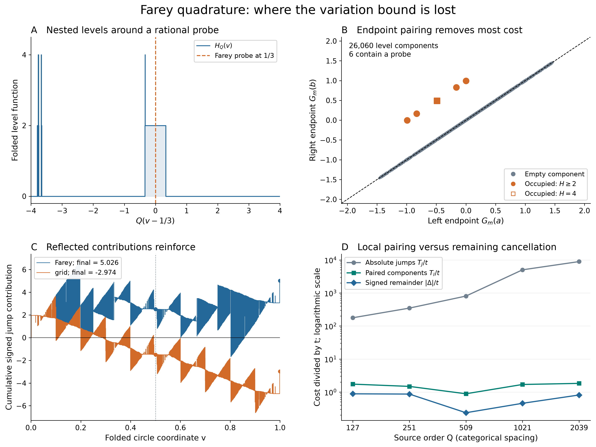

# Where the Farey quadrature variation budget is lost

## Question

Does the large bounded-variation cost in the
[rational-probe sampling question](../../farey_discrepancy/clues/CLUE-half-arc-rational-probe-sampling-discrepancy.md)
come from cancellation between distant parts of the circle, or already
from separating the two endpoints of individual level intervals?
The [denominator profile](farey-probe-denominator-profile.md) resolves
which probes contribute. This view resolves the signed quadrature
formula and the loss from applying the triangle inequality too early.
It is a finite diagnostic, not a bound uniform in the source order.

## Construction

Let \(F_Q\subset[0,1)\) be the cyclic reduced Farey set, including zero,
with \(N_Q=|F_Q|\), and use cyclic half arcs open on the left:
\[
D_Q(u)=\#(F_Q\cap(u,u+1/2])-N_Q/2,\qquad
w(z)=\max(0,2-|z|).
\]
Put \(t=\lfloor\sqrt{Q/8}\rfloor\), \(m=\lfloor t/2\rfloor\),
\(n=|F_m|\). Folding the antipodal probes gives
\[
H_Q(v)=2w(D_Q(v/2)),\qquad
A=\sum_{v\in F_m}H_Q(v),\qquad
\Delta=A-n\int_0^1 H_Q(v)\,dv. \tag{1}
\]
This is exactly the original \(r=0\) discrepancy: its unfolded probe
set is \(\{v/2,(v+1)/2:v\in F_m\}\), of cardinality \(2n\).
Every displayed order satisfies \(2t^2(2/Q+1/N_Q)<1\), so
[FD-348](../../farey_discrepancy/findings/FD-348-small-denominator-half-period-pairs-are-exact-rational-translates.md)
identifies \(A\) with the genuine diagonal half-period gap count.

The comparison uses the folded grid \(\{j/n:0\le j<n\}\). It preserves
cardinality and antipodal pairing after unfolding, but not the Farey
denominator restrictions. Its tally has no asserted gap-count identity.
For either folded probe set \(B\), define at nonprobe points
\[
G_B(x)=\#(B\cap[0,x))-nx-\tfrac12,\quad 0<x<1.
\]
The half-unit subtraction centers the primitive; it does not change
the quadrature error. Let \(J_b=H_Q(b)-H_Q(b-)\) at its nonzero jumps.
Complete antipodal pairs cancel in \(D_Q\): even denominators divisible
by four pair internally, and odd denominators at most \(Q/2\) pair
with their doubles. Only the larger odd denominators remain.
After folding, all such \(b\) have reduced odd denominator \(Q/2<q\le Q\), whereas
the displayed probes have smaller reduced denominators. Thus no jump
coincides with a probe. Expanding the finite step function yields
\[
\Delta_B=-\sum_b J_bG_B(b). \tag{2}
\]
Indeed, the error of \(\mathbf1_{[b,1)}\) is
\(-\#(B\cap[0,b))+nb\), and \(\sum_bJ_b=0\).
No Fourier series, limit, or numerical quadrature is involved.

There is a more local grouping. Since \(H_Q\in\{0,2,4\}\), write
\[
H_Q=2\mathbf1_{\{H_Q\ge2\}}+2\mathbf1_{\{H_Q=4\}}.
\]
Let \(\mathcal I\) contain the maximal circular intervals in these
**two** level sets. Intervals from different levels may overlap;
they are counted separately. Merge the pieces across zero into their
single circular component. For \(I=(a,b)\) with cyclic orientation,
put \(\ell_I=|I|\), \(k_I=\#(B\cap I)\). Endpoints are nonprobes,
so their inclusion does not affect the count. Then
\[
G_B(b)-G_B(a)=k_I-n\ell_I,
\quad
\Delta_B=2\sum_{I\in\mathcal I}(k_I-n\ell_I). \tag{3}
\]
A full-circle component, if present, contributes zero. The displayed
orders have none. Define the two absolute budgets
\[
T_J=\sum_b|J_bG_B(b)|,\qquad
T_I=2\sum_{I\in\mathcal I}|k_I-n\ell_I|.
\]
Pairing each component's endpoints before taking absolute values gives
\[
|\Delta_B|\le T_I\le T_J. \tag{4}
\]
\(T_J\) is already no larger than the usual supremum-discrepancy
times total-variation bound. It retains actual discrepancy values
at the source jumps rather than replacing them all by a supremum.

Reflection does not provide cancellation in (2). Off the jumps and
probes, \(H_Q(1-x)=H_Q(x)\) and \(G_B(1-x)=-G_B(x)\).
Consequently \(J_{1-b}=-J_b\), and the two reflected summands in (2)
are **equal**. The cumulative signed sum at \(x=1/2\) is exactly
\(\Delta_B/2\). Moreover the chosen centering minimizes \(T_J\)
among constant offsets of the discrepancy primitive: each reflected
pair has values \(g,-g\) and equal absolute jump size, and
\(|g-c|+|-g-c|\ge2|g|\). The large budget is not an avoidable
choice of additive constant.

**Exact construction and display.** Take
\(Q=127,251,509,1021,2039\), an exploratory panel inherited from
the denominator view. Set \(L=\operatorname{lcm}(1,\ldots,Q)\).
For each odd \(Q/2<q\le Q\) and \(1\le a<q\) coprime to \(q\),
the folded defect \(D_Q(v/2)\) jumps at \(v=a/q\) by \(+1\)
for odd \(a\), and by \(-1\) for even \(a\). Start at zero,
sort the integer positions \(aL/q\), and apply \(2w\) to every
step value. Record only nonzero \(H_Q\) jumps. Integrals are integer
length times height divided by \(L\). The two level components,
probe populations, (2), (3), and all comparisons use exact integers
and rational numbers.

A–C use \(Q=1021,t=11,m=5,n=10\). A is a local crop
\(|v-1/3|\le4/Q\), selected to make a probe-containing component
readable; it includes all 18 nonzero jumps there. It is not a
representative random window. B plots every component at its endpoint
pair \((G_B(a),G_B(b))\), using Farey probes. Vertical displacement
from the diagonal is its error before the factor two in (3).
Gray marks have no probe; orange marks contain a probe. Shape also
distinguishes the two occupied levels. Overlapping marks are not a
density estimate. C keeps every jump in the cumulative sum (2), in
intrinsic coordinate order, for Farey and grid probes. D compares the
three costs in (4), divided by \(t\), for Farey probes; order positions
are categorical, the vertical axis logarithmic, and connecting lines
do not fit a rate. No image pixel determines any reported number.

## Observation

Exact values rounded for display are:

| \(Q,t\) | Level components | Occupied components | \(T_J\) | \(T_I\) | \(\Delta\) |
|---|---:|---:|---:|---:|---:|
| 127, 3 | 693 | 2 | 533.504740 | 5.218272 | 2.654735 |
| 251, 5 | 1,801 | 3 | 1,743.747983 | 7.424734 | 4.350098 |
| 509, 7 | 5,720 | 2 | 5,648.676126 | 6.217430 | 1.656585 |
| 1021, 11 | 26,060 | 6 | 55,380.664872 | 18.685922 | 5.026109 |
| 2039, 15 | 66,314 | 10 | 134,245.578887 | 27.494563 | 12.239625 |

Every occupied component on this panel contains exactly one folded
probe, and every component satisfies \(n\ell_I<0.025\).
Thus every empty component has negative error, every occupied one
positive error. These are finite checks, not universal assertions.
At 1021, the occupied components contribute 11.856015 to (3), and
the empty ones contribute \(-6.829906\). Local endpoint pairing
removes over 99.96% of \(T_J\) before that remaining cancellation
is considered. Nested components are not independent observations.

The equal grid also exhibits large local cancellation. At 1021 it has
\(T_J=26387.470895\), \(T_I=10.817028\), and
\(\Delta=-2.973891\), with only two occupied components.
Its negative sign contrasts with the Farey discrepancy despite the
same source, cardinality, and spatial mean. At 2039 the grid discrepancy
is positive, 20.239625. The first two orders have identical Farey and
grid sets, so those agreements are degenerate controls.

The diagonal concentration in B is imposed by the interval identity:
an empty interval has \(G_B(b)-G_B(a)=-n\ell_I\).
It is not a newly discovered correlation. Likewise the reflection in
C is exact algebra, not evidence for probabilistic decorrelation.

## Robustness

A separate full-source construction used the integer Farey-neighbor
recurrence, without odd-shell pruning or Möbius inversion. It merged
the exit events from fractions below one half with the entrance events
from fractions above one half, cancelling simultaneous events before
applying \(2w\). Across the five orders it processed respectively
4,956; 19,272; 79,034; 317,418; and 1,264,768 individual events.
It reproduced every nonzero jump and the complete integral exactly.

For every \(8\le Q\le48\) and
\(2\le t\le\min(\lfloor Q/2\rfloor,12)\), a separate
sorted-reduced-fraction construction checked direct half-arc ranks at
all odd-shell breakpoints and their following interval midpoints:
125,804 comparisons across 379 panels. It independently integrated
the complete source partition and checked both probe tallies.
The signed identity, interval grouping, circular seam, reflection,
and inequalities (4) passed exactly. These overlapping tests validate
implementation and conventions, not an asymptotic law.

For every displayed order and both probe geometries, adding each of
\(-1,-1/2,0,1/2,1\) to the centered primitive preserved the signed
sum and did not improve its absolute budget: 50 offset checks.
Simultaneously rotating all components and probes by \(1/7\) or
\(1/11\) preserved each component population and signed error in
402,352 exact comparisons. Reordering probes changes none of these
quantities. C's partial sums depend on the specified coordinate cut;
the complete error and intrinsic component budget do not.

The image is 12.8 by 9.6 inches at 250 dpi, or 3200 by 2400 pixels,
rendered with NumPy 2.5.4 and Matplotlib 3.11.2 and fully decoded with
Pillow 13.0.0. Fine events may merge at browser scale; the exact tables
and interval identities, not the apparent trace thickness, support
the comparison. No random-null, independence, Gaussian, fitted-rate,
or held-out confirmation claim is made.

## Research consequence

This view separates two losses that a single variation norm hides:
discarding cancellation inside each level component, and discarding
cancellation between its occupied and empty components. On this panel,
the first loss is much larger. The grid comparison shows that this
local cancellation is not diagnostic of the Farey probe geometry.

The representation does not supply a new bound. In particular,
\(T_I\le A+n\int H_Q\) follows immediately from (3), but it still
contains the unknown arithmetic tally \(A\). Proving that only few
actual rank-level components meet probes remains a counting problem;
local pairing has not solved it. The
[FD-350 partition-only obstruction](../../farey_discrepancy/findings/FD-350-rational-probe-plateaus-have-a-sharp-spatial-sampling-cost.md)
also prevents treating local constancy and small spatial mass alone
as sufficient transfer hypotheses. Here the components retain the
actual two rank levels, but no uniform estimate on their probe
occupancy is established.

The finite integration-by-parts identity and the two-level decomposition
are classical. For the bounded-variation/discrepancy framework, see
Christoph Aistleitner and Josef Dick, *Functions of bounded variation,
signed measures, and a general Koksma–Hlawka inequality*,
[equation (2)](https://arxiv.org/pdf/1406.0230).
Equations (2)–(4) are derived here to fix the cyclic and endpoint
conventions; no new general quadrature theorem is claimed.

The retained contribution is the exact comparison of where the
absolute-jump budget is spent, including the reflection and grid
controls. This PNG/Markdown pair is supporting exploration, not a
canonical finding. Both proposed sampling bounds, the separate spatial
small-window estimate, and their asymptotics remain open. No new clue
duplicates the accepted sampling question, no clue disposition changes,
and no RH improvement is asserted.
