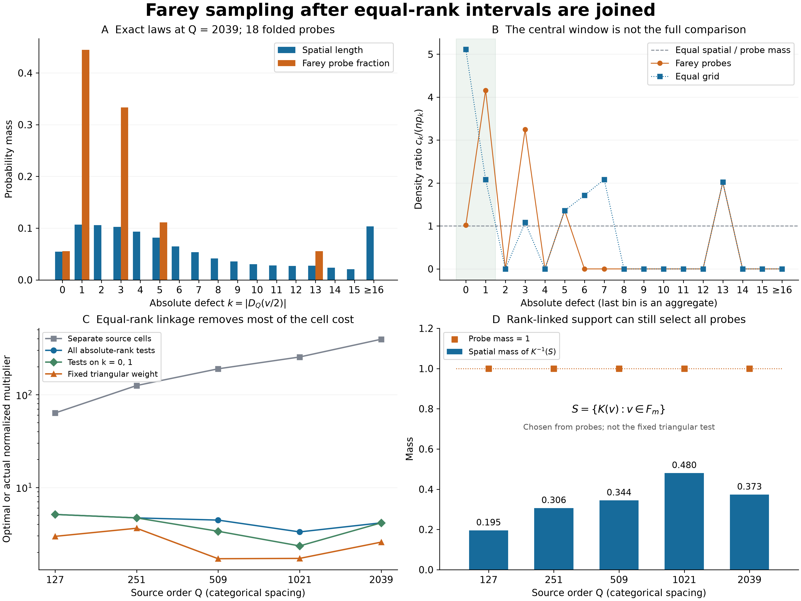

# Farey sampling after equal-rank intervals are joined

## Question

How much of the large positive sampling cost survives when separated
source intervals with the same absolute rank defect must receive the
same value? The partition-only obstruction in
[FD-350](../../farey_discrepancy/findings/FD-350-rational-probe-plateaus-have-a-sharp-spatial-sampling-cost.md)
explicitly leaves this linkage out. The
[endpoint-pairing view](farey-quadrature-endpoint-pairing.md) retains
individual level components. Here the representation instead joins
**all** components carrying the same absolute integer defect.

This tests the size and location of the finite sampling cost, not a
uniform estimate. In particular, a worst-case test chosen from all rank
levels is different from the fixed central triangular weight in the
[accepted sampling question](../../farey_discrepancy/clues/CLUE-half-arc-rational-probe-sampling-discrepancy.md).

## Construction

Use the cyclic reduced Farey set \(F_Q\subset[0,1)\), including zero,
with \(N_Q=|F_Q|\), and right-continuous cyclic half arcs:
\[
D_Q(u)=\#(F_Q\cap(u,u+1/2])-N_Q/2.
\]
Set \(t=\lfloor\sqrt{Q/8}\rfloor\), \(m=\lfloor t/2\rfloor\),
\(n=|F_m|\), and fold the paired probes as in FD-348:
\[
E_t=\{v/2,(v+1)/2:v\in F_m\},\qquad
K_Q(v)=|D_Q(v/2)|.
\]
Half-period antisymmetry ensures that the spatial distribution of
\(|D_Q|\) equals the spatial distribution of \(K_Q\). The empirical
law on \(E_t\) likewise equals that of \(K_Q\) on \(F_m\).
Define the exact finite distributions
\[
p_k=|\{v\in[0,1):K_Q(v)=k\}|,\qquad
c_k=\#\{v\in F_m:K_Q(v)=k\},\qquad \nu_k=c_k/n.
\tag{1}
\]
Lengths are Lebesgue measure; probe masses are deterministic counts.
They are not estimates obtained from independent random samples.
Every probe lies inside a constant interval, so \(c_k>0\) implies
\(p_k>0\). Define
\[
R_{\rm rank}=\max_{p_k>0}\frac{c_k}{np_k}.
\tag{2}
\]
This is exactly the least multiplier satisfying
\[
\frac1n\sum_{v\in F_m}g(K_Q(v))
\le R_{\rm rank}\int_0^1g(K_Q(v))\,dv
\quad\text{for every nonnegative }g.
\tag{3}
\]
The proof is termwise comparison of the two finite sums; an indicator
of a maximizing rank level attains equality. This is the elementary
finite density-ratio principle, not a new sampling theorem.

For comparison let \(J(v)\) be the full circular constant interval
of the signed function \(D_Q(\cdot/2)\) containing a probe, merging
its two pieces at zero. These cells are disjoint by FD-350, since
\(Q>3t\). The sharp multiplier for arbitrary nonnegative functions
constant on the individual cells is
\[
R_{\rm cell}=\max_{v\in F_m}\frac1{n|J(v)|}.
\]
Joining cells of equal absolute rank replaces their local sampling
densities by a spatial-length-weighted average. In particular,
\[
R_w\le R_{01}\le R_{\rm rank}\le R_{\rm cell},\qquad
R_{01}=\max_{k\in\{0,1\}}\frac{c_k}{np_k},
\tag{4}
\]
where the actual multiplier of the fixed triangular weight is
\[
R_w=\frac{2c_0+c_1}{n(2p_0+p_1)}.
\tag{5}
\]
The unfolded tally is \(A=2(2c_0+c_1)\), its spatial baseline is
\(2n(2p_0+p_1)\), and their difference is the original \(r=0\)
quadrature discrepancy. Every displayed order satisfies
\(2t^2(2/Q+1/N_Q)<1\), so
[FD-348](../../farey_discrepancy/findings/FD-348-small-denominator-half-period-pairs-are-exact-rational-translates.md)
identifies \(A\) with the corresponding genuine gap count.

The equal-grid control uses \(\{j/n:0\le j<n\}\) with the **same**
source law \(p\). After unfolding it preserves cardinality and
antipodal pairing, but not Farey denominator restrictions. It has no
asserted gap-count interpretation.

**Exact construction.** The source orders are
\(127,251,509,1021,2039\), inherited from the endpoint comparison.
This is exploratory reuse, not an untouched confirmation panel.
Let \(L=\operatorname{lcm}(1,\ldots,Q)\). For each odd denominator
\(Q/2<q\le Q\) and coprime \(1\le a<q\), place a jump at
\(aL/q\) of size \(+1\) for odd \(a\), \(-1\) for even \(a\).
Starting with defect zero, sort and accumulate these jumps. All other
half-arc events cancel in antipodal pairs. Sum the integer lengths
of intervals with absolute defect \(k\), then divide by \(L\) to
obtain \(p_k\). Binary search gives the probe values and their cell
lengths. All measures, comparisons, maxima and identities use exact
integers and rational numbers. Floating point is used only for display.

Panels A and B use the largest order, \(Q=2039\), without choosing it
by its resulting ratio. They display \(k=0,\ldots,15\) individually
and aggregate **all** remaining ranks \(16,\ldots,510\). Neither
probe set meets that tail, so its ratio is zero; none of its spatial
mass is dropped. The shading in B marks the triangular weight's support.
Lines between rank points are visual guides, not continuous densities.
Panel C has a logarithmic vertical axis and categorical order spacing;
its lines are not rate fits. Panel D uses the rank-linked control
\[
S=\{K_Q(v):v\in F_m\},\qquad f_S(v)=\mathbf1_{\{K_Q(v)\in S\}}.
\tag{6}
\]
Its probe mass is one by construction, and its spatial mass is
\(p(S)=\sum_{k\in S}p_k\). It is the smallest union of whole
absolute-rank levels containing every probe. This is an **adaptive**
control depending on \(Q,t\), not the prescribed triangular test.

## Observation

The exact comparisons, rounded only for this table, are:

| \(Q\) | \(n\) | \(R_{\rm cell}\) | \(R_{\rm rank}\) | Maximizing \(k\) | \(R_{01}\) | \(R_w\) | \(p(S)\) |
|---:|---:|---:|---:|---:|---:|---:|---:|
| 127 | 1 | 63.500000 | 5.121557 | 0 | 5.121557 | 2.973393 | 0.195253 |
| 251 | 2 | 125.500000 | 4.701832 | 0 | 4.701832 | 3.636579 | 0.306134 |
| 509 | 4 | 190.122041 | 4.452662 | 4 | 3.374023 | 1.706911 | 0.344196 |
| 1021 | 10 | 254.999755 | 3.320326 | 3 | 2.345050 | 1.720704 | 0.480158 |
| 2039 | 18 | 396.082952 | 4.159235 | 1 | 4.159235 | 2.577195 | 0.373199 |

Joining equal absolute-rank cells removes most of the large multiplier
on this panel. It does not make the two measures equal, and the
maximizing rank moves. At orders 509 and 1021 the unrestricted maximum
comes from a rank excluded by the fixed triangular weight. Thus even
an exact worst-level norm can diagnose the wrong part of the target.

At 2039 the nonzero counts are
\((c_0,c_1,c_3,c_5,c_{13})=(1,8,6,2,1)\).
The zero level has density ratio \(1.022099\), close to one here,
while the level \(k=1\) has ratio \(4.159235\). The target's excess
is therefore not a uniform amplification of its two central levels.
The equal grid instead maximizes at zero, with ratio \(5.110497\);
it has five zero-level probes rather than one. Its counts are
\((c_0,c_1,c_3,c_5,c_6,c_7,c_{13})=(5,4,2,2,2,2,1)\).
At the first two orders the Farey and grid sets coincide, so that
agreement is a degenerate control.

The support control (6) still assigns value one to every probe after
imposing equal-rank linkage. Its spatial masses are between 0.195 and
0.481 on the displayed panel. Its unfolded positive discrepancy is
exactly \(2n(1-p(S))\). No asymptotic lower bound follows: the control
changes with the panel, and neither persistent missing spatial mass
nor growth of this discrepancy divided by \(t\) is proved.

## Robustness

A separate full Farey-neighbor recurrence built every source point,
using \((a/b,c/d)\mapsto(c/d,(hc-a)/(hd-b))\),
\(h=\lfloor(Q+b)/d\rfloor\), starting with \(0/1,1/Q\).
For each point below one half it supplied an exit event at twice its
coordinate; each point above one half supplied an entrance event at
twice its coordinate minus one. Cancelling coincident events exactly
reproduced the entire pruned event list, hence every interval and
spatial mass. The five full source cardinalities were
4,958; 19,274; 79,036; 317,420; and 1,264,770.
Direct binary-search half-arc ranks in these full sources independently
checked all 70 folded Farey/grid probe evaluations. No Fourier cutoff
or spatial mesh is used.

An additional sorted-reduced-fraction construction, independent of the
neighbor recurrence, tested every \(8\le Q\le60\) and
\(2\le t\le\min(12,\lfloor(Q-1)/3\rfloor)\): 428 panels,
1,886 probe evaluations, and 17,196 full-source partition intervals.
It integrated direct midpoint ranks over that partition and recovered
the odd-shell spatial law exactly. It also checked positivity,
normalization, the support-control identity and the sampling bound
for \(g(k)=(1+k)^{-j}\), \(j=0,1,2,3\). These are implementation
checks, not independent statistical evidence.

For each main order, joining consecutive ranks into bins of widths
2, 3 and 5 never increased the maximum density ratio, as follows
algebraically from weighted averaging. Such binning can conceal a
worst rank, so (2) and the table always use the unmerged exact levels.
Permuting rank labels jointly in both measures leaves (2) invariant;
changing the labels without transporting the triangular test would
change the question. Permuting the probes leaves every reported count
unchanged. The comparison is intrinsic to lengths and integer labels,
not a colormap or coordinate-layout effect.

The saved image is 3200 by 2400 pixels, rendered at 12.8 by 9.6 inches
and 250 dpi using NumPy 2.5.4 and Matplotlib 3.11.2, fully decoded with
Pillow 13.0.0. Markers distinguish the curves without color. No Gaussian
fit, randomness, independence assumption, significance test or
extrapolated rate is used.

## Research consequence

The finite comparison identifies a substantial distinction between
freedom on individual source cells and freedom on whole rank levels.
The FD-350 partition obstruction cannot simply be read as the observed
cost of rank-linked tests. Conversely, rank linkage does not force
measure agreement: the adaptive whole-level support control still
selects all probes. Neither observation settles the fixed-weight
sampling question.

The next load-bearing input remains a bound for the actual arithmetic
level counts relative to their spatial masses, with the required
uniformity in \(Q,t\). Even a uniform bound on \(R_{\rm rank}\)
would give only \(A\ll n(2p_0+p_1)\); a separate spatial estimate
\(2p_0+p_1=O(1/t)\) would still be needed to reach \(A=O(t)\).
No such bound follows from these five points. The absolute and one-sided
quadrature estimates remain open, as does that spatial estimate.

The finite density-ratio and aggregation identities are classical
measure comparison. The relevant quadrature background remains
Aistleitner–Dick, *Functions of bounded variation, signed measures,
and a general Koksma–Hlawka inequality*,
[equation (2)](https://arxiv.org/pdf/1406.0230), whose bound retains a
variation factor. Dress, *Discrépance des suites de Farey*,
[J. Théor. Nombres Bordeaux 11 (1999), 345–367](https://www.numdam.org/article/JTNB_1999__11_2_345_0.pdf),
provides the classical Farey discrepancy context, including the role
of small-denominator neighborhoods. Neither is being cited as a
uniform bound on the density ratios computed here. Targeted prior-art
orientation and comparison with FD-348/FD-350 identify no new general
theorem in this representation.

This paired artifact retains an exact exploratory comparison and its
limits. It is not canonical mathematical evidence, creates no finding
or duplicate clue, changes no clue disposition, and asserts no RH
improvement.
