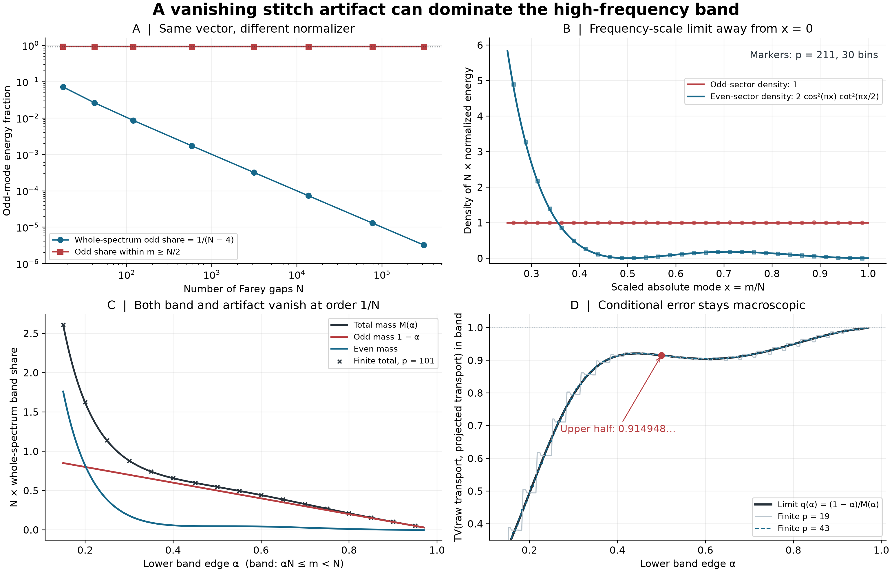

# A small global stitch term dominates conditioned high bands

## Question

Does VIS-466's vanishing odd-mode stitch fraction remain negligible when
one normalizes inside a high-frequency band? The calculation isolates a
representation effect before interpreting a conditional spectrum as
arithmetic evidence. [VIS-467](../findings/VIS-467-vanishing-stitch-parity-dominates-farey-high-bands.md)
contains the independent finite formulas and proof.

## Construction

For even `N`, put `h=N/2`. Set `v_k=1` on `2≤k≤h−1`, `v_k=−1` on
`h+2≤k≤N−1`, and zero elsewhere, for `1≤k<N`. This is the exact FD-319
right-endpoint transport divided by `b=1/(2p)` at
`N=N_p=∑_{q≤p}φ(q)`. Multiplying by `b` does not change any displayed
normalized quantity. Let `a_k=(v_k−v_(N−k))/2`.

Compute every sine mode with
`vhat_m=√(2/N)∑_k v_k sin(πmk/N)` and
`π_m(v)=|vhat_m|²/(N−4)`. The band is always the **absolute-mode** set
`B_(N,α)={m: αN≤m<N}`; modes are not reindexed by parity. Define

`g(x)=2 cos²(πx) cot²(πx/2)`,

`M(α)=1−α+∫_α^1 g(x) dx`, and `q(α)=(1−α)/M(α)`.

- **A:** `p=7,11,19,43,101,211,503,1009`; plot complete odd mass and
  odd mass conditioned on `m≥N/2`, on logarithmic axes. The dotted line
  is the derived limit `π/(16−4π)`, not a fit. Connecting lines do not
  assert monotone finite convergence.
- **B:** the limiting densities of `N∑π_m δ_(m/N)`, split by parity,
  on `0.25≤x≤1`. Markers are full DST data at `p=211`, binned into 30
  equal intervals on `[0.25,1]`; each bin sums `Nπ_m` and divides by
  its width. They approximate bin averages, not pointwise coefficients.
  Both parity densities use the same total-energy denominator. These
  are finite-measure densities away from zero, not full probability
  densities; the even density is not integrable at zero.
- **C:** limiting rescaled whole-spectrum band shares `M(α)`, `1−α`
  and their difference, for 280 equally spaced `α` in `[0.15,0.97]`.
  Crosses show finite total band shares multiplied by `N` at `p=101`,
  for 17 equally spaced `α` in `[0.15,0.95]`.
- **D:** `q(α)` on the same 280-point grid, with finite conditional
  odd fractions at `p=19,43`. By the exact mixture identity these
  fractions equal `TV(π^B(v),π^B(a))`. The red point marks `α=1/2`.
  The finite curves have steps from including individual integer modes.

Totient counts can be reproduced by the integer sieve initialized with
`φ(j)=j`, then subtracting `φ(j)/r` at every multiple of each detected
prime `r`. The transform is SciPy `dst(type=1,norm='ortho')`. The integral
was evaluated by adaptive quadrature and independently checked against
VIS-467's elementary closed form. No randomness, fitted parameter,
external dataset, confirmation sample, or omitted-mode normalization is
used. This is a deterministic illustration of a derived identity.

Matplotlib uses a 14 by 9 inch figure at 220 dpi, producing 3080 by 1980
pixels. NumPy 2.5.4, SciPy 1.18.1, Matplotlib 3.11.2 and Pillow 13.0.0
were used. Color distinguishes sectors; axes, line styles and formulas
carry the same information without color.

## Observation

Global odd mass falls as `1/(N−4)`, but the selected band's total mass
also falls at order `1/N`. The upper-half odd fraction tends to
`0.91494809158…`, even while global leakage tends to zero. The odd
rescaled density is constant; the even density has an internal zero at
`x=1/2` and tends quadratically to zero at `x=1`. Thus a band near the
largest available sine mode is particularly sensitive to the stitch
assignment. This behavior is imposed by the exact coordinate stencil.

## Robustness

VIS-467 checks the complete coefficient formula for 128 even dimensions,
including generic dimensions unrelated to primes, with direct sine
matrices at five sizes. It tests the conditional identity at four band
edges, sign/amplitude scaling and rank reversal. Exact rational Farey
gap reassemblies at `p=7,11,19`, and floating checks at `p=43,101,211`,
connect the stencil to the source construction. The full reconstructed
discrepancy cancels the odd coefficients; its even-band law is not
assumed equal to that of the projection. Pixel resolution does not enter any computed statistic: the limits follow
from residue-class Riemann sums, and the finite checks retain every sine
coefficient.

The band rule was fixed before the finite checks, and the plotted curve
shows an interval of band edges rather than selecting one favorable
window. There is no statistical significance or arithmetic-selectivity
claim. Limits hold for fixed `α>0`; the separate statement `q(α)→1`
as `α→1` takes the dimension limit first.

## Research consequence

[VIS-467](../findings/VIS-467-vanishing-stitch-parity-dominates-farey-high-bands.md)
provides a concrete obstruction to using global spectral closeness for
conditional high-band comparison. Use the full discrepancy or explicitly
project the transport, then check the residual energy inside the chosen
band. Projection alone does not prove transfer of its even-band law.
This image is supporting context; the finding is the evidence. No
arithmetic anomaly, new null ensemble, or RH improvement follows.
