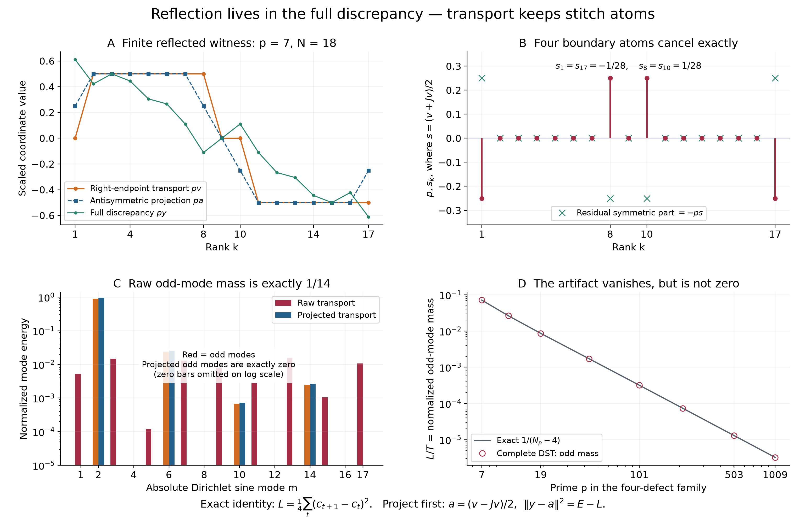

# Reflected Farey transport keeps a finite stitch-parity contribution

## Question

Does preserving reflection of a Farey excursion reassembly make its exact
block transport reflection-antisymmetric as well? This checks a finite
representation convention before using odd/even spectral allocation as a
control. The precise answer and derivation are in
[VIS-466](../findings/VIS-466-reflected-farey-transport-parity-is-a-stitch-boundary-term.md).

## Construction

For an odd prime `p`, generate the genuine Farey grid by the integer
neighbor recurrence starting with `(a,b,c,d)=(0,1,1,p)`, repeatedly using
`k=floor((p+b)/d)` and replacing the two neighbors by
`(c,d,k*c-a,k*d-b)` until reaching `1/1`. Let `N` be the number of gaps and
`D_k=x_k-k/N`. Partition at vertices with denominator `p`, giving the
excursions `E_j` from `j/p` to `(j+1)/p`.

Use FD-319's fixed reflected `BCA` order: move all excursions right of the
central excursion to the left, keep the central excursion, then move the
original left excursions to the right. Each excursion keeps its internal
directed denominator-edge word. Include its endpoint and exclude its
starting point when transporting discrepancy entries. This specifies
`y=e+v`, where `y` is the reconstructed discrepancy, `e` the correspondingly
permuted genuine discrepancy, and `v` the exact block displacement.

Write `Jz_k=z_(N-k)`, `a=(v-Jv)/2`, `s=(v+Jv)/2`, `E=||e||²`,
`T=||v||²`, `L=||s||²`. The transport is `+1/(2p)` on ranks
`2,...,N/2-1`, zero at ranks `1,N/2,N/2+1`, and `-1/(2p)` on ranks
`N/2+2,...,N-1`. Its symmetric part is supported at four ranks:
` s_1=s_(N-1)=-1/(4p)` and
` s_(N/2-1)=s_(N/2+1)=1/(4p)`.

- **A:** all 17 interior ranks at `p=7`, `N=18`; plot `p*v`, `p*a`, `p*y`
  on linear axes. At this prime the original excursion lengths are
  `(3,4,2,4,3)` and their reordered labels are `(4,5,3,1,2)`.
- **B:** the same ranks; plot `p*s` as stems and the residual symmetric
  part `p*(e+Je)/2=-p*s` as crosses. Zero entries are retained.
- **C:** all 17 absolute sine modes at `p=7`; compute
  `zhat_m=sqrt(2/N)*sum_k z_k sin(pi*m*k/N)` and divide each squared
  coefficient by its own complete vector energy. Raw transport bars are
  red for odd modes and orange for even modes; projected bars are blue.
  The ordinate is logarithmic with displayed range `1e-5` to `1.4`;
  exactly zero modes are omitted, and floating roundoff below the range
  is not interpreted as positive mass. There is no spectral truncation
  in the normalization.
- **D:** `p=7,11,19,43,101,211,503,1009`; compare the complete-DST odd share
  with the exact fraction `L/T=1/(N_p-4)` on log/log axes. Lines connect
  the listed points only. They are not a fitted law or a random-null mean.

The figure uses Matplotlib at 14 by 9 inches and 220 dpi, yielding
3080 by 1980 pixels. Sine transforms use SciPy `dst(type=1,norm='ortho')`;
NumPy 2.5.4, SciPy 1.18.1, Matplotlib 3.11.2 and Pillow 13.0.0 were used.
All coordinates and transforms are specified above; no external data,
random draw or fitted parameter determines the displayed panels.

## Observation

The full discrepancy is exactly antisymmetric, but the transport includes
a symmetric boundary contribution. At `p=7`, its normalized odd sine mass
is exactly `1/14`, even though every odd sine coefficient of the full
reconstructed discrepancy is zero. The residual cancels the boundary
contribution exactly. Projection removes that contribution and changes
the transport normalization from `T` to `T-L`.

For the displayed four-defect family, the raw odd mass becomes small as
`p` increases. Finite smallness must not be confused with exact parity;
the formula holds before taking a limit. The plot illustrates a derived
identity, not an empirical discovery of an arithmetic signal.

## Robustness

VIS-466 establishes the general stitch identity
`L=(1/4)*sum_t (c_(t+1)-c_t)^2` and the corrected residual energy `E-L`.
It records exhaustive rational checks of all 392 reflected permutations
at `p=7,11`, plus 512 floating-point reflected permutations at larger
primes. The checks reconstruct grids independently from their original
positive gaps, retaining all modes and the complete directed-edge
inventory. They are broader than the four-defect rendering family.

A direct sine matrix at `p=7` agrees with the type-I DST within `2e-15`.
Multiplying the transport by `-3` or reversing ranks preserves its
normalized spectral energy within the same tolerance. Linear coordinate
panels identify the four exceptional ranks without color or log scaling;
the logarithmic panels only expose the small spectral mass. No random-null
calibration, untouched confirmation sample, or asymptotic arithmetic test
is claimed.

## Research consequence

[VIS-466](../findings/VIS-466-reflected-farey-transport-parity-is-a-stitch-boundary-term.md)
is the canonical mathematical evidence. It makes VIS-461's endpoint-parity
warning exact for the full reflected excursion class and clarifies the
reflection sentence in FD-320: full discrepancy has exact parity, whereas
raw right-endpoint transport need not. Its normalized projected comparison
uses the exact energies `T-L` and `E-L`.

This is a correction to a representation-based control, not a new Farey
ordering criterion, a valid arithmetic anomaly, or an RH implication.
Orthogonal projection is classical; see the [FFTW symmetry-convention
documentation](https://www.fftw.org/fftw3_doc/Real-even_002fodd-DFTs-_0028cosine_002fsine-transforms_0029.html)
and the prior-art boundary in VIS-466. The image supports inspection and
is not proof by appearance.
