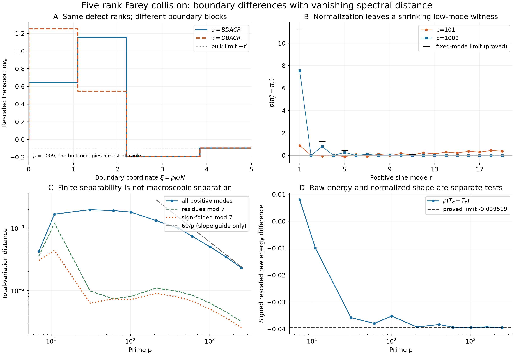

# Five equal defect ranks: boundary differences with vanishing spectral distance

## Question

Can the equal-rank five-defect Farey pair of FD-329 retain a macroscopic
normalized spectral difference, despite its small raw energy separation?
The boundary view distinguishes actual profile differences from changes
caused by normalizing each spectrum by its own energy.

## Construction

Use exactly the artificial excursion words \(BDACR\) and \(DBACR\) and the
transport-vector convention in [VIS-460](../findings/VIS-460-five-defect-rank-pair-has-inverse-prime-spectral-separation.md).
For each prime \(p\), compute \(N=\sum_{q\le p}\varphi(q)\) by an integer
totient sieve. With
\[
a=(p+1)/2,\quad b=\lfloor p/3\rfloor+1,\quad h=N-2-2a-2b,
\quad(x,y,z)=(a/N-1/p,b/N-1/p,h/N-(p-6)/p),
\]
form the consecutive block lengths \((1,b,b,a,h,a)\). Their transport
values are \((0,x,x+z,-2y,-y,0)\) and
\((0,x+y+z,x-y,-2y,-y,0)\). This specifies all \(N-1\) ranks.

Apply the orthonormal type-I discrete sine transform and divide squared
coefficients by the corresponding exact block energy
\(T=\sum\text{length}\times\text{value}^2\).
All positive modes \(1\le r<N\) are retained. Define
\(\operatorname{TV}(\pi,\eta)=\frac12\sum_r|\pi(r)-\eta(r)|\).
For the fixed modulus 7, also use
\(\mu(j)=\sum_{r\equiv j\bmod7}\pi(r)\) and
\(\widetilde\mu(j)=[\mu(j)+\mu(-j)]/2\).

- **A:** \(p=1009\), plot \(pv_k\) against \(\xi=pk/N\), restricted to
  \(0\le\xi\le5\). The bulk plateau continues outside the displayed boundary
  region. The horizontal dotted line is its limiting value
  \(-Y=1-\pi^2/9\).
- **B:** plot \(p(\pi^\sigma(r)-\pi^\tau(r))\) for modes 1–19 at
  \(p=101,1009\), against the proved fixed-mode limits
  \((-D/T_0)q_r\) from VIS-460. Connecting lines only guide the eye on
  the discrete mode set.
- **C:** the full, modulo-7, and folded modulo-7 distances at
  \(p=7,11,31,61,101,211,401,601,1009,1601,2503\), on logarithmic axes.
  The line \(60/p\), displayed for \(p\ge211\), is only an illustrative
  slope guide: 60 is neither a proved bound nor a fitted asymptotic constant.
- **D:** plot the independently normalized raw difference
  \(p(T_\sigma-T_\tau)=-2pby(y+z)\) against its proved limit
  \(D=-\frac23(\pi^2/9-1)(5-4\pi^2/9)\).

The statistic, complete-mode convention, prime list, and modulus were
fixed before computing this panel. These are deterministic diagnostics
of a derived theorem, not an untouched statistical confirmation sample.
The figure uses Matplotlib 3.11.2, NumPy 2.5.4, SciPy 1.18.1, and Pillow
13.0.0; 13 by 9 inches at 220 dpi gives 2860 by 1980 pixels. Colors
identify the words or observation maps, with line styles and markers
providing redundant distinctions. No random simulation or smoothing is used.

## Observation

The two rescaled profiles remain visibly different in a shrinking boundary
region, while most ranks share the same bulk. The full spectral distance
eventually decreases; residue reduction and folding can reduce it further.
Convergence is slow because the common limiting energy is small
(\(T_0\approx0.00283779\)). Neither the small-prime nonmonotonicity nor
the apparent finite-scale slope is evidence of a different limiting law.
The signed first-mode residual approaches a nonzero value only after
multiplication by \(p\).

## Robustness

Exact rational Farey-edge reconstruction at \(p=7,11\) verifies the
transport indexing, equal defect ranks, and unequal defect values.
A dense sine-matrix calculation agrees with the DST there within
\(2\cdot10^{-14}\) per coefficient. Full spectral masses agree with one
within \(3\cdot10^{-13}\) throughout the panel. No positive-frequency tail
has been discarded or renormalized away. The modulo-7 and folded views
obey their required total-variation contractions.

The shrinking boundary is expanded in A explicitly rather than mistaken
for a positive fraction of the rank interval. The physical coordinate
\(k/N\) gives that region width \(O(p^{-1})\). Multiplication of either
transport vector by a nonzero scalar leaves its normalized spectral law
unchanged. The theorem controls all mode windows and common spectral
pushforwards, so its conclusion does not depend on the selected modulus,
colormap, or plotted prime range. The finite folded curves alone do not
establish their own sharp asymptotic constants.

The saved PNG was fully decoded with Pillow, inspected for readability,
and validated at its full pixel dimensions before installation. Binary
identity is checked at staging and at the exact published commit.

## Research consequence

[VIS-460](../findings/VIS-460-five-defect-rank-pair-has-inverse-prime-spectral-separation.md)
proves \(\operatorname{TV}(\pi^\sigma_p,\pi^\tau_p)=\Theta(p^{-1})\):
there is a quantitative transport-spectrum witness, but no macroscopic
window separation. Its leading fixed-mode difference comes from the
different energy denominators. The exact first defect value distinguishes
the two words for every prime \(p\ge7\).

This narrows the [five-defect clue](../clues/CLUE-five-defect-rank-collision-spectral-control.md)
for its stated pair. General joint rank-and-value uniqueness is not
established. Neither this image nor the transport theorem transfers the
inverse-prime rate to the full reassembled discrepancy or to genuine Farey
order; there is no RH claim.
