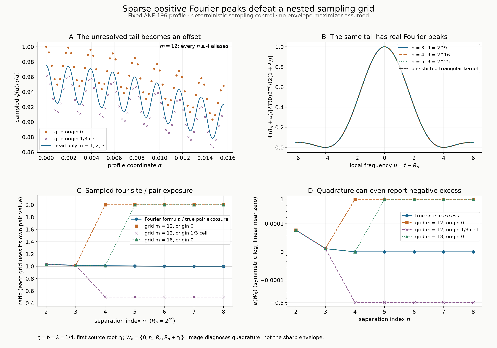

# Sparse Fourier peaks hidden by a nested sampling grid

## Question

Can an ordinary dyadic plot or quadrature resolve the sparse Fourier peaks
in [ANF-196](../../analytic_frontier/findings/ANF-196-positive-fourier-notches-can-have-no-power-stability-rate.md)?
That source constructs one fixed positive-Fourier notch with no power
stability rate. Here the question is a representation control: does
increasing the resolution of a nested grid protect the numerical test
against those peaks?

## Construction

Use the source's convention \(\widehat f(t)=\int f(\alpha)
e^{-2\pi i\alpha t}\,d\alpha\), and fix
\[
\eta=b=\lambda=\tfrac14,\qquad R_n=2^{n^2},\qquad w_n=2^{-n},
\quad \tau(\alpha)=b(1-|\alpha|/\eta)_+,
\]
\[
\phi(\alpha)=\frac{\tau(\alpha)}{1+\lambda}
\left(1+\lambda\sum_{n\ge1}w_n\cos(2\pi R_n\alpha)\right).
\]
This is the **infinite fixed profile**, including when it is sampled.
Its Fourier transform can be evaluated without quadrature:
\[
T(t)=b\eta\operatorname{sinc}^2(\eta t),\quad
\Phi(t)=\frac{T(t)+\frac\lambda2\sum_{n\ge1}w_n
[T(t-R_n)+T(t+R_n)]}{1+\lambda},
\qquad \operatorname{sinc}(x)=\frac{\sin\pi x}{\pi x}.
\]
All shifted kernels are nonnegative. The chosen amplitude is admissible:
for the source's \(g\), the elementary inequalities
\(\cos u\ge1-u^2/2\) and \(\sin u\le u\) imply
\(g(u)\ge3/4\) on its support \([-1/2,1/2]\). Consequently
\(J_0(\alpha)=(g*g)(\alpha)\ge27/64\) on \([-1/4,1/4]\),
whereas \(0\le\phi\le\tau\le1/4\).

Let \(r=r_1\in(1,3/2)\) be the first zero of
\[
K(t)=\frac{\cos\pi t-a t\sin\pi t}{1-2\pi^2t^2},\qquad
 a=\sqrt2\pi\cot(1/\sqrt2),\qquad F=K^2.
\]
The numerical value is \(r\simeq1.057278291008855267\). Compare the
simple-site pair \(P=\{0,r\}\) and four-site configurations
\(W_n=\{0,r,R_n,R_n+r\}\), \(n=2,\ldots,8\).
Here \(S_V(\alpha)=\sum_{x\in V}e^{-2\pi i\alpha x}\), and
for these simple-site sets \(L(V)=|V|\), so \(L(P)=2\) and
\(L(W_n)=4\). Write
\(h(V)=L(V)^{-1}\int\phi|S_V|^2\) and
\(e(V)=L(V)^{-1}\int J_0|S_V|^2-1\).
Pair counting gives
\[
h(P)=\Phi(0)+\Phi(r),\qquad
h(W_n)=h(P)+\Phi(R_n)+\tfrac12[\Phi(R_n-r)+\Phi(R_n+r)].
\]
The true ratio tends to one. **No assertion is made that \(r_1\)
maximizes \(\Phi\) over the source roots**: this is not a computation of
the sharp envelope in ANF-195/196.

For the true excess, avoid subtracting nearly equal floating-point
energies. With \(D(t)=1-2\pi^2t^2\), use ANF-196's integer-separation
identity, valid for this fixed root too:
\[
e(W_n)=D(R_n)^{-2}+
\frac{a^2R_n^2\sin^2\pi r}{2}
[D(R_n-r)^{-2}+D(R_n+r)^{-2}]>0.
\]

The quadrature is the rectangle sum
\(Q_{m,\theta}(f)=2^{-m}\sum_{k\in\mathbb Z}
f((k+\theta)2^{-m})\), with compact support making the sum finite.
Define \(h_{m,\theta}(V)=Q_{m,\theta}(\phi|S_V|^2)/L(V)\)
and \(e_{m,\theta}(V)=Q_{m,\theta}(J_0|S_V|^2)/L(V)-1\).
Compare \(m=12,18\) and \(\theta=0,1/3\). The plots show both origins
at \(m=12\) and the unshifted refinement at \(m=18\); the shifted
refinement was also checked. Evaluate sampled phases by integer modular
reduction, not by taking a floating sine of \(2^{64}\).

The infinite profile samples are available exactly as a finite head
plus a geometric tail. Put \(n_0=\lceil\sqrt m\rceil\). At grid nodes,
\[
\sum_{n\ge n_0}2^{-n}\cos(2\pi R_n\alpha)
=2^{1-n_0}\begin{cases}1,&\theta=0,\\-1/2,&\theta=1/3.\end{cases}
\]
The second case uses \(2^j\equiv\pm1\pmod3\). Both are constant
aliases, despite the actual nonconstant profile.

- **A:** Plot the exact infinite-profile samples divided by \(\tau\)
  on \(0\le\alpha\le1/64\), at \(m=12\), with the finite head
  \(n=1,2,3\) as a continuous control. The unresolved tail shifts the
  head by \(+0.025\) or \(-0.0125\) in this normalization. The head
  curve is not presented as an interpolation of the infinite profile.
- **B:** Translate frequency to \(u=t-R_n\), \(-6\le u\le6\), at
  \(n=3,4,5\), and divide \(\Phi\) by
  \(\lambda T(0)2^{-n}/[2(1+\lambda)]\). Plot 301 points per curve.
  The comparison \(\operatorname{sinc}^2(u/4)\) is the corresponding
  single shifted kernel, a positive lower bound on each rescaled curve.
  Near coincidence is imposed by the construction, not new self-similarity.
- **C:** Compare the true ratio \(h(W_n)/h(P)\) with
  \(h_{m,\theta}(W_n)/h_{m,\theta}(P)\); each grid uses its own
  sampled pair denominator. Lines between integer \(n\) guide the eye.
- **D:** Compare true and sampled source excess. The vertical scale is
  symmetric logarithmic, linear for \(|e|\le10^{-8}\). Small true
  excesses therefore visually merge into zero; their values are not zero.

For reproducible source quadrature, use, for \(d=|\alpha|\le1\),
\[
J_0(\alpha)=\frac{\sin(\sqrt2(1-d))/\sqrt2+(1-d)\cos(\sqrt2d)}
 {4\sin^2(1/\sqrt2)},
\]
and zero outside. This is the direct convolution of \(g\) with itself.
The Fourier evaluation uses 90 decimal digits and the first 40 modulation
terms. The omitted tail is bounded uniformly by
\(B=\lambda T(0)2^{-40}/(1+\lambda)<1.14\cdot10^{-14}\).
The pair and four-site exposures have tail bounds \(2B\) and \(4B\),
respectively; the plotted true ratios change by less than
\(8\cdot10^{-13}\) from this truncation alone. This is an analytic
truncation bound, not a claim of interval-certified floating arithmetic.
Rendering uses Matplotlib, 15 by 10.5 inches at 200 dpi: 3000 by 2100
pixels. Marker shapes and line styles supplement color.

## Observation

The underlying factorization is
\(S_{W_n}(\alpha)=S_P(\alpha)(1+e^{-2\pi iR_n\alpha})\).
When \(n^2\ge m\), it gives the exact quadrature identity
\[
\frac{h_{m,0}(W_n)}{h_{m,0}(P)}=2,
\qquad
\frac{h_{m,1/3}(W_n)}{h_{m,1/3}(P)}=\tfrac12.
\]
These factors hold for any nonnegative weight with positive sampled pair
energy. They are not arithmetic information. For the source energy,
\[
e_{m,\theta}(W_n)=c_\theta[1+e_{m,\theta}(P)]-1,
\quad c_0=2,\quad c_{1/3}=1/2.
\]
Since the sampled pair source energy is already close to one, the same
near-extremizer can appear to have excess near \(1\) or \(-1/2\).

| Quantity | True, \(n=4\) | Grid \(m=12,\theta=0\) | Grid \(m=12,\theta=1/3\) |
| --- | ---: | ---: | ---: |
| Four-site / pair exposure | 1.0073692054 | 2 | 0.5 |
| Source excess | \(5.17443\cdot10^{-13}\) | 1.00000000087 | −0.500000000073 |

At \(n=8\), the true exposure ratio is approximately 1.0004605753
and the true excess is approximately \(6.53105\cdot10^{-42}\).
Refining the mesh from \(m=12\) to \(m=18\) multiplies sample count
by roughly 64 but postpones constant aliasing only from \(n=4\) to
\(n=5\). The invisible tail weight is \(2^{1-\lceil\sqrt m\rceil}\),
not a fixed power of the mesh width.

## Robustness

The two shifted grids sample the **same** infinite function, not separately
truncated profiles. The alias factors hold algebraically and numerically
agree within \(4.5\cdot10^{-16}\) at both mesh sizes and both origins.
A direct complex exponential sum at \(m=12,n=2\) agrees with the
factored four-site quadrature within \(1.4\cdot10^{-17}\).
Independent numerical convolution checks at
\(|\alpha|=0,1/8,1/4,3/4\) agree with the displayed \(J_0\) formula
within \(2.5\cdot10^{-16}\). These are checks of the formulas, not
proofs of the source envelope or infinite asymptotics.

Origin shifts are diagnostic here, not a universal repair: both chosen
origins remain resonant, with different constants. Nothing here claims
failure of all nonuniform or randomized quadratures. For each **fixed**
\(n\), Riemann quadrature still converges as \(m\to\infty\), because
the compactly supported integrand is continuous. Failure is of a uniform
resolution claim across increasing \(R_n\); the two limit orders differ.
The large-order source excess is evaluated by its positive formula and
not inferred from a raster or from cancellation in a sampled integral.

## Research consequence

Retain this pair as a negative representation control for the sparse-peak
example in ANF-196. A profile that looks smooth on nested grids, or whose
pair quadrature appears converged, does not validate its four-site energy
at an unresolved separation. The explicit Fourier formula and its tail
bound provide the check in this example. This answers the visualization
question without opening a new clue or claiming a new canonical theorem.

The alias mechanism is classical. See Trefethen and Weideman,
[The Exponentially Convergent Trapezoidal Rule](https://people.maths.ox.ac.uk/trefethen/publication/PDF/2014_149.pdf),
*SIAM Review* 56:3 (2014), 385–458, §§2–3 and Figure 2.1,
DOI `10.1137/130932132`, for Fourier modes becoming constants on a uniform
grid. [Shannon's sampling theorem](https://fab.cba.mit.edu/classes/S62.12/docs/Shannon_noise.pdf),
*Communication in the Presence of Noise* (1949), §II, requires a finite
bandwidth in the sampled variable; this profile's modulation spectrum is
unbounded. Compact support of \(\phi\) in \(\alpha\) does not impose
that bandwidth. No new sampling theorem or Fourier-decay law is claimed.

The no-power stability result remains ANF-196's canonical claim, with its
actual maximizing root and exact hypotheses. This image neither verifies
that maximizer nor extends the real envelope to complex configurations,
and has no independent RH consequence.
