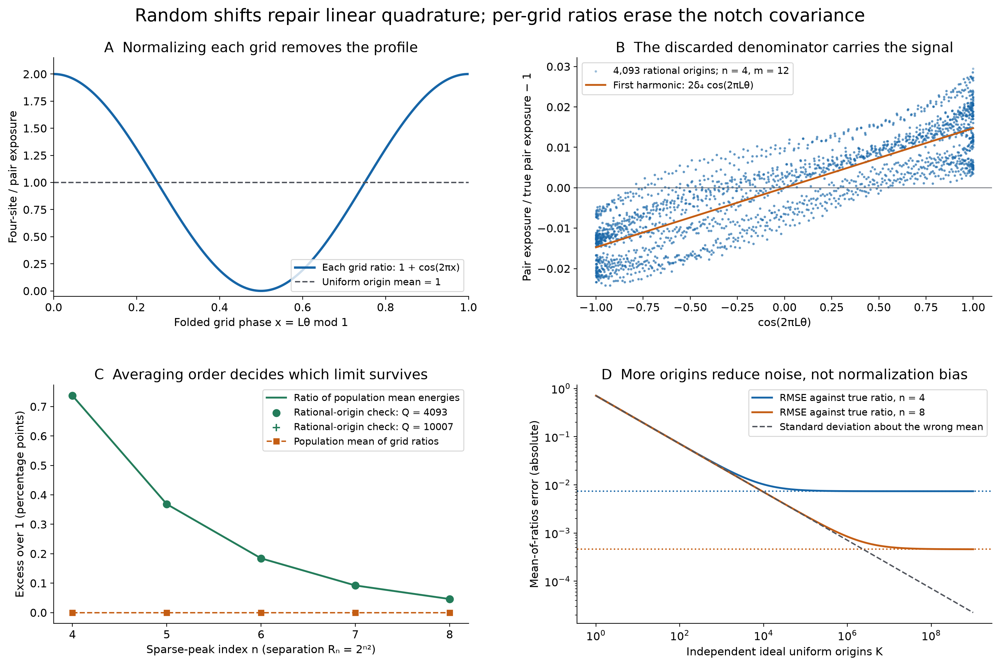

# Random grid origins and the order of normalization

## Question

Does averaging over grid origins repair the unresolved sparse-peak
measurement in [the dyadic-aliasing control](notch-dyadic-aliasing.md)?
Compare two concrete operations: average the four-site/pair ratios, or
average each energy and then divide. The representation question is
whether normalization discards the very correlation that carries the
Fourier peak.

## Construction

Use the fixed infinite positive-Fourier profile from
[ANF-196](../../analytic_frontier/findings/ANF-196-positive-fourier-notches-can-have-no-power-stability-rate.md),
with the same parameters as the preceding visualization:
\[
 b=\eta=\lambda=\tfrac14,\quad R_j=2^{j^2},\quad
 \tau(\alpha)=b(1-|\alpha|/\eta)_+,
\]
\[
 \phi(\alpha)=\frac{\tau(\alpha)}{1+\lambda}
 \left[1+\lambda\sum_{j\ge1}2^{-j}\cos(2\pi R_j\alpha)\right].
\]
The series is uniformly convergent; \(\phi\ge0\), is continuous and
compactly supported, and has nonnegative Fourier transform under
\(\widehat f(t)=\int f(\alpha)e^{-2\pi i\alpha t}\,d\alpha\).
For numerical reference use the explicit transform
\[
 T(t)=b\eta\operatorname{sinc}^2(\eta t),\qquad
 \Phi(t)=\frac{T(t)+\frac\lambda2\sum_{j\ge1}2^{-j}
 [T(t-R_j)+T(t+R_j)]}{1+\lambda},
 \quad \operatorname{sinc}(x)=\frac{\sin\pi x}{\pi x}.
\]
Fix \(r\) as the first root in \((1,3/2)\) of
\(\cos\pi r-a r\sin\pi r=0\), where
\(a=\sqrt2\pi\cot(1/\sqrt2)\). Numerically
\(r=1.057278291008855267\ldots\). This is a fixed reference pair,
**not an asserted maximizing pair** for the ANF-196 envelope.

For \(P=\{0,r\}\), \(W_n=\{0,r,R_n,R_n+r\}\), and
\(S_V(\alpha)=\sum_{x\in V}e^{-2\pi i\alpha x}\), define
\[
 f(\alpha)=\frac{\phi|S_P|^2}{2}
   =\phi(\alpha)(1+\cos2\pi r\alpha),\qquad
 H=\int f=\Phi(0)+\Phi(r),
\]
\[
 A(t)=\widehat f(t)=\Phi(t)+\tfrac12[\Phi(t-r)+\Phi(t+r)],
 \quad \Delta_n=A(R_n)>0,\quad \delta_n=\Delta_n/H.
\]
The normalized true four-site energy is \(H+\Delta_n\), so the
true four-site/pair ratio is \(1+\delta_n\).

For \(h=2^{-m}\), write
\[
 Q_{m,\theta}(g)=h\sum_{k\in\mathbb Z}g(h(k+\theta)),\qquad
 D(\theta)=Q_{m,\theta}(f),\qquad
 N_n(\theta)=Q_{m,\theta}(\phi|S_{W_n}|^2/4).
\]
The plotted meshes have \(m=12\), with \(m=13\) as a check;
\(D(\theta)>0\) for all origins in both cases. Whenever \(n^2\ge m\),
\(L=R_n h\) is a positive integer. Put
\(c_n(\theta)=\cos(2\pi L\theta)\).

The figure uses the following views:

- **A:** the exact ratio as a function of the folded phase
  \(x=L\theta\pmod1\). The curve is universal for these unresolved
  configurations, independently of the notch weights.
- **B:** \(D(\theta)/H-1\) against \(c_4(\theta)\), at the 4093
  deterministic origins \(\theta=\ell/4093\), \(0\le\ell<4093\).
  The orange line \(2\delta_4c_4\) is the exact cosine projection under
  **continuous uniform origin measure**; it is not a fitted regression
  or a claim that the conditional mean is linear. The remaining modulation
  frequencies produce the spread. The dots are discrete samples, with
  no interpolation of the infinite profile.
- **C:** the population limits of the two averaging operations for
  \(n=4,\ldots,8\). The vertical coordinate is excess over 1, multiplied
  by 100. Markers check ratios of mean energies on deterministic rational
  origin grids with 4093 and 10007 points. Lines between integer indices
  are guides to the eye.
- **D:** the exact root-mean-square error of the mean of ratios for
  \(K\) independent ideal uniform origins, at \(n=4,8\). The curves
  come from the formula below, not a Monte Carlo fit; the plotted real
  \(K\) coordinate smoothly joins the integer-sample formula.

Render at 15 by 10 inches and 200 dpi, producing 3000 by 2000 pixels.
Line styles and markers supplement color. The deterministic origin
panels are checks of the construction; they are not independent random
samples, confirmation data, or estimates of a significance level.

## Observation

The factorization \(S_{W_n}=S_P(1+e^{-2\pi iR_n\alpha})\) gives
\[
 \frac{\phi|S_{W_n}|^2}{4}
   =f(\alpha)(1+\cos2\pi R_n\alpha).
\]
At the grid nodes the last cosine equals \(c_n(\theta)\). Therefore
\[
 N_n(\theta)=D(\theta)(1+c_n(\theta)),\qquad
 Z_n(\theta):=N_n(\theta)/D(\theta)=1+c_n(\theta).
\]
If \(\Theta\) is uniform on \([0,1)\), multiplication by the integer
\(L\) preserves uniform measure modulo one. Consequently
\[
 \mathbb E Z_n=1,\qquad \operatorname{Var}(Z_n)=\tfrac12.
\]
This exact law contains no profile information. For independent origins,
\(\overline Z_{n,K}\to1\) almost surely. As an estimator of the true
ratio \(1+\delta_n\), its bias and mean-square error are
\[
 \operatorname{Bias}(\overline Z_{n,K})=-\delta_n,\qquad
 \mathbb E[(\overline Z_{n,K}-(1+\delta_n))^2]
 =\delta_n^2+\frac1{2K}.
\]
The bias persists at every fixed \(n\), however many origins are used.
This is an order-of-normalization effect, not a failure of uniform random
shifts to integrate linear observables.

Indeed, changing variables on the grid cells proves directly that
\[
 \int_0^1 Q_{m,\theta}(g)\,d\theta=\int_{\mathbb R}g(\alpha)\,d\alpha
\]
for these compactly supported integrands. No Poisson-summation regularity
assumption is needed. Thus
\[
 \mathbb E D=H,\quad \mathbb E N_n=H+\Delta_n,\quad
 \operatorname{Cov}(D,c_n)=\mathbb E[D c_n]=\Delta_n.
\]
The original signal is exactly a denominator–phase covariance. Dividing
within each realization removes it; energy-weighted averaging retains it:
\[
 \frac{\sum_{i=1}^K N_n(\Theta_i)}{\sum_{i=1}^K D(\Theta_i)}
 =\frac{\sum_i D(\Theta_i) Z_n(\Theta_i)}{\sum_i D(\Theta_i)}
 \longrightarrow 1+\delta_n\quad\text{almost surely}.
\]
The numerator and denominator sample means are individually unbiased.
Their finite-sample ratio is **not asserted unbiased**. Consistency here
is for fixed \(n,m\); no uniform precision or rate in the growing
separation is claimed.

Numerically, \(H\simeq0.0948985073492080\), and:

| Sparse-peak index | True ratio minus 1 | Mean of origin ratios minus 1 |
| --- | ---: | ---: |
| 4 | 0.007369205394247 | 0 |
| 5 | 0.003684602619668 | 0 |
| 6 | 0.001842301309833 | 0 |
| 7 | 0.000921150654917 | 0 |
| 8 | 0.000460575327458 | 0 |

These values describe the specified reference pair. They are not excesses
above the sharp real envelope in ANF-196.

## Robustness

The normalization and covariance identities hold for any integrable
weight for which these energies are defined and the grid denominator is
positive. In particular changing the notch amplitude cannot change the
law of \(Z_n\). This is an algebraic control for construction-imposed
universality, stronger than comparing visually similar random samples.
It does not classify nonuniform grids or all numerical estimators.

For the numerical panels, truncate the modulation sum after \(J=40\)
terms. In Fourier space the uniform omitted-tail bound is
\[
 B=\frac{\lambda T(0)}{1+\lambda}2^{-40}
 =1.13686837721616\ldots\times10^{-14}.
\]
Both \(H\) and \(\Delta_n\) have error at most \(2B\). Since their
truncated positive approximations satisfy \(H_J>0.0948\) and
\(\Delta_{n,J}/H_J<0.008\) in the displayed range, the error in
\(\delta_n\) from truncation is below \(2.5\times10^{-13}\).
Fourier references use mpmath at 100 decimal digits. This tail bound is
analytic; the arithmetic is not interval-certified.

For sampled values take \(k=-2^{m-2},\ldots,2^{m-2}-1\), covering the
support up to zero-valued endpoints. Evaluate the resolved head
\(j<\lceil\sqrt m\rceil\) directly. At rational origins
\(\theta=\ell/Q\), every remaining sampled modulation equals
\[
 \cos\left(2\pi\,
   \frac{(2^{j^2-m}\ell)\bmod Q}{Q}\right).
\]
Compute the residue by integer modular exponentiation before converting
to floating point. This avoids floating sine evaluations at enormous
arguments and does not silently replace the infinite profile by the
unshifted-grid constant alias. The omitted profile tail contributes at
most
\(\lambda2^{-40}Q_{m,\theta}(\tau(1+\cos2\pi r\alpha))/(1+\lambda)\)
to \(D\), less than \(4.6\times10^{-14}\) for either mesh using the
crude support-count bound. The infinite-profile pointwise ratio identity
itself does not require a truncation.

With NumPy double-precision quadrature, the maximum difference between
rational-origin energy-ratio excesses and the Fourier reference over
\(n=4,\ldots,8\) is approximately:

| Origin count \(Q\) | Mesh exponent \(m\) | Maximum absolute difference |
| --- | --- | ---: |
| 4093 | 12 | \(1.11\times10^{-9}\) |
| 5003 | 12 | \(1.05\times10^{-12}\) |
| 10007 | 12 | \(2.31\times10^{-14}\) |
| 4093 | 13 | \(1.11\times10^{-9}\) |

These finite differences are checks, not a monotone convergence theorem
or a universal endorsement of these origin denominators. Uniform grids
in origin space can themselves alias high frequencies. The exact
continuous-origin identity, not agreement between selected finite grids,
justifies the population limit. A direct four-site complex exponential
sum at \(n=4,m=12,\theta=137/4093\) also agrees with the factored
quadrature to below \(10^{-14}\). The means of the grid ratios agree
with 1 to below \(5\times10^{-16}\).

## Research consequence

Retain this pair as a normalization control for the sparse-notch
visualization. Randomizing the grid origin is a valid linear-integration
repair in expectation, but averaging already-normalized ratios converges
to a different, profile-independent quantity. The usable control is to
retain both energies and their joint origin dependence before forming
the final ratio. Finite sampling cost remains a separate question.

This is a classical estimator distinction specialized to the source
construction. Cranley and Patterson,
[Randomization of Number Theoretic Methods for Multiple Integration](https://doi.org/10.1137/0713071),
*SIAM Journal on Numerical Analysis* 13:6 (1976), 904–914, introduce the
random-shift framework. L'Ecuyer and Lemieux,
[Variance Reduction via Lattice Rules](https://www.gerad.ca/papers/G-99-46.pdf),
GERAD G–99–46, §4, Propositions 3–4, give unbiasedness and Fourier-variance
formulas. The identities used here are derived directly above. No new
randomized quadrature theorem is claimed.

The resolved question concerns representation and averaging order; it
needs neither a new proposed clue nor a new canonical finding. ANF-196
remains the canonical source for its no-power stability result. This
image does not establish its maximizing root, change its envelope, give
a new source-excess bound, or imply anything about RH.
