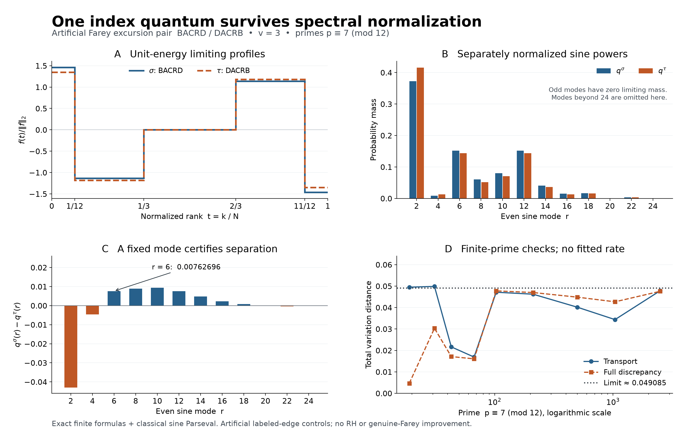

# One index quantum survives spectral normalization

## Question

Does the six-rank, one-quantum Farey pair from
[FD-333](../../farey_discrepancy/findings/FD-333-one-quantum-fixed-rank-farey-spectral-instability.md)
remain distinguishable after dividing each sine spectrum by its own total
energy? The raw energy difference does not answer this question. This view
fixes the source's first requested case, \(v=3,u=4\), with
\(p\equiv7\pmod {12}\), and displays both shape and probability.

## Construction

The artificial whole-excursion words are \(\sigma=BACRD\) and
\(\tau=DACRB\). The source's genuine five blocks have gap counts
\((a,b,h,b,a)\). With \(N=\sum_{q\le p}\varphi(q)\),
\(i=(p+1)/4\), \(j=(p-1)/3\), define
\[
x=a/N-(i-1)/p,\quad y=b/N-(j-i)/p,\quad z=h/N-(p-2j)/p.
\]
The finite transport heights, repeated on lengths \((1,b,a,h,a,b)\), are
\((0,x,-y,0,y,-x)\) and
\((0,x+y+z,-y,0,y,-x-y-z)\), respectively. Use ranks
\(1\le k<N\) and the orthonormal type-I DST
\(\widehat w_r=\sqrt{2/N}\sum_k w_k\sin(\pi rk/N)\).
The probability of mode \(r\) is \(|\widehat w_r|^2/\|w\|_2^2\).

- **A:** The limits of \(p w\) have heights
  \((A,-7/12,0,7/12,-A)\) on intervals with endpoints
  \((0,1/12,1/3,2/3,11/12,1)\). Here \(A=3/4\) for sigma and
  \(A=2/3\) for tau. Each displayed profile is divided by its own
  \(\sqrt{E_A}\), where \(E_A=A^2/6+49/288\).
- **B:** For even \(r=2,4,\ldots,24\), show
  \(q_A(r)=8[A-(A+7/12)\cos(\pi r/12)+(7/12)\cos(\pi r/3)]^2/
  (\pi^2r^2E_A)\). Odd limiting modes vanish. The displayed modes are
  not renormalized after truncation; the full infinite law has mass one.
- **C:** Show the signed difference of the same probabilities, including
  its mode-6 witness \(2716/(36081\pi^2)\).
- **D:** Show full-spectrum distances at primes
  \(19,31,43,67,103,211,499,1039,2503\). Both finite vectors retain all
  \(N-1\) modes, including finite transport's small odd-mode mass.
  The dotted line is the exact finite-series reduction of the limiting
  distance in [VIS-461, equation (9)](../findings/VIS-461-one-quantum-farey-pair-retains-normalized-spectral-separation.md),
  approximately \(0.0490847588\). Lines between primes guide the eye;
  they are not interpolation or a rate fit.

The following deterministic procedure reproduces the finite inputs.
Generate order-\(p\) Farey numerator/denominator pairs from
\((a,b,c,d)=(0,1,1,p)\) using
\(k=\lfloor(p+b)/d\rfloor\) and
\((a,b,c,d)\leftarrow(c,d,kc-a,kd-b)\).
Find the ranks of the vertices
\(1/p,i/p,j/p,(p-j)/p,(p-i)/p,(p-1)/p\).
The intervals between these ranks partition the directed gaps into the
five original blocks. Reorder the **same edges**, keeping the first and
last outer gap fixed. The full reconstructed discrepancy at output rank
\(k\) equals the genuine discrepancy at the original right-endpoint
rank of its incoming edge plus the indicated transport shift. This
formula avoids summing millions of floating gaps; exact rational gap
summation independently checks it at the three smallest primes.

Rendering uses Matplotlib, 15 by 9.5 inches at 200 dpi, producing a
3000 by 1900 PNG. Blue solid and orange dashed encodings distinguish the
words without relying only on color. Probability axes are linear;
only the prime axis in D is logarithmic.

## Observation

The normalized profiles and their spectral laws remain distinct. The
largest displayed signed residual is at mode 2; mode 6 was chosen for
its simple exact rational-over-\(\pi^2\) certificate. The small-prime
values are visibly nonmonotone. For example:

| Prime | Transport TV | Full-discrepancy TV | Signed transport mode-6 difference |
| --- | --- | --- | --- |
| 19 | 0.0494819 | 0.0046610 | -0.0075966 |
| 103 | 0.0471340 | 0.0477659 | 0.0071403 |
| 2503 | 0.0478382 | 0.0475740 | 0.0074172 |

The theorem gives a positive limiting distance, not positivity of every
finite signed witness or monotone approach to the limit.

## Robustness

Exact rational reconstruction at \(p=19,31,43\) checks every transport
coordinate, all six common defect ranks and the exact one-quantum value
difference. Direct sine matrices agree with the DST within
\(4\cdot10^{-15}\). Complete finite spectral masses agree with one within
\(10^{-13}\). Multiplying a transport by \(-3\) preserves its normalized
spectrum within \(3\cdot10^{-14}\) per mode; amplitude and global sign
therefore cannot explain the retained difference.

The limiting comparison uses exact integration, its own Parseval energy
for each word, and a uniform \(C/r^2\) probability tail. It does not
infer infinite-frequency separation from a cropped spectrum. The full
reassembled discrepancy inherits the limiting law by norm continuity
and the source's \(o(1)\) residual; no residual rate is assumed. Finite
transport odd modes need not vanish exactly, whereas reflection removes
full-discrepancy odd modes. This distinction is retained in panel D.

The contrast with the boundary-localized five-defect pair of
[VIS-460](../findings/VIS-460-five-defect-rank-pair-has-inverse-prime-spectral-separation.md)
is a change of mathematical family, not a change of colormap or scaling.
Prior-art anchors and the source's continuum normalization inconsistency
are documented in VIS-461. This is a deterministic exploratory rendering
of a proved comparison; there is no sampled null ensemble or statistical
significance claim.

## Research consequence

[VIS-461](../findings/VIS-461-one-quantum-farey-pair-retains-normalized-spectral-separation.md)
proves distinct limiting normalized spectra and their transfer to the full
artificial discrepancy, resolving the specified \(v=3\) test in the
[one-quantum clue](../clues/CLUE-one-quantum-farey-normalized-spectral-separation.md).
The image supports inspection; the finding's formulas and tail argument
are the evidence. Other fixed \(v\), uniform rates and arbitrary spectral
pushforwards remain outside this result. These are labeled-edge controls,
not competing genuine Farey sequences; no RH consequence follows.
