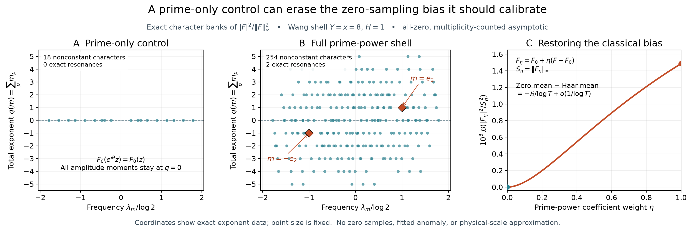

# Prime-only shell controls can erase the classical zero-sampling bias

## Question

Does deleting higher prime powers preserve the classical lower-order
zero-sampling baseline of a Wang ratio shell? The prior
[character-boundary view](zero-ordinate-character-boundaries.md) showed
the resonance cost. This view asks whether the observable can actually
see that cost, using exact character geometry rather than frequency
magnitude alone. The canonical derivation is
[VIS-463](../findings/VIS-463-prime-only-shell-symmetry-erases-zero-resonance-bias.md).

## Construction

Use \(Y=x=8\), \(H=1\) and prime powers
\(q,r\in\{2,3,4,5,7,8,9,11,13,16\}\). Retain ordered pairs with
\(8<\max(q,r)\le16\), \(1/2<q/r<2\), and \(q\ne r\).
For \(q=p^k,r=s^l\), the shell character is \(z_p^kz_s^{-l}\)
with coefficient
\[
 b_{q,r}=a_qa_r e^{-i\lambda/2}\operatorname{sinc}(\lambda/2),
 \quad \lambda=\log(q/r),\quad
 a_q=\frac{\Lambda(q)}{\sqrt q}\min(q/8,8/q).
\]
All sinc factors are positive. The common point \(z_p=p^{i/2}\)
aligns all coefficients, giving the exact supremum \(S=\sum|b|\).
The prime-only control \(F_0\) retains only pairs with \(k=l=1\)
and uses its own exact supremum \(S_0\).

Panels A and B expand respectively \(|F_0|^2/S_0^2\) and
\(|F|^2/S^2\), grouping equal exponent vectors. A nonconstant
character \(m\) is plotted at
\[
 (\lambda_m/\log2,\ q(m)),\qquad
 \lambda_m=\sum_pm_p\log p,\quad q(m)=\sum_pm_p.
\]
Point size is constant and does not encode coefficient magnitude.
Orange diamonds mark exactly the vectors \(m=ke_p\), \(k\ne0\),
which are the classical prime-power resonances. The prime-only square
has 18 nonconstant characters, the full square 254, with two exact
resonances \(\pm e_2\). Nonzero total exponent is necessary but
not sufficient for this resonance; the colors use the full exponent
vector, not only the plotted coordinates. The constant is omitted.

Panel C uses \(F_\eta=F_0+\eta(F-F_0)\) on 301 equally spaced
\(\eta\in[0,1]\). Coefficient alignment gives
\(S_\eta=S_0+\eta(S-S_0)\). For this finite bank, both factors in
each resonant collision lie in the removed subpolynomial, so
\[
 \mathcal B(|F_\eta|^2/S_\eta^2)
 =\mathcal B(|F|^2/S^2)
       \left(\frac{\eta S}{S_0+\eta(S-S_0)}\right)^2.
\]
Here \(\mathcal B(P)=\sum_{p,k\ne0}c_{ke_p}(\log p)p^{-|k|/2}\).
Numerically \(S=3.867553796991105\),
\(S_0=1.685379460493184\), and
\(\mathcal B(|F|^2/S^2)=0.001485659816910\).
The displayed ordinate is multiplied by \(10^3\). For each fixed
\(\eta\), VIS-463 proves that the all-zero, multiplicity-counted
mean minus its own Haar mean is
\(-\mathcal B/\log T+o(1/\log T)\).

This is a 16 by 5.5 inch figure at 200 dpi, yielding 3,200 by 1,100
pixels, rendered with NumPy 2.5.4 and Matplotlib 3.11.2. It uses no
zero dataset, random sample, simulation fit or estimated significance.
The finite shell and interpolation illustrate an exact obstruction;
they are not a confirmation panel for an empirical anomaly.

## Observation

The prime-only bank lies entirely in the hyperplane \(q(m)=0\).
Its common-phase symmetry excludes every nonzero coordinate axis.
The full shell reaches two such axes already at the first squared
amplitude moment. Its bias coefficient is positive, so the classical
zero-sampling shift is negative. Interpolating the removed coefficients
restores that shift continuously despite exact supremum normalization.
The two controls have different Haar laws; each displayed bias is
relative to its own law.

## Robustness

Reduced-fraction enumeration of \((q/r)/(s/t)\) and independent
prime-exponent convolution agreed on every grouped character and
coefficient to \(10^{-14}\). At 17 deterministic torus points,
the grouped polynomial agreed with direct squared evaluation to
\(2.3\times10^{-16}\). Midpoint coefficient alignment was checked
to \(3.4\times10^{-17}\). The interpolation formula was compared
with direct convolution at \(\eta=0,1/8,1/4,1/2,3/4,1\), with
absolute discrepancy below \(10^{-16}\).

The exact prime-only exclusion was also checked at dyadic heights
\(16,32,64\), but its validity for every height and all fixed mixed
moments follows from circle averaging, independently of these checks.
Prime-coordinate permutation leaves both total exponent and resonance
membership unchanged. Reversing all frequencies conjugates coefficients
and preserves the real functional. An arbitrary phase translation can
change the full-shell bias; this is why the canonical coefficient phase
was retained. The picture is not a claim of translation-invariant bias.

Neither raster resolution nor point overlap decides resonance: exact
integer exponents and rational ratios do. The finite-shell sign follows
from a positive formula in VIS-463. The temporary PNG was closed,
verified and fully loaded with Pillow, then visually inspected before
atomic installation; staged and exact published blob bytes are checked
against its SHA-256 identity.

## Research consequence

[VIS-463](../findings/VIS-463-prime-only-shell-symmetry-erases-zero-resonance-bias.md)
retains the coefficient-resolved classical bias and improves the
sufficient fixed-moment remainder after subtracting it. The prime-only
symmetry kills that term, while the full coefficient bank need not.
Higher-power sparsity alone therefore cannot justify dropping those
terms at the \(1/\log T\) resolution. The finding gives a normalized
Wiener perturbation bound; its usefulness at the physical Wang scale
remains unproved. No new clue or selector-anomaly claim is required.

The prime-resonant Fourier correction is classical, as in
[Ford–Meng–Zaharescu, Theorem 1 and (1.3)](https://www.ford126.web.illinois.edu/wwwpapers/FMZ.pdf).
The image supports inspection of the shell specialization; canonical
mathematical evidence lives in VIS-463, not in the plotted pattern.
