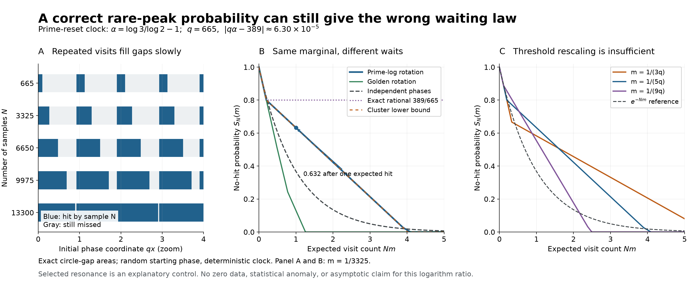

# A prime-reset clock separates peak probability from waiting time



## Question

Does calibrating the entire one-sample response law also calibrate the
waiting time to a rare peak? The answer is already negative in a
one-dimensional slice of the finite Euler–Hankel model. This view
isolates the sampling mechanism: a clock that resets one prime phase
leaves an irrational rotation in the other, whose near returns revisit
previously covered phases instead of supplying independent trials.

The [weak-prime crossover](euler-hankel-weak-prime-crossover.md)
concerned changing the response coefficients under the correct Haar
law. Here the response and its one-time law are held fixed while the
temporal dependence changes. The specific resonance is selected to
explain a failure mode, not to test an arithmetic anomaly.

## Construction

For \(n\in\{2,4,3\}\), take \(\varepsilon=r=0.01\),

\[
 c_2=(\log2)2^{-1-\varepsilon},\quad
 c_4=(\log2)4^{-1-\varepsilon},\quad
 c_3=(\log3)3^{-1-\varepsilon},\qquad
 f_n(u)=c_n e^{-r(\log n-u)}1_{[0,\log n]}(u).
\]

The real positive inner products are

\[
 K_{nm}=\frac{c_nc_m}{2r}
 \left(e^{-r|\log n-\log m|}-e^{-r(\log n+\log m)}\right).
\]

Use \(R(z,w)=\|zf_2+z^2f_4+wf_3\|_2^2\), and sample at

\[
 h_j=\frac{2\pi j}{\log2},\quad z_j=2^{-ih_j}=1,\quad
 w_j=e^{2\pi i x}3^{-ih_j}=e^{2\pi i(x-j\alpha)},\quad
 \alpha=\frac{\log3}{\log2}-1,\quad j=0,1,\ldots .
\]

Here \(x\sim\mathrm{Unif}(\mathbb R/\mathbb Z)\) is chosen **once**.
This is the Haar ensemble on the section \(z=1\), not Haar on the
full two-torus and not a claim about a canonical initial height. In
particular, the unshifted arithmetic start \(x=0\) hits the maximum at
sample zero. No observed zero ordinates or Gram points enter the view.

Set \(A=K_{2,3}+K_{4,3}\simeq0.15253647055\). The deficit from the
maximum is exactly

\[
 D_j=R_{\max}-R(1,w_j)=4A\sin^2\!\bigl(\pi(x-j\alpha)\bigr).
\]

For \(0<m<1\), choose the threshold

\[
 t_m=4A\sin^2(\pi m/2).
\]

Then \(D_j\le t_m\) precisely when

\[
 x\in I_m+j\alpha,\qquad I_m=[-m/2,m/2]\pmod1.
\]

Each sample has hit probability \(m\), and the expected number of hits
in the first \(N\) samples is \(Nm\). Define the *forward no-hit*
probability, including sample zero, by

\[
 S_N(m)=\Pr\{D_j>t_m\text{ for }0\le j<N\},\qquad S_0(m)=1.
\]

The irrationality of \(\alpha\) follows from unique factorization:
a rational logarithm ratio would give \(3^b=2^a\) for positive
integers. Its convergents include \(31/53,179/306,389/665\); the next
denominator is 15601. For the main rendering, take

\[
 q=665,\quad \delta=|q\alpha-389|
 \simeq0.0000629795688606667364,\quad m=1/(5q)=1/3325.
\]

Panel A displays the exact hit intervals in the initial-phase window

\[
 0\le qx\le4,\qquad N\in\{q,5q,10q,15q,20q\}.
\]

This is a zoom, not the integration domain. Panel B uses the full
circle and compares the rotation with independent uniform phases,
the golden rotation \((\sqrt5-1)/2\), and the rational rotation
\(389/665\). All start uniformly and have **the same full one-sample
deficit law**, hence the same one-time moments and peak probability.
Only the dependence between samples changes. The rational control is
an intentionally non-ergodic surrogate, not an admissible prime-log
ratio.

Panel B evaluates 901 equally spaced integer-rounded \(N\)-values
from 0 to 16625, with the five displayed multiples of \(q\) added.
Panel C uses \(m=1/(dq)\) for \(d=3,5,9\), each at 701
integer-rounded counts from 0 to \(5/m\). Connecting lines aid
inspection; \(N\) is discrete. Its dashed exponential is the
small-\(m\) independent reference, whereas Panel B uses the exact
independent probability \((1-m)^N\).

The PNG is 3200 by 1340 pixels, exported at 16 by 6.7 inches and
200 dpi with NumPy 2.5.4 and Matplotlib 3.11.2. Every probability is a
deterministic interval area; there is no Monte Carlo, fitted exponent,
held-out sample, or significance test.

## Observation

Let \(g_1,\ldots,g_N\) be the cyclic gaps between the sorted distinct
points \(\{j\alpha\pmod1:0\le j<N\}\). The exact survival law is

\[
 \boxed{S_N(m)=\sum_{i=1}^N(g_i-m)_+.}                 \tag{1}
\]

Indeed, equal intervals of length \(m\) cover \(m/2\) from each end
of each gap. Its uncovered portion has length \((g_i-m)_+\).
Summing gives (1), including wraparound and overlaps. No
independence approximation is involved. In particular, complete
coverage occurs exactly when the largest gap is at most \(m\).

The long nearly linear segment in Panel B has an elementary
near-rational explanation. Write \(j=s+\ell q\), \(0\le s<q\).
Within one residue class, successive interval centers move by signed
distance \(q\alpha-389\) on the circle. If that class contributes
\(L_s\) samples, the union of its intervals has length at most
\(m+(L_s-1)\delta\): project the corresponding interval hull from
the line onto the circle. Overlap or wrapping can only reduce its
measure. For \(N\ge q\), all \(q\) classes occur and
\(\sum_s(L_s-1)=N-q\), so

\[
 \boxed{S_N(m)\ge[1-qm-(N-q)\delta]_+.}               \tag{2}
\]

For \(N<q\), the ordinary union bound gives \(S_N(m)\ge[1-Nm]_+\).
Equation (2) is valid for any integer \(q\ge1\) with
\(\delta=\|q\alpha\|_{\mathbb R/\mathbb Z}\); a convergent merely
helps make it informative. It need not be an equality when clusters
overlap. In particular, it is strictly below the plotted exact tail
near \(N=13300\).

Some numerical values of (1) are:

| \(N\) | \(Nm\) | Prime-log rotation | Independent phases | Golden rotation |
| ---: | ---: | ---: | ---: | ---: |
| 665 | 0.2 | 0.800000 | 0.818706 | 0.800000 |
| 3325 | 1 | 0.632474 | 0.367824 | 0.130413 |
| 6650 | 2 | 0.423067 | 0.135295 | 0 |
| 9975 | 3 | 0.213660 | 0.049765 | 0 |
| 13300 | 4 | 0.012361 | 0.018305 | 0 |
| 16625 | 5 | 0 | 0.006733 | 0 |

Thus after one expected hit the missed fraction is about 0.632, even
though every one-time response statistic is exactly calibrated. It
eventually falls below the independent tail and reaches zero: the
rotation is not uniformly slower. The rational control has
\(S_N=1-\min(N,q)m\), hence the permanent floor 0.8 here. This
follows from coprimality of 389 and 665 and \(m<1/q\).

Panel C shows that even rescaling time by the exact event mass does
not collapse these finite-threshold tails. This is a statement about
the displayed thresholds, not a claimed shrinking-target limit law.

## Robustness

For reproducibility, (1) is computed by the following operation,
with the logarithm ratio first evaluated at 85 decimal digits and
then converted to NumPy extended precision:

```python
points = sort((arange(N, dtype=longdouble) * alpha) % 1)
gaps = diff(concatenate((points, [points[0] + 1])))
survival = sum(maximum(gaps - m, 0))
```

Return 1 separately for \(N=0\). The matching independent control
uses `exp(N * log1p(-m))`. Panel A draws the centered intervals,
including seam-crossing copies, before clipping to the stated zoom.

Checks cover \(N=1,53,306,665,1330,3325,6650,9975,13300,16625\)
and \(m=1/(dq)\), \(d=3,5,9\):

- An independently implemented union of wrapped intervals, sorted
  and merged by endpoints, agrees with (1) within \(1.2\cdot10^{-16}\)
  absolute error.
- Translating all centers by 0.371928 changes the results by less
  than \(2.4\cdot10^{-14}\); reversing the rotation gives identical
  numerical results. Both invariances also follow directly from
  circle measure. Color and the coordinate zoom cannot alter (1).
- Recomputing all points, gaps, and probabilities using 75-digit
  decimal arithmetic at \(N=665,3325,9975,13300\), \(m=1/3325\),
  changes the results by less than \(1.3\cdot10^{-13}\).
- Equation (2) holds within \(1.8\cdot10^{-13}\) floating-point
  error. The displayed exact survival curve is nonincreasing.
- Using the earlier denominators 53 and 306 and their corresponding
  \(m=1/(5q)\), the no-hit fractions at \(Nm=1,2,3\) are respectively
  \((0.161342,0,0)\) and \((0.510882,0.414523,0.318165)\). The
  selected 665-scale behavior is not presented as universal across
  thresholds or convergents.

These are arithmetic and geometric consistency checks, not
statistical confirmations or certified interval bounds. The argument
for (1) and (2), rather than raster resolution, supplies the exact
interpretation. Positive changes to the kernel parameters merely
change \(A\) and the threshold \(t_m\) when the probability width
\(m\) is held fixed.

## Research consequence

Retain this pair as a concrete dependence control for rare-peak
sampling: a correct one-point Haar calibration does not justify an
independent-phase waiting law. For this reset clock, the entire
finite-horizon answer is the circle-gap functional (1), with (2)
giving an explicit near-resonance obstruction to rapid coverage.
The selected phase ensemble, clock, and target must all be preserved
by a null used to interpret waiting times.

The underlying mathematics is classical. N. B. Slater,
[*Gaps and steps for the sequence nθ mod 1*](https://doi.org/10.1017/S0305004100042195),
*Mathematical Proceedings of the Cambridge Philosophical Society*
63 (1967), 1115–1123, treats rotation gaps and visits to intervals.
A. Haynes and J. Marklof,
[*Higher dimensional Steinhaus and Slater problems via homogeneous dynamics*](https://people.maths.bris.ac.uk/~majm/bib/steinhaus.pdf),
§1.1, supplies a modern primary-source account of the classical
three-gap boundary. Formula (1) requires only sorting and interval
union; no three-gap classification is needed to evaluate it.
Z. Coelho and E. de Faria,
[*Limit laws of entrance times for homeomorphisms of the circle*](https://doi.org/10.1007/BF02761095),
*Israel Journal of Mathematics* 93 (1996), 93–112, studies limiting
entrance processes through continued-fraction renormalization. Its
theorem is not being asserted for this particular threshold family.

Locally, [VIS-428](../findings/VIS-428-fixed-shell-growing-supremum-uniform-saturation.md)
establishes eventual continuous-flow saturation, and
[VIS-440](../findings/VIS-440-directional-level-crossing-flux-hitting-tail.md)
shows that target mass alone misses directional crossing geometry.
This view supplies a discrete reset-clock example with the *complete*
finite-horizon tail and a near-rational cluster control. It does not
replace either continuous-time statement with a discrete one.

This is supporting exploratory context, not a new canonical finding
or a novelty claim. The bounded question is answered; no unresolved
clue is created. There is no claim about independent trials at actual
zeta zeros, finite-height transport from those zeros, the asymptotic
continued fractions of \(\log3/\log2\), the full Euler source, or RH.
