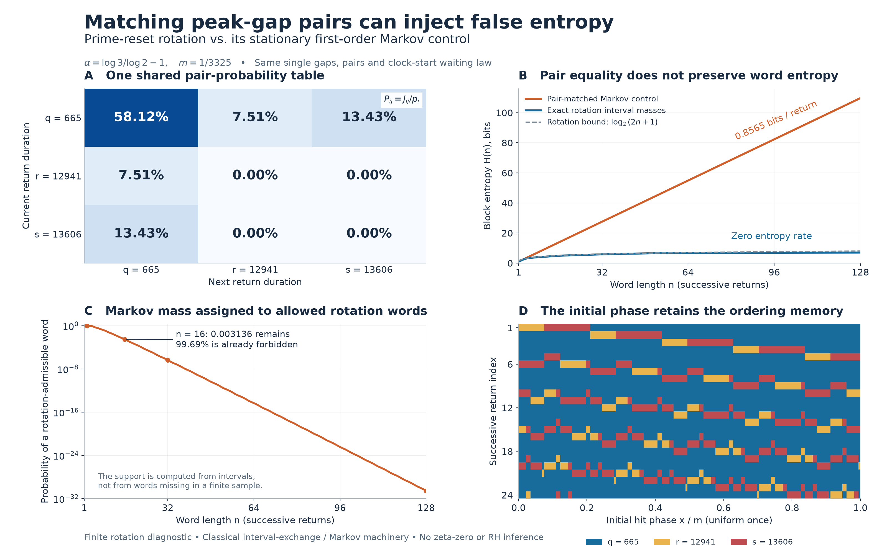

# Pair matching injects positive entropy into a zero-entropy prime clock

## Question

Does giving a surrogate the exact consecutive-gap law repair the
[matched-renewal control](prime-reset-renewal-order.md)? That control
already matches the complete single-return and stationary forward-wait
laws. Here a stationary first-order Markov control also matches **every
ordered pair of return durations**. A phase-to-word representation then
shows why the control still fails at long word lengths: it replaces an
interval exchange's linear word growth by exponential word growth.

This is a finite rotation diagnostic, with the resonance and target
width inherited from the earlier view. It is not a statistical test of
arithmetic specificity or a new general entropy theorem.

## Construction

Use normalized circle measure and
\[
f(x)=x-\alpha\pmod1,\qquad
\alpha=\log3/\log2-1,\qquad E=[0,m),\quad m=1/3325.
\]
The reset heights \(2\pi j/\log2\) fix the phase of 2 and rotate
the phase of 3. After translating the target to \(E\), take the
initial hit phase uniformly in \(E\) **once**. Let \(G\) be the
first-return map to \(E\). Write
\[
q=665,\quad r=12941,\quad s=13606=q+r,\qquad
\delta=q\alpha-389,\quad a=m+r\alpha-7570,\quad b=m-a.
\]
The independently reconstructed return partition is
\[
\begin{array}{c|c|c}
x&\tau(x)&G(x)\\\hline
[0,a)&r&x+b\\
[a,\delta)&s&x+b-\delta\\
[\delta,m)&q&x-\delta.
\end{array}                                                   \tag{1}
\]
Its images tile \(E\), so normalized length is invariant. All
intervals are half-open; null endpoints do not affect probabilities.
Define \(X_j=\tau(G^j x)\), in **return index**, not clock time.
Put \(u=a/m\), \(v=(\delta-a)/m\), and \(\ell=u+v\).
In duration order \((q,r,s)\), the marginal and pair laws are
\[
p=(1-\ell,u,v),\qquad
J=\begin{pmatrix}1-2\ell&u&v\\u&0&0\\v&0&0\end{pmatrix}.       \tag{2}
\]
Both margins of \(J\) equal \(p\). The control is the stationary
Markov chain with initial law \(p\) and transition matrix
\[
P_{ij}=J_{ij}/p_i.                                             \tag{3}
\]
This is a realizable, nondegenerate probability model. It also has
a stationary clock-time realization: replace duration \(i\) by
levels \((i,j)\), \(0\le j<i\), advance one level per clock step,
and at the last level choose the next duration using row \(i\) of
\(P\). Give each level mass \(mp_i\). The identity
\(m\sum_i ip_i=1\) normalizes these masses, and
\(\sum_i mp_iP_{ik}=mp_k\) proves stationarity at level zero.
Conditioned on a hit, its gap law is precisely (3).

Consequently the same tower count as in the
[length-bias view](prime-reset-return-length-bias.md) gives both
models the complete zero-inclusive forward-wait tail
\[
\Pr(T\ge N)=m\sum_i p_i(i-N)_+,\qquad N\ge0.                  \tag{4}
\]
No equality of the full complex Euler-response process is asserted.

For a word \(w=(w_0,\ldots,w_{n-1})\), let
\[
C_w=\{x\in E:X_0=w_0,\ldots,X_{n-1}=w_{n-1}\},\quad
R_n(w)=|C_w|/m,\quad
M_n(w)=p_{w_0}\prod_{j=0}^{n-2}P_{w_jw_{j+1}}.
\]
Let \(\mathcal L_n=\{w:|C_w|>0\}\). Compute these cylinders
by interval intersection, not by observing a finite orbit.

Panel A displays the common \(J\), with a fixed color scale
\([0,0.65]\) and labeled probabilities. Panel B compares Shannon
block entropies in bits for every integer \(1\le n\le128\).
Panel C shows \(M_n(\mathcal L_n)\) on a logarithmic vertical
axis. Panel D colors \(X_j\) over the entire initial coordinate
\(x/m\in[0,1)\) for \(j=0,\ldots,23\); each colored rectangle
is an actual cylinder interval, not a phase-grid sample.

The PNG is 3200 by 2000 pixels, exported at 16 by 10 inches and
200 dpi with NumPy 2.5.4 and Matplotlib 3.11.2. Connecting strokes
in B and C interpolate integer word lengths only.

## Observation

The exact pair match conceals a persistent difference in word growth.
A length-\(n\) cylinder is an interval on which \(G^n\) is a
translation. Refining to length \(n+1\) cuts it only where its
image crosses \(a\) or \(\delta\). Since \(G^n\) is bijective,
each of those points has at most one preimage across all cylinders.
Starting with three intervals, induction gives
\[
|\mathcal L_n|\le2n+1,\qquad
H_R(n)\le\log_2(2n+1),\qquad \lim_{n\to\infty}H_R(n)/n=0.    \tag{5}
\]
No genericity or infinite distinct-orbit assumption is needed for
this **upper bound**. In the displayed finite calculation the count
is exactly \(2n+1\) through \(n=128\); equality at all lengths
is not needed or inferred from that calculation.

By contrast, the control's only forbidden adjacent pairs are two
long gaps. Its allowed-word count is
\((2^{n+2}-(-1)^n)/3\). This follows from the recurrence
\(c_n=c_{n-1}+2c_{n-2}\), \(c_1=3,c_2=5\). Its entropy is
\[
H_M(n)=H(p)+(n-1)h_M,\qquad
h_M=-\sum_{ij}J_{ij}\log_2P_{ij}
       \simeq0.856523379>0.                                   \tag{6}
\]
Zero terms are omitted. The nontrivial row out of \(q\) makes
the entropy rate strictly positive.

This support discrepancy also has an all-length bound. Put
\(\beta=\max_j P_{qj}<1\). Every allowed control word has at
least \(\lfloor(n-1)/2\rfloor\) transitions out of \(q\),
because every long duration must be followed by \(q\). Hence
\[
M_n(\mathcal L_n)
 \le (2n+1)\max_i p_i\,\beta^{\lfloor(n-1)/2\rfloor}
 \longrightarrow0.                                         \tag{7}
\]
Thus the control eventually places almost all its mass outside the
rotation's word support, despite the exact pair match. This is a
support statement, not a conclusion drawn from the plotted slope.

| Word length | Rotation words | Rotation entropy, bits | Markov entropy, bits | Markov mass on rotation words |
| ---: | ---: | ---: | ---: | ---: |
| 2 | 5 | 1.794031 | 1.794031 | 1 |
| 3 | 7 | 2.539214 | 2.650554 | 0.944534 |
| 16 | 33 | 4.840878 | 13.785358 | 0.00313601 |
| 32 | 65 | 5.826564 | 27.489732 | \(4.62271\times10^{-7}\) |
| 128 | 257 | 6.998025 | 109.715977 | \(2.84235\times10^{-31}\) |

The pair match also gives the exact identity
\[
D_2(R_n\Vert M_n)=H_M(n)-H_R(n),                              \tag{8}
\]
where \(D_2\) uses base-two logarithms. Indeed, the expectation
of \(-\log_2 M_n\) under \(R_n\) depends only on its initial
marginal and adjacent-pair marginals, which equal those of \(M_n\).
This is an implementation cross-check and another description of
the same discrepancy, not independent evidence. Likewise,
\(1-M_n(\mathcal L_n)\) is a lower bound on total variation,
not generally its exact value.

## Robustness

The first-return partition was rebuilt from uncovered \([0,m)\):
for successive integers \(k\ge1\), intersect its remaining pieces
with \([k\alpha,k\alpha+m)\pmod1\), assign the newly covered
pieces return duration \(k\), and remove them. Stop only when
nothing remains. This recovers (1), verifies its image tiling, and
verifies \(\sum_i i|E_i|=1\) algebraically.

All coordinates are stored as \(c+k\alpha\), with rational
\(c\). Signs and floor decisions are certified using
\[
L_d=2\sum_{j=0}^{109}\frac{x_d^{2j+1}}{2j+1},\qquad
U_d=L_d+\frac{2x_d^{221}}{221(1-x_d^2)},\qquad
x_d=(d-1)/(d+1),\quad d=2,3.
\]
Then \(L_3/U_2-1<\alpha<U_3/L_2-1\). Outward rounding to
denominator \(10^{75}\) gives an enclosure of width less than
\(5.17\times10^{-69}\). Every required affine comparison is
resolved on that enclosure; identical affine pairs are recognized
exactly. No undecided comparison is replaced by a floating-point
sign.

For reproducibility, refine a cylinder stored as
\(([l,h),o,w)\), meaning \(G^n(x)=x+o\) there, by each branch
\(([L_i,H_i),o_i,i)\) of (1): retain
\[
[l',h')=[l,h)\cap[L_i-o,H_i-o),
\quad o'=o+o_i,\quad w'=wi
\]
when the intersection has positive length. Begin with
\(([0,m),0,\varnothing)\). All depth-\(n\) lengths sum exactly
to \(m\); the row and column sums of the depth-two lengths equal
the depth-one lengths exactly. Repeating for \(G^{-1}\) through
length 32 gives the identical probabilities on reversed words.
Target translation is an exact conjugacy. Permuting duration labels
changes neither entropy nor allowed-word mass.

The same calculation at widths \(1/1995\) and \(1/5985\),
through length 32, gives:

| Target width | Return durations | Markov entropy rate, bits/return | \(M_{16}(\mathcal L_{16})\) |
| --- | --- | ---: | ---: |
| \(1/1995\) | 665, 10946, 11611 | 0.644230254 | 0.0248924 |
| \(1/3325\) | 665, 12941, 13606 | 0.856523379 | 0.00313601 |
| \(1/5985\) | 665, 14271, 14936 | 0.900387858 | 0.00222152 |

All three have the sparse pair support used in (7). This is a
threshold perturbation check, not a shrinking-target limit.
Direct 85-digit iteration of the induced map at every depth-12
cylinder midpoint verifies its entire symbolic word for each width.
Evaluating all retained cylinder lengths at 65 versus 90 digits
changes them by less than \(1.53\times10^{-59}\). Separately,
80-digit evaluations of the entropies and allowed-word masses at
lengths 3, 16, 32 and 128 where applicable agree with the plotted
values within \(10^{-12}\) absolute entropy error and
\(10^{-12}\) relative mass error. The support/zero claims come
from rational enclosures; the displayed decimal entropies and
probabilities are numerical evaluations of those certified intervals.

The phase strip is illustrative. Thin rectangles can become
subpixel, but none of the word counts, entropies, or probabilities
is computed from pixels. There is no Monte Carlo, p-value, selected
height, or untouched confirmation dataset.

## Research consequence

A first-order Markov control repairs the renewal model's pair error
but still manufactures long-order randomness. The visual separation
is explained by interval-exchange geometry before any arithmetic
interpretation: repeatedly increasing a fixed local calibration
order is not itself evidence of an exceptional prime or zeta effect.
A future multi-peak test must justify its full null at the word
length being tested or retain the actual induced dynamics.

The ingredients are classical. Sébastien Ferenczi and Luca Q.
Zamboni, [*Languages of k-interval exchange transformations*](https://academic.oup.com/blms/article-abstract/40/4/705/708659),
*Bulletin of the London Mathematical Society* 40 (2008), 705–714,
DOI `10.1112/blms/bdn051`, places linear word complexity in its
standard interval-exchange setting. The elementary cut-count proof
in (5) supplies the only complexity bound used here. Robert M.
Gray, [*Entropy and Information Theory*, corrected first edition,
§2.6](https://ee.stanford.edu/~gray/it1_corrected_6-23.pdf), gives
the stationary Markov approximation and relative-entropy framework;
(6) and (8) are direct finite-alphabet specializations. The
[earlier renewal view](prime-reset-renewal-order.md) supplies the
rotation-return and stationary-tower literature boundary.

This view adds the explicit pair-matched process and its phase-to-word
support diagnostic to that finite prime-clock example. It does not
claim a new theorem about interval exchanges, Markov approximation,
or entropy. It also does not rule out useful approximations with
growing memory, quantify their required memory, or establish a
zeta-zero selection anomaly, a Wang-source limit, or an RH consequence.
The PNG/Markdown pair is supporting exploratory context, not a new
canonical finding. The bounded comparison is answered; no new clue
is required.
