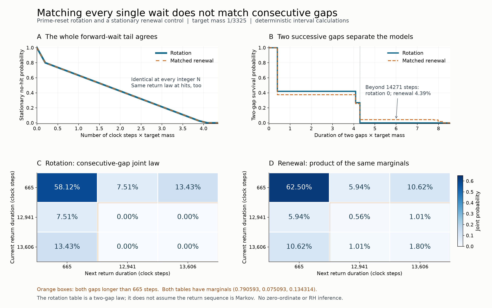

# Matching full waiting laws still leaves consecutive peak gaps uncalibrated

## Question

Does matching the **entire** hit-start return law and stationary
forward-wait law also calibrate consecutive peak gaps? The
[length-bias view](prime-reset-return-length-bias.md) shows why matching
only the mean return is insufficient. This view gives the stronger
control its full return distribution, then tests the order of two
successive returns. A realizable stationary renewal process passes
both one-wait checks exactly and still assigns positive probability
to pairs forbidden by the prime-reset rotation.

This is a diagnostic of a finite rotation model, not an arithmetic
anomaly test. The resonance and threshold come from the earlier view;
there is no untouched confirmation sample or fitted statistical law.

## Construction

Use normalized circle measure, the rotation
\[
 f(x)=x-\alpha\pmod1,\qquad
 \alpha=\log3/\log2-1,\qquad E=[0,m),\qquad m=1/3325.
\]
This is the section of the
[prime-reset clock](prime-reset-clock-waiting-law.md) sampled at
heights \(2\pi j/\log2\): the phase of 2 resets while the phase
of 3 rotates. The starting phase is uniform once. The centered
rare-peak interval has been translated to \(E\), preserving all
laws. Counts below are clock steps, not physical height.

Let \(\tau(x)=\min\{n\ge1:f^n(x)\in E\}\) for a uniformly
chosen hit \(x\in E\), and let \(G(x)=f^{\tau(x)}(x)\).
The two successive gaps are \(\tau_0=\tau(x)\) and
\(\tau_1=\tau(G(x))\), without redrawing \(x\).
Put
\[
 q=665,\quad r=12941,\quad s=q+r=13606,\qquad
 \delta=q\alpha-389,\qquad a=m+r\alpha-7570,
 \qquad b=m-a.
\]
The certified first-return partition and induced map are
\[
\begin{array}{c|c|c}
 x & \tau(x)&G(x)\\\hline
 [0,a)&r&x+b\\
 [a,\delta)&s&x+b-\delta\\
 [\delta,m)&q&x-\delta
\end{array}                                                    \tag{1}
\]
with \(0<a<\delta<m/2\). Their image intervals are
\([b,m),[m-\delta,b),[0,m-\delta)\), respectively, and tile
\(E\). In particular, normalized Lebesgue measure on \(E\) is
invariant under \(G\).

Write
\[
 u=a/m,\quad v=(\delta-a)/m,\quad \ell=u+v=\delta/m,
 \qquad p=(1-\ell,u,v)
\]
in duration order \((q,r,s)\). These are the hit-start return
probabilities. Direct cancellation gives
\[
 q(m-\delta)+ra+s(\delta-a)
 =665\cdot7570-12941\cdot389=1,
\]
so \(\sum_i p_i r_i=1/m\).

The matched **renewal control** is the finite-state chain with states
\((r_i,j)\), \(0\le j<r_i\). Advance deterministically to the
next level; from the last level choose a fresh duration \(r_k\)
with probability \(p_k\) and move to \((r_k,0)\). A hit is a
visit to level zero. Initialize each state with probability
\(mp_i\), equivalently choose a duration with probability
\(mr_i p_i\) and then choose its level uniformly. This probability
law is invariant: each nonzero level receives its predecessor's
mass \(mp_i\), and level \((r_i,0)\) receives
\(p_i\sum_k mp_k=mp_i\). Thus the control is stationary in
clock time and, conditional on a hit, has independent successive
gaps with law \(p\). It is an event-process control; no equality of
the full complex Euler response process is asserted.

Panel A plots the stationary forward tail \(S_N=\Pr(T\ge N)\),
where \(T\) includes a possible hit at time zero. Both models have
\[
 S_N=m\sum_i p_i(r_i-N)_+,\quad N\ge0.              \tag{2}
\]
Their hit-start return tails also coincide. Panel A evaluates every
integer \(0\le N\le14500\); the continuous connecting strokes are
only a rendering convention.

Panels C and D show the joint probabilities of two successive gaps,
using the same color scale \([0,0.65]\), duration ordering, and
percentage labels. With \(E_i=\{x\in E:\tau(x)=r_i\}\), compute
\[
 J_{ij}=|E_i\cap G^{-1}E_j|/m;                      \tag{3}
\]
for renewal, use \(Q_{ij}=p_i p_j\). Panel B plots
\(\Pr(\tau_0+\tau_1>N)\) from these two tables at every distinct
sum of return durations, with right-continuous steps and horizontal
axis \(mN\). The table is a two-gap law, not an assumption that the
rotation's duration sequence is a Markov chain.

The PNG is 3200 by 2000 pixels, exported at 16 by 10 inches and
200 dpi with NumPy 2.5.4 and Matplotlib 3.11.2. Calculations use
interval lengths, not Monte Carlo or orbit-frequency estimates.

## Observation

The two long-return intervals together map to \([m-\delta,m)\).
Since \(m>2\delta\), that image lies inside the short-return
interval \([\delta,m)\). A long gap must therefore be followed
by the short gap. Intersecting the three images with (1) gives
\[
 J=\begin{pmatrix}
 1-2\ell&u&v\\u&0&0\\v&0&0
 \end{pmatrix},\qquad Q=pp^{\mathsf T}.              \tag{4}
\]
Both row and column marginals equal \(p\). At the displayed width,
\[
 p\simeq(0.790592934,0.075093003,0.134314063),
 \qquad \ell\simeq0.209407066.
\]
The two models agree on every single-return statistic and the
entire stationary forward tail, yet
\[
 \Pr_{\rm rotation}(\tau_0>665,\tau_1>665)=0,\qquad
 \Pr_{\rm renewal}(\tau_0>665,\tau_1>665)
 =\ell^2\simeq0.043851319.                           \tag{5}
\]
The sum of two rotation gaps is at most \(q+s=14271\), whereas
every two-long renewal pair has sum at least \(2r=25882\).
Consequently the rotation has zero probability of exceeding 14271,
while renewal has probability \(\ell^2\) at that cutoff. The
renewal plateau persists up to, but not including, 25882.

For another exact description, \((\tau_0-q)(\tau_1-q)=0\)
under the rotation. Since both marginal means are \(1/m\),
\[
 \operatorname{Cov}(\tau_0,\tau_1)=-(1/m-q)^2
 =-7075600,\qquad
 m^2\operatorname{Cov}(\tau_0,\tau_1)=-0.64.         \tag{6}
\]
Renewal has covariance zero. The total variation distance between
the ordered-pair tables is \(2\ell^2\simeq0.087702639\).
These are different summaries of the same pair-law discrepancy,
not independent confirmations.

## Robustness

The first-return partition was rebuilt rather than assumed. Start
with uncovered \([0,m)\); for each integer \(n\ge1\), intersect
the remaining pieces with \([n\alpha,n\alpha+m)\pmod1\), assign
newly covered pieces return time \(n\), and remove them. Stop only
when no piece remains. Every endpoint is stored as \(c+k\alpha\)
with rational \(c\) and integer \(k\).

All endpoint ordering and integer-part decisions use rational
enclosures. For \(n=2,3\), use
\[
 L_n=2\sum_{j=0}^{109}\frac{x_n^{2j+1}}{2j+1},\quad
 U_n=L_n+\frac{2x_n^{221}}{221(1-x_n^2)},\qquad
 x_n=(n-1)/(n+1).
\]
Then \(L_3/U_2-1<\alpha<U_3/L_2-1\). Outward rounding to
rationals with denominator \(10^{75}\) gives width less than
\(5.17\cdot10^{-69}\). Evaluating each affine difference at both
ends resolves its sign; algebraically identical endpoints are
recognized exactly. No undecided comparison is rounded away.

For each pair of partition pieces, the intersection in (3) is the
intersection of \([l_i,h_i)\) with
\([l_j-o_i,h_j-o_i)\), where \(G(x)=x+o_i\) on piece \(i\).
Exact affine arithmetic verifies that image pieces tile \(E\),
all joint row/column masses equal the marginal masses, the
return-weighted lengths sum to 1, and the covariance is exactly
\(-(1/m-q)^2\). The same checks pass under reversed rotation;
its joint table is the transpose of the original, hence identical
for these symmetric tables. Target translation is a conjugacy and
preserves these laws exactly.

The width perturbations give:

| Target mass | Return durations | Rotation two-long probability | Renewal two-long probability |
| --- | --- | ---: | ---: |
| \(1/1995\) | 665, 10946, 11611 | 0 | 0.015786475 |
| \(1/3325\) | 665, 12941, 13606 | 0 | 0.043851319 |
| \(1/5985\) | 665, 14271, 14936 | 0 | 0.142078275 |

All six forward/reverse partitions were certified with the same
rational enclosure. As a separate implementation check, direct
85-digit circle iteration at the midpoint of each of the five
positive pair atoms, for each displayed width, finds exactly the
two claimed hit times through the second return. Evaluating the
main partition endpoints and translations at 65 versus 90 digits
changes them by less than \(5.9\cdot10^{-61}\). These decimal
checks supplement the exact partition certificate. Rendering
rounds probabilities to floating point. The excluded pairs are
exact zeros, independent of color, table order, or pixel resolution.

The no-two-long conclusion uses \(m>2\delta\) and the stated
return partition. It is not asserted for arbitrary thresholds,
rotations, growing prime sets, or a shrinking-target limit.

## Research consequence

Even full event-gap and forward-wait calibration leaves an
independence assumption untested. A diagnostic about multiple
peaks must retain the relevant joint return law or justify a
renewal approximation. Here the induced map supplies the missing
constraint explicitly. The discrepancy is deterministic rotation
geometry, not evidence of exceptional arithmetic peak selection.

The ingredients are classical. N. B. Slater,
[*Gaps and steps for the sequence nθ mod 1*](https://doi.org/10.1017/S0305004100042195),
*Mathematical Proceedings of the Cambridge Philosophical Society*
63 (1967), 1115–1123, treats the interval-return/gap structure of
irrational rotations. N. Haydn, Y. Lacroix and S. Vaienti,
[*Hitting and return times in ergodic dynamical systems*](https://www.cpt.univ-mrs.fr/~vaienti/HLV.pdf),
*Annals of Probability* 33 (2005), 2043–2050, §3, supplies the
return-tower framework relating the two marginal laws. Matthias
Winkel's [Oxford Applied Probability lecture 12, §12.1](https://www.stats.ox.ac.uk/~winkel/bs3a07l12.pdf)
describes the size-biased equilibrium construction for integer
renewal gaps. The finite-state construction above retains our
zero-inclusive hitting convention explicitly.

The additional diagnostic is the fully matched renewal control and
its forbidden-pair contrast for this prime-clock section, derived
directly in (1)–(6). No new general return-time theorem is claimed.
This PNG/Markdown pair is supporting exploratory context, not a
canonical finding. The bounded comparison is answered, so no new
clue is needed. No zero-ordinate selection, Gram-sampling anomaly,
full Euler-source limit, or consequence for RH has been established.
