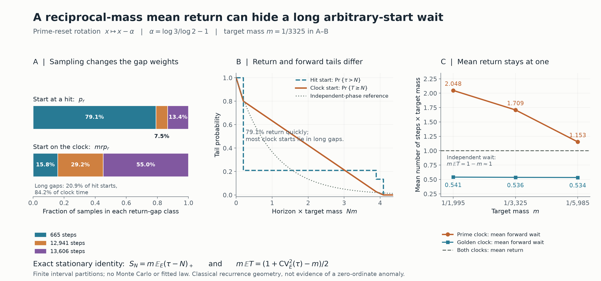

# A mean-return calibration can hide long arbitrary-start waits

## Question

Does the reciprocal-target-mass mean return certify a rare-peak
waiting-time calibration? The [prime-reset clock](prime-reset-clock-waiting-law.md)
already has an exactly calibrated one-time response law and a long
forward no-hit tail. This view isolates a further sampling trap:
starting at a hit and starting at an arbitrary stationary time weight
the same gaps differently. A mean-return check passes for both the
prime clock and the golden-rotation control, although their mean
forward waits differ substantially.

This is a finite-model diagnostic. The selected resonance explains
a failure mode; it is not an arithmetic anomaly test.

## Construction

On the unit circle use normalized Lebesgue measure and
\[
 f_\alpha(x)=x-\alpha\pmod1,\qquad
 \alpha=\frac{\log3}{\log2}-1,\qquad E=[0,m).
\]
The prime-reset sampling heights are \(h_j=2\pi j/\log2\).
They fix the phase of 2 and rotate the phase of 3 by \(-\alpha\).
The starting phase is uniform **once**; no new random phase is drawn
at later samples. Translation takes the centered target in the linked
view to \(E\) without changing any law below. In that model the
response deficit is \(4A\sin^2(\pi x)\), with
\(A=K_{2,3}+K_{4,3}>0\); threshold
\(4A\sin^2(\pi m/2)\) gives a centered target of length \(m\).
Thus changing positive kernel parameters only reparametrizes the
threshold when \(m\) is fixed.

There are two distinct initial ensembles and two time conventions:
\[
 \tau(x)=\min\{j\ge1:f_\alpha^j(x)\in E\},
       \qquad x\sim\operatorname{Unif}(E),
\]
\[
 T(x)=\min\{j\ge0:f_\alpha^j(x)\in E\},
       \qquad x\sim\operatorname{Unif}(\mathbb R/\mathbb Z).
\]
The return time \(\tau\) starts after a hit. The forward wait \(T\)
includes sample zero, so \(\Pr(T=0)=m\). Define
\(S_N=\Pr(T\ge N)\), including \(S_0=1\).
All counts are discrete numbers of reset steps, not physical height.

Panels A–B fix \(m=1/3325\). Write
\[
 \delta=665\alpha-389,\qquad
 a=m+12941\alpha-7570.
\]
The exact first-return partition, with irrelevant endpoints assigned
half-open, is
\[
 \tau(x)=
 \begin{cases}
 12941,&0\le x<a,\\
 13606,&a\le x<\delta,\\
 665,&\delta\le x<m.
 \end{cases}                                                   \tag{1}
\]
Here \(0<a<\delta<m\). Put
\(p_r=|\{x\in E:\tau(x)=r\}|/m\). Panel A compares \(p_r\)
with the stationary gap-class weights \(mrp_r\), using the same
color for the same return duration. Panel B compares
\(\Pr_E(\tau>N)\), \(S_N\), and the independent-phase reference
\((1-m)^N\) at every integer \(0\le N\le14500\). Connecting
lines in the forward curve are only a rendering convention.
For independent phases, both displayed tail conventions give
\((1-m)^N\), even though the two means differ by one step.

Panel C uses \(m=1/(665d)\), \(d=3,5,9\), comparing the prime
rotation with \(\beta=(\sqrt5-1)/2\). The independent control
has \(m\mathbb ET=1-m\); the dashed line is instead the exact
mean-return identity \(m\mathbb E_E\tau=1\) for both rotations.
The small difference is below ordinary figure resolution and is
stated explicitly rather than conflating the two expectations.

The PNG is 3200 by 1500 pixels, exported at 16 by 7.5 inches and
200 dpi with NumPy 2.5.4 and Matplotlib 3.11.2. There is no Monte
Carlo, fitted distribution, significance test, or untouched
confirmation sample. Panel C is a diagnostic perturbation, not an
estimate of a shrinking-target limit.

## Observation

The numerical probabilities from (1) are:

| Return duration \(r\) | Hit-start weight \(p_r\) | Stationary gap weight \(mrp_r\) |
| ---: | ---: | ---: |
| 665 | 0.790592934 | 0.158118587 |
| 12941 | 0.075093003 | 0.292264227 |
| 13606 | 0.134314063 | 0.549617187 |

About 79.1% of returns are short when sampling from hits. But the
other 20.9% of return gaps occupy about 84.2% of stationary clock
time. An arbitrary start therefore usually sees a long gap.

This is the classical length-bias mechanism, and it needs **no
independence of successive gaps**. To see it exactly, partition
\(E\) into \(E_r=\{\tau=r\}\). The sets
\(f^j(E_r)\), \(0\le j<r\), form disjoint return towers covering
the circle up to null sets. Each level has measure \(mp_r\).
Consequently
\[
 \sum_r mrp_r=1,\qquad \mathbb E_E\tau=1/m.            \tag{2}
\]
In a tower of height \(r\), the forward waits on its levels are
\(0,r-1,r-2,\ldots,1\). Exactly \((r-N)_+\) levels have
\(T\ge N\), also giving \(r\) at \(N=0\). Hence
\[
 \boxed{S_N=m\sum_r p_r(r-N)_+
             =m\mathbb E_E(\tau-N)_+.}               \tag{3}
\]
This identity reconstructs the entire forward tail from the full
return law. The deficiency is in the **mean-only** calibration,
not in the information content of the complete return distribution.
Summing (3) over integers \(N\ge1\) yields
\[
 \boxed{\mathbb ET=
 \frac{m}{2}\mathbb E_E[\tau(\tau-1)],\qquad
 m\mathbb ET=
 \frac{1+\operatorname{CV}_E^2(\tau)-m}{2}.}           \tag{4}
\]
The second moment is finite for these fixed interval targets.
Equations (2)–(4) are stationary recurrence identities, not claims
that the rotation is a renewal process.

For the prime clock, (1) even checks (2) by cancellation:
\[
 665(m-\delta)+12941a+13606(\delta-a)
 =665\cdot7570-12941\cdot389=1.
\]
Thus \(\mathbb E_E\tau=3325\) exactly, whereas
\(\mathbb ET\simeq5682.215829\), or
\(m\mathbb ET\simeq1.708937092\). The corresponding golden
rotation has return values \(1597,2584,4181\), the same exact
mean return 3325, and \(m\mathbb ET\simeq0.536482079\).
The independent forward mean is \(3324\).

The dependence on target width is material:

| \(m\) | Prime \(m\mathbb ET\) | Golden \(m\mathbb ET\) | Both \(m\mathbb E_E\tau\) |
| ---: | ---: | ---: | ---: |
| 1/1995 | 2.047922021 | 0.540954974 | 1 |
| 1/3325 | 1.708937092 | 0.536482079 | 1 |
| 1/5985 | 1.153370641 | 0.533702221 | 1 |

No universal ordering of all irrational rotations or all thresholds
is asserted. A uniform mean return is compatible with very different
second moments and forward waits.

## Robustness

The partition was obtained without time-series sampling. Begin with
an uncovered list containing \([0,m)\). For each integer \(n\ge1\),
intersect that list with the wrapped interval
\([n\alpha,n\alpha+m)\pmod1\). Assign newly covered pieces return
time \(n\), remove them, and stop only when the list is empty.
The algorithm tests every earlier candidate return and gives (1).
It also supplies the golden and width-perturbed partitions.

For a reproducible exact arithmetic certificate, represent every
endpoint as \(c+k\alpha\), with rational \(c\) and integer \(k\).
Enclose each logarithm using
\[
 L_n=2\sum_{j=0}^{109}\frac{x_n^{2j+1}}{2j+1},\quad
 0<\log n-L_n<
 \frac{2x_n^{221}}{221(1-x_n^2)},\quad x_n=\frac{n-1}{n+1}.
\]
With upper bounds \(U_n\), use
\(L_3/U_2-1<\alpha<U_3/L_2-1\). The interval width is less than
\(5.17\cdot10^{-69}\). For \(\beta\), let
\(b=\lfloor\sqrt{5\cdot10^{150}}\rfloor\) by exact integer
square root; the bracket
\([(b-10^{75})/(2\cdot10^{75}),
(b+1-10^{75})/(2\cdot10^{75})]\) has width
\(5\cdot10^{-76}\).

Evaluate each affine endpoint difference at both rational bounds.
All ordering decisions and integer parts of \(n\alpha\) or
\(n\beta\) resolve strictly, except algebraically identical
endpoints, which are recognized as equal. This certifies the entire
partition, rather than merely approximating its points. Exact
rational arithmetic also verifies that the piece lengths sum to
\(m\) and their return-weighted sum is the constant affine
expression 1. These checks pass for both rotations at
\((q,d)=(665,3),(665,5),(665,9),(53,5),(306,5)\), with
\(m=1/(qd)\). No undecided comparison was rounded away.

The following additional checks concern numeric evaluation and
representation, rather than providing independent evidence:

- At 65 decimal digits, (3) agrees with the separately computed
  circle-coverage expression \(\sum_i(g_i-m)_+\), where \(g_i\)
  are the cyclic gaps of the first \(N\) orbit points, to absolute
  error below \(2.1\cdot10^{-58}\). Counts checked include
  \(N=0,1,q,5q,10q,15q,20q\) and each return duration and its
  two neighbors, for all ten partitions. At 90 digits the maximum
  discrepancy is below \(2.1\cdot10^{-83}\).
- Raising precision from 65 to 90 digits changes the scaled mean
  waits by less than \(5.7\cdot10^{-58}\). Rendering rounds the
  evaluated probabilities to ordinary floating point; the displayed
  decimal values are not interval endpoints.
- Reversing either rotation preserves all return-duration weights;
  the 65-digit discrepancy is below \(1.4\cdot10^{-58}\).
  Translation of the target conjugates the system and preserves
  both laws exactly. Colors and bar ordering do not enter (2)–(4).
- The earlier widths \(1/(5\cdot53)\) and \(1/(5\cdot306)\)
  give prime scaled forward means about 0.581840219 and 1.998746608.
  Thus the selected 665-resonance is not being extrapolated across
  thresholds. The golden values there are about 0.549766257 and
  0.548417216.

## Research consequence

A rare-peak diagnostic must state whether it samples from hits or
from stationary time. Matching target mass, the full one-time
response law, and even the mean return leaves the forward mean
uncontrolled. The relevant extra quantity for that mean is the
second return moment; the full forward tail requires the full
return law via (3). This adds an explicit event-versus-time sampling
control to the earlier waiting portrait.

The recurrence mechanism is classical. Mark Kac,
[*On the notion of recurrence in discrete stochastic processes*](https://doi.org/10.1090/S0002-9904-1947-08927-8),
*Bulletin of the AMS* 53 (1947), 1002–1010, is the original mean-return
anchor. N. Haydn, Y. Lacroix, and S. Vaienti,
[*Hitting and return times in ergodic dynamical systems*](https://www.cpt.univ-mrs.fr/~vaienti/HLV.pdf),
*Annals of Probability* 33:5 (2005), 2043–2050, §1 and §3, explicitly
relate hitting and return distributions using return towers. Their
positive-time hitting convention differs from the zero-inclusive
\(T\) here; (3)–(4) were derived with that difference retained.
Neither a new recurrence theorem nor independent inter-return
sampling is claimed.

This pair is supporting exploratory context, not a canonical finding.
The bounded finite-model question is answered, so no unresolved clue
is manufactured. There is no assertion about zero-ordinate selection,
Gram sampling, a full Euler-source limit, asymptotic continued
fractions of \(\log3/\log2\), or RH.
