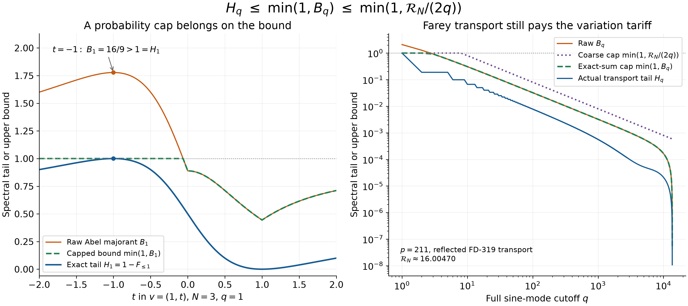

# Capping a sine-tail bound without capping its majorant

## Question

Which quantity inherits the probability ceiling when a summation-by-parts
bound estimates a normalized sine-energy tail? The comparison separates
an actual spectral fraction from its potentially loose upper bound, then
checks the surviving estimate on a concrete Farey excursion transport.

## Construction

For a real nonzero vector \(v=(v_1,\ldots,v_{N-1})\), append zero endpoints
and define
\[
T=\sum_jv_j^2,\quad V=\sum_{j=1}^{N}|v_j-v_{j-1}|,\quad
\mathcal R_N=NV^2/T,\quad
\widehat v_m=\sqrt{2/N}\sum_{j=1}^{N-1}v_j\sin(\pi mj/N).
\]
For \(1\le q<N\), the plotted quantities are
\[
H_q=\frac{\sum_{m=q+1}^{N-1}|\widehat v_m|^2}{T},\qquad
B_q=\frac{V^2}{2NT}\sum_{m=q+1}^{N-1}
\csc^2\!\left(\frac{\pi m}{2N}\right),
\]
\(\min\{1,B_q\}\), and (right panel) \(\min\{1,\mathcal R_N/(2q)\}\).

**Left:** \(N=3\), \(q=1\), \(v=(1,t)\), with 1,601 equally spaced
values of \(t\in[-2,2]\), using linear axes. The exact plotting formulas
are
\[
H_1(t)=\frac{(1-t)^2}{2(1+t^2)},\qquad
B_1(t)=\frac{2(1+|t-1|+|t|)^2}{9(1+t^2)}.
\]
The marker \(t=-1\) has \(H_1=1\) and \(B_1=16/9\).

**Right:** the reflected FD-319 transport at \(p=211\), with
\(N=\sum_{d\le p}\varphi(d)=13624\). The vector can be regenerated
directly, without numerical reconstruction of Farey gaps:
\[
v_j=\begin{cases}
1/(2p),&2\le j\le N/2-1,\\
-1/(2p),&N/2+2\le j\le N-1,\\
0,&\text{otherwise}.
\end{cases}
\]
All full-mode cutoffs \(1\le q<N\) are computed using an orthonormal
type-I discrete sine transform and reverse cumulative sums of squared
coefficients. Both axes are logarithmic in this panel. The empty terminal
tail and zero-valued tails are omitted from logarithmic drawing, never
replaced by a positive floor. The majorant uses the finite cosecant sum,
not an infinite-series approximation. Here
\(V=2/p\), \(T=(N-4)/(4p^2)\), and
\(\mathcal R_N=16N/(N-4)\approx16.00470\).

The PNG uses Matplotlib at 12.8 by 5.7 inches and 240 dpi (3072 by 1368
pixels), constrained layout, and DejaVu Sans. Blue denotes the actual
tail; orange the uncapped Abel bound; dashed green the exact-sum cap;
dotted purple the coarser variation cap. Lines and labels distinguish
the quantities independently of color. No fitted parameters, statistical
null, confirmation sample, or inferential significance is used.

## Observation

The raw majorant exceeds one on part of the exact two-coordinate family.
The probability cap therefore cannot be asserted for the raw majorant.
Taking its minimum with one yields a valid upper bound. On the reflected
Farey transport the capped bounds still control every tail; at \(q=100\),
\(H_q\approx0.0078177993\). Rank smoothness remains a sufficient mechanism
for low-frequency concentration.

## Robustness

The left marker is an exact rational counterexample, independent of pixel
resolution or sampling density. Direct sine-matrix checks covered every
nonzero ternary vector for \(2\le N\le9\) and every cutoff (73,776 cases).
A further 62,592 Gaussian-vector/cutoff checks and exact-gap Farey
reconstructions at \(p=101,211\), with reflected, unreflected and randomly
permuted complete excursions, found no violation of the capped chain
beyond \(2\cdot10^{-12}\). See the finding for the check specification.
Global nonzero rescaling and rank reversal preserve both normalized
spectra and roughness. The two panels deliberately use different axis
scales; the inequality and the exact marker do not depend on either scale.

The Farey panel shows an artificial labeled-edge excursion control's
transport, not the genuine Farey discrepancy or a calibrated arithmetic
anomaly. Its positive limiting transport energy permits the separate
VIS-447 perturbation transfer; no transfer is inferred solely from
visual similarity.

## Research consequence

[VIS-465](../findings/VIS-465-capped-variation-tariff-for-farey-transport-spectrum.md)
persists the corrected exact capped chain, the uncapped-majorant
counterexample and the Farey variation consequence. The coefficient
decay is classical bounded-variation Fourier analysis; compare
[Wu (1993)](https://www.ams.org/proc/1993-117-03/S0002-9939-1993-1150658-3/).
The mathematical result is a correction and a retained control criterion,
not a novel harmonic-analysis theorem or an RH implication. No new clue
is needed to restate the resolved cap question.
