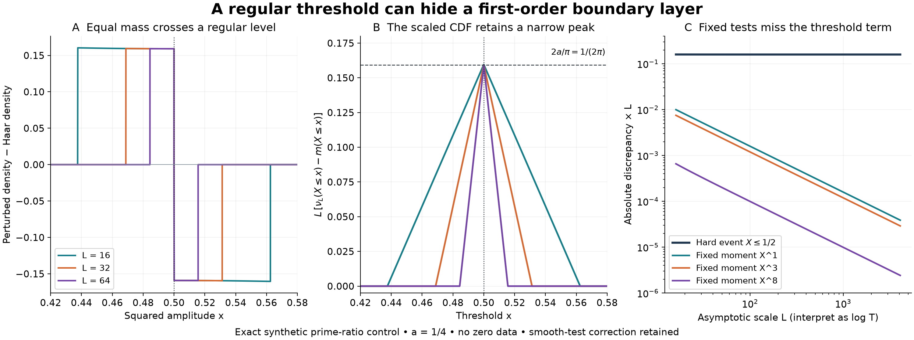

# A regular threshold can hide a first-order boundary layer

## Question

Does the fixed-test prime-axis calibration in
[VIS-463](../findings/VIS-463-prime-only-shell-symmetry-erases-zero-resonance-bias.md)
also calibrate a hard low-amplitude threshold at `1/log T` resolution?
The representation follows mass through the threshold, making the
difference between fixed smooth tests and a hard decision explicit.
The canonical negative inference result is
[VIS-464](../findings/VIS-464-smooth-zero-bias-does-not-determine-hard-threshold-correction.md).

## Construction

Use the fixed prime-only `Y=x=2, H=1` Wang ratio shell, normalized to
`X=cos^2 v`, where `v=theta_2-theta_3-log(2/3)/2`. Its Haar density
is `rho(x)=1/(pi sqrt(x(1-x)))` on `(0,1)`. Fix `a=1/4` and the
regular threshold `t=1/2`. For `L>=16`, define the signed collar

\[
 d_L(x)=\mathbf1_{(1/2-1/L,1/2)}(x)
       -\mathbf1_{(1/2,1/2+1/L)}(x).
\]

The synthetic torus law is `dnu_L=(1+h/L+a d_L(X))dm`, with
`h=-sum_{p=2,3} log p (K_{1/sqrt p}(theta_p)-1)` and
`K_r(theta)=(1-r^2)/(1-2r cos theta+r^2)`. The `h/L` term retains
the classical prime-axis correction for all fixed smooth torus tests;
its conditional common-phase average is zero. Thus the exact amplitude
marginal is simply `(1+a d_L(x))rho(x)dx`. The density is positive
and has total mass one. These laws are constructed controls; there is
no zero dataset, statistical fit, random sample or anomaly claim.

Panel A plots the marginal density difference `a d_L rho` for
`L=16,32,64`, on `0.42<=x<=0.58`. Panel B plots `L` times its
integrated CDF difference on that same fixed horizontal scale. With
`G(x)=(2/pi)arcsin(sqrt x)`, this difference is exactly

\[
 a\{G(\operatorname{clip}(x,1/2-1/L,1/2))-G(1/2-1/L)
   -G(\operatorname{clip}(x,1/2,1/2+1/L))+1/2\}.
\]

The value at `1/2`, after multiplying by `L`, tends to
`2a/pi=1/(2pi)`. Panel C compares that scaled hard-event discrepancy
with the absolute scaled discrepancies of the fixed moments
`X, X^3, X^8` on 151 logarithmically spaced `L` values from 16 to
4096. The moment discrepancies are evaluated from

\[
 a\int_0^{1/L}[(1/2-s)^r-(1/2+s)^r]\rho(1/2+s)\,ds.
\]

The construction and tested level are fixed analytically; no favorable
height window or statistic was selected from data. `L` is an
asymptotic scale, interpretable as `log T`, not a zero index.

The figure is 15 by 5.6 inches at 200 dpi, exactly 3000 by 1120 pixels,
using NumPy 2.5.4 and Matplotlib 3.11.2. Panel A uses a 1601-point
grid plus explicit jump locations; panel B uses 2001 points. Adaptive
one-dimensional quadrature uses absolute tolerance `1e-15` for the
moment curves. All axis quantities are defined independently of the
rendering grid.

## Observation

Equal positive and negative collar masses approach the same regular
level. Smooth tests almost cancel them; the hard event keeps only one
side. The unscaled CDF discrepancy tends to zero everywhere. After
scaling by `L`, it retains a peak at the fixed threshold, even though
every fixed moment's scaled discrepancy vanishes. The narrowing peak
does not indicate a singularity in the Haar amplitude density.

## Robustness

Independent integrations in phase and amplitude coordinates agreed
within `4.5e-17` for `L=16,24,32,64,128,256`, moments
`r=0,1,2,3,8`, and the hard event. The first-moment closed form
`-a(1-sqrt(1-4/L^2))/pi`, total collar mass zero, and the exact CDF
formula were also checked. Periodic quadrature verified the prime-axis
Fourier coefficients through order eight and common-phase cancellation
within `4.8e-16`. At `L=16` the full torus density has an analytic
lower bound greater than `0.353`; this bound increases with `L`.

The finding proves the same order separation with smooth odd collar
profiles, and either sign of the perturbation. Thus neither a step
density, a color choice nor unresolved raster detail is essential.
The finite tests check the drawing; the proof gives all fixed smooth
tests, all large `L`, and uniform ordinary anti-concentration.

The temporary PNG was closed, verified and fully loaded with Pillow,
then inspected at its saved resolution before atomic installation.
Every staged and exact published PNG blob is checked against the
validated SHA-256 digest and decoded again.

## Research consequence

[VIS-464](../findings/VIS-464-smooth-zero-bias-does-not-determine-hard-threshold-correction.md)
rules out deriving a `1/log T` hard-tail correction from fixed-test
asymptotics plus ordinary vanishing boundary mass. It gives a sufficient
moving-bracket condition instead. This leaves actual zero thresholds
as an arithmetic question and preserves all existing leading Haar
convergence statements. No additional clue or execution handoff is
needed for this completed inference audit.

The smooth-versus-indicator distinction already appears in
[Ford–Soundararajan–Zaharescu, §1](https://www.ford126.web.illinois.edu/wwwpapers/fsz.pdf);
the prime-axis signed density comes from
[Ford–Meng–Zaharescu, (1.3)](https://www.ford126.web.illinois.edu/wwwpapers/FMZ.pdf).
The image documents a precise countermodel in the shell geometry,
not a new theorem inferred from visual appearance.
