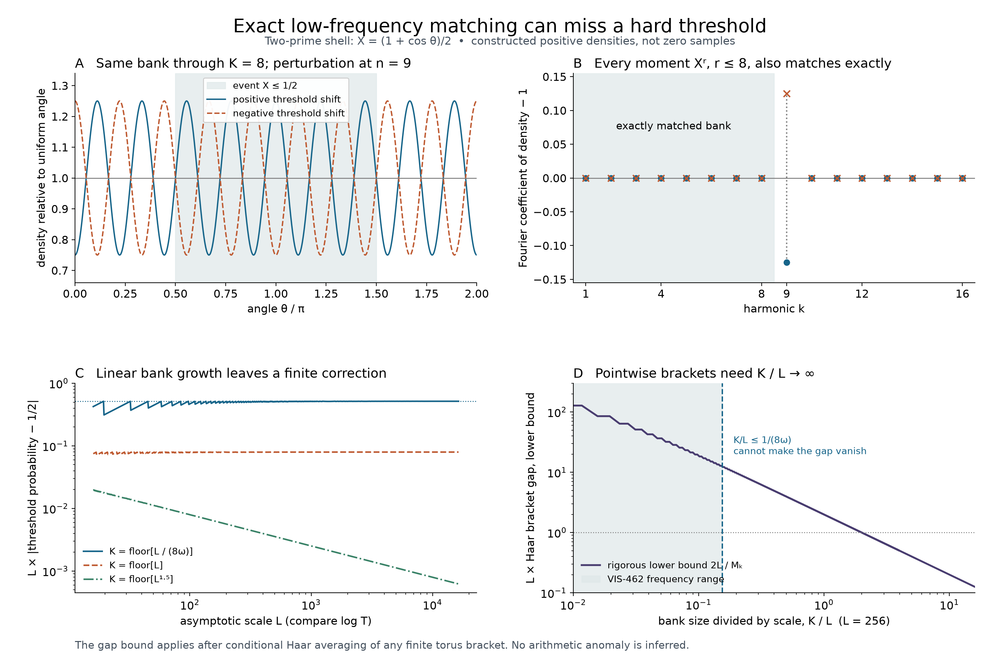

# A growing Fourier bank can miss a hard threshold

## Question

Can exact control of a growing Fourier bank repair the hard-threshold
inference failure in
[VIS-464](../findings/VIS-464-smooth-zero-bias-does-not-determine-hard-threshold-correction.md)?
The angle representation exposes which harmonics a bank sees and how
the hard event integrates a harmonic just outside it. This is a
constructed control, with no zero dataset or statistical fitting.

## Construction

For the fixed prime-only `Y=x=2, H=1` shell, set
`theta=2(theta_2-theta_3)-log(2/3)` and
`X=(1+cos(theta))/2`. Haar angle measure is `dtheta/(2pi)`.
The event `E={X<=1/2}` is the half-circle `[pi/2,3pi/2]`.
Let `a=1/4`, `omega=2log(3/2)`, `L>=16`, and let `n` be the
smallest odd integer greater than an integer bank cutoff `K>=0`.
Write `s_n=sin(n*pi/2)`.

The torus controls have densities `1+h/L ∓ a s_n cos(n theta)`,
where `h=-sum_{p=2,3} log(p)(K_{1/sqrt(p)}(theta_p)-1)` and
`K_r(u)=(1-r^2)/(1-2r cos(u)+r^2)`. This is the same classical
prime-axis signed correction as VIS-464. Its conditional mean at
fixed `theta` is zero. The plotted angle marginals are therefore
exactly `1 ∓ a s_n cos(n theta)`; the full torus laws remain positive.

Panel A uses `K=8`, `n=9`, on 5001 equally spaced angle points.
Shading marks the event. Panel B displays the exact Fourier coefficients
of the marginal density minus one for `k=1,...,16`: the only nonzero
positive-frequency coefficient is `∓a s_n/2` at `k=n`. The harmonics
through `K` and every amplitude moment through degree `K` match Haar
exactly, while the event shifts by `±a/(pi n)`.

Panel C uses 750 logarithmically spaced `L` values from 16 to 16384
and shows the exact absolute scaled shift `La/(pi n)` for
`K=floor[L/(8 omega)]`, `floor[L]`, and `floor[L^(3/2)]`.
The first limit is `8a omega/pi`, the second `a/pi`, and the third
is zero. The third curve is only a property of these constructed
controls, not sufficient evidence of threshold calibration for general
measures or for zeta zeros.

Panel D fixes `L=256` and uses `K=1,...,4096`. It plots
`2L/M_K`, where `M_K=2 ceil((K+1)/2)`. Any pointwise trigonometric
brackets of the half-circle event have Haar gap at least `2/M_K`:
their difference is nonnegative, at least one at both jumps, and
equally spaced quadrature with `M_K>K` nodes is exact. Brackets may
overshoot `[0,1]`; positivity refers to their difference. Conditional
Haar averaging extends this lower bound to arbitrary finite torus
brackets. If all physical frequencies are at most `L/8`, the averaged
degree is at most `floor[L/(8 omega)]`, the shaded range.

The image uses a 15 by 10 inch figure at 200 dpi, producing exactly
3000 by 2000 pixels with NumPy 2.5.4 and Matplotlib 3.11.2. Curves
come from the displayed formulas, not raster estimates. The parameters
were fixed from the exact construction, without confirmation-data
selection or favorable-window search.

## Observation

Both smooth densities look oscillatory and have identical low-frequency
readouts, but the same half-circle threshold separates them. Linear
growth of the bank leaves a nonzero scaled discrepancy. The independent
bracket floor shows that no choice of coefficients inside the available
physical band can make its Haar gap be `o(1/L)`.

## Robustness

Exact rational Laurent convolution of `X^r` verified 78 support checks
for `K=0,1,2,3,8,16,32`, including the first detected harmonic:
the coefficient at `±n` is zero for `r<n` and `4^(-n)` at `r=n`.
Direct adaptive angle integration checked the event shift for
`K=0,1,2,3,8,16,32,64,128` within `2.4e-16`. For
`K=0,1,2,3,8,16,32,64`, equally spaced quadrature of
`|sum_{j=0}^K b_j exp(ij theta)|^2`, with
`b_j=(sin(j+1)+i cos(2j+1))/(j+1)`, agreed with its exact constant
coefficient within `6.7e-16`. These checks validate implementation;
VIS-464 supplies the general proof.

The full torus density has the analytic lower bound `0.3532327975`
at `L=16`, improving thereafter. Reversing the perturbation reverses
the event shift. Offset amplitudes preserve the same degree bound,
and averaging extra torus coordinates does not increase the surviving
bank. This global oscillatory model has scaled residual total variation
`2aL/pi`; it does not share the bounded-variation property or convergence
against every continuous test of the separate boundary-collar model.

The PNG was rendered to temporary storage, closed, fully verified and
loaded with Pillow, then visually inspected before atomic installation.
The staged and exact remote-commit blobs must match the validated
SHA-256 identity and decode completely before publication is reported.

## Research consequence

The result strengthens the existing inference obstruction in VIS-464
without a new finding identity. Exact matching through `K=O(log T)`
does not determine a `1/log T` threshold correction. The particular
moving-bracket repair cannot be supplied solely by VIS-462's current
frequency range. Higher-frequency estimates or other arithmetic boundary
information remain necessary for that method; no zero anomaly or RH
consequence follows.

The inverse-degree interval approximation tradeoff is classical:
[Ford–Soundararajan–Zaharescu, section 2, proof of Theorem 1(ii) and Theorem 2](https://www.ford126.web.illinois.edu/wwwpapers/fsz.pdf).
The canonical finding derives the shell control and the conditional
averaging argument explicitly. No claim of a new general approximation
theorem, new selector, or need for an execution handoff is made.
