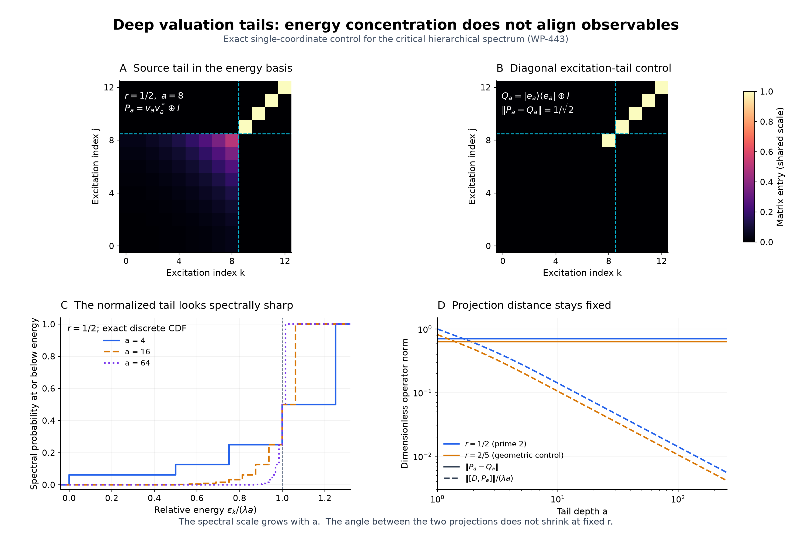

# Deep valuation tails and a persistent observable angle

## Question

Does the increasingly narrow **relative-energy** portrait of a deep
divisibility tail make it interchangeable with a diagonal excitation
tail? This tests a possible misleading visual inference from
[WP-443's critical hierarchical spectrum](../../weil_positivity/findings/WP-443-critical-valuation-energy-has-an-explicit-hierarchical-spectrum.md):
concentration near one energy scale might look like convergence of the
source observable to its integer-labelled spectral counterpart.

The view compares both observables in the same energy eigenbasis and
keeps their operator distance beside the rescaled energy picture.

## Construction

Use one coordinate of WP-443, with geometric probability
\(\nu_r(j)=(1-r)r^j\), \(0<r<1\), and positive energy scale
\(\lambda\). Write \(h_a(j)=1_{j\ge a}\), with integer \(a\ge1\).
The orthonormal basis and eigenvalues are
\[
 \psi_0=1,\qquad
 \psi_k=\frac{h_k-rh_{k-1}}{\sqrt{(1-r)r^k}},\qquad
 \varepsilon_0=0,\quad
 \varepsilon_k=\lambda\left(k+\frac r{1-r}\right)\ (k\ge1).
\]
Let \(Ue_k=\psi_k\) and \(D=U^*AU=\operatorname{diag}(\varepsilon_k)\).
The two projections being compared are
\[
 P_a=U^*M_{h_a}U,\qquad Q_ae_k=1_{k\ge a}e_k.
\]
Here \(M_{h_a}\) is multiplication by the source tail indicator.
For the prime coordinate \(r=1/p,\lambda=\log p\), \(Q_a\)
is the ordinary prime-power divisibility projection in the local
integer excitation labelling. It commutes with \(D\).

Set \(v_a=U^*(h_a/r^{a/2})\). Its nonzero entries are
\[
 (v_a)_0=r^{a/2},\qquad
 (v_a)_k=\sqrt{1-r}\,r^{(a-k)/2}\quad(1\le k\le a).
 \tag{1}
\]
Relative to \(\operatorname{span}\{e_0,\ldots,e_a\}\oplus
\overline{\operatorname{span}}\{e_{a+1},\ldots\}\), the exact matrices are
\[
 P_a=v_av_a^*\oplus I,\qquad
 Q_a=e_ae_a^*\oplus I.                                      \tag{2}
\]
All norms below are Hilbert-space operator norms.

The four panels use these explicit definitions:

- **A and B:** entries of \(P_8\) and \(Q_8\) for \(r=1/2\),
  indices \(0\le j,k\le12\), with the same linear color scale
  \([0,1]\). Dashed lines separate the finite block from the identical
  identity tails. The display is an exact invariant compression, not a
  zero-boundary approximation to the original infinite generator.
- **C:** the exact cumulative distribution of
  \(\varepsilon_k/(\lambda a)\) in the unit vector \(v_a\), for
  \(r=1/2\) and \(a=4,16,64\). Every atom is included, including
  the ground-state mass \(r^a\); steps are not smoothed or binned.
- **D:** \(\|P_a-Q_a\|\) (solid) and
  \(\|[D,P_a]\|/(\lambda a)\) (dashed), at integer depths
  \(1\le a\le256\). Joining segments are visual guides. Blue uses
  \(r=1/2\); orange uses the non-prime-reciprocal geometric control
  \(r=2/5\). Both axes are logarithmic. The formulas remove the scale
  \(\lambda\), so no choice of energy units affects this comparison.

The PNG is 3000 by 2000 pixels, rendered at 15 by 10 inches and 200 dpi
with NumPy 2.5.4 and Matplotlib 3.11.2. Matrix pixels use nearest-neighbor
rendering. Ordering follows increasing excitation index; the color map
encodes matrix entries and carries no extra mathematical structure.

## Observation

The relative-energy distribution sharpens, but the projection angle
stays fixed. These are exact features of the construction, not inferences
from the raster.

To derive (1), iterate
\(h_k=rh_{k-1}+\sqrt{(1-r)r^k}\,\psi_k\).
For (2), every \(\psi_k\) with \(k\le a\) is constant on
\(T_a=\{a,a+1,\ldots\}\). Multiplication by \(h_a\) therefore
has rank one on that block. Each \(\psi_k\) with \(k>a\) is
supported in \(T_a\) and has zero mean there, so multiplication
fixes it without cross-block entries. This also proves that \(P_a\)
preserves the diagonal operator domain of \(D\).

The vectors in the finite block have
\(\langle e_a,v_a\rangle=\sqrt{1-r}\). The two nonzero eigenvalues
of \(v_av_a^*-e_ae_a^*\) are consequently \(\pm\sqrt r\). Thus
\[
 \boxed{\|P_a-Q_a\|=\sqrt r\quad\text{for every }a\ge1.}    \tag{3}
\]
Equivalently, the one nonzero principal angle has sine \(\sqrt r\).
The spectral mass below excitation index \(a\) is always
\(\langle v_a,(I-Q_a)v_a\rangle=r\), however deep the source tail.

The energy distribution in \(v_a\) has probabilities
\[
 p_{a,0}=r^a,\qquad p_{a,k}=(1-r)r^{a-k}\quad(1\le k\le a).
\]
Its mean and variance are
\[
 \mu_a=\lambda a,\qquad
 V_a=\lambda^2\frac{r(1-r^a)}{(1-r)^2}.                    \tag{4}
\]
For a short independent check, use
\(v_a=\sqrt r\,v_{a-1}+\sqrt{1-r}\,e_a\), with \(v_0=e_0\).
The disjoint supports give \(\mu_a=\lambda a\) by induction and
\(V_a=rV_{a-1}+\lambda^2r/(1-r)\), starting at \(V_0=0\).
Solving this recurrence yields (4).

For the finite rank-one block, put
\(w_a=(D-\mu_a)v_a\), so \(w_a\perp v_a\).
Then \([D,P_a]=w_av_a^*-v_aw_a^*\) on the finite block and
zero on the common identity tail. Its norm is \(\|w_a\|=\sqrt{V_a}\).
In particular,
\[
 \frac{\|[D,P_a]\|}{\lambda a}
 =\frac{\sqrt{r(1-r^a)}}{(1-r)a}\longrightarrow0,            \tag{5}
\]
whereas the **unscaled** commutator tends to
\(\lambda\sqrt r/(1-r)>0\).
Chebyshev's inequality applied to (4) gives, for every fixed
\(\delta>0\),
\[
 \sum_{|\varepsilon_k/(\lambda a)-1|\ge\delta}p_{a,k}
 \le \frac{r}{(1-r)^2a^2\delta^2}.
\]
This proves weak convergence of the rescaled spectral probability
to a point mass at one, simultaneously with the fixed operator distance
in (3). It does not assert CDF convergence at that limit's discontinuity.

## Robustness

The complete discrepancy in (2) lives in indices \(0,\ldots,a\).
Increasing the displayed cutoff beyond \(a\) adds identical identity
blocks and cannot reduce the distance. Simultaneous basis permutations,
sign changes, or unitary coordinate changes preserve both norms. They
can change the matrix picture, but not the discrimination in panel D.

An exact rational audit used
\(r\in\{1/2,1/3,1/5,2/5,3/4\}\). On the finite partition
\(\{0\},\ldots,\{13\},T_{14}\), the tail bucket has its exact
mass \(r^{14}\). Direct weighted integration of products of the
unnormalized functions \(1,h_k-rh_{k-1}\), restricted to \(T_a\),
verified all **15,750 matrix entries** of (2) for \(1\le a\le14\).
This checks the matrix against the source multiplication operation,
not just against its outer-product formula. Separate exact rational
sums verified unit probability, the mean, and the variance for all
**320** combinations of those five ratios and \(1\le a\le64\).

Double-precision spectral-norm checks used the same ratios, depths
\(1,2,4,8,16,32,64\), and cutoffs \(a\) and \(a+5\).
The maximum absolute errors against (3) and (5)'s unscaled formula
with \(\lambda=1\) were respectively
\(3.34\cdot10^{-16}\) and \(2.89\cdot10^{-15}\).
Projection idempotency residuals were below \(2.66\cdot10^{-16}\).
Reversed/rolled basis order and alternating basis signs preserved the
distance within \(3.34\cdot10^{-16}\). These are finite consistency
checks; the identities above justify the infinite-operator statements.

The \(r=2/5\) control exhibits the same separation. It is an admissible
geometric coordinate for the prescribed hierarchical generator, not
an alternative arithmetic system satisfying a global Weil identity.
Neither concentration nor noncommutation is prime-specific here.

There are two important limits to the obstruction. At fixed \(r\),
both \(P_a\) and \(Q_a\) converge **strongly** to zero: the former
because the source sets decrease to a null set, the latter because
excitation tails escape every fixed vector. Equation (3) concerns
operator norm and is consistent with that strong convergence. Also,
if \(r\to0\), the distance \(\sqrt r\) does tend to zero. In the
prime specialization this is the large-prime limit, distinct from
increasing the exponent of a fixed prime.

## Research consequence

Retain this as a representation control accompanying WP-443. Relative
spectral concentration or a small **rescaled** commutator cannot justify
identifying these two source projections in operator norm. The adjacent
excitation spacing after division by \(\lambda a\) is \(1/a\),
so the picture loses the gap resolution needed to infer an invariant
subspace angle. The full observable must remain part of any comparison
with the Weil form.

This is an elementary specialization of existing hierarchical and
projection geometry, with the displayed identities derived above.
Bendikov and Krupski,
[On the spectrum of the hierarchical Laplacian](https://arxiv.org/abs/1308.4883),
equations (1.3)--(1.5) and Section 3, provide the classical nested-ball
eigenbasis framework used by WP-443. Drineas and Ipsen,
[Low-Rank Matrix Approximations Do Not Need a Singular Value Gap](https://doi.org/10.1137/18M1163658),
*SIAM Journal on Matrix Analysis and Applications* 40:1 (2019), 299--319,
Section 1.3, Lemma 1.5
([author preprint](https://arxiv.org/abs/1801.00670)), recall the standard
projection-distance/principal-angle relation. No new general hierarchy
or subspace-perturbation theorem is claimed.

The pair is supporting visual context, not a new canonical finding or
an unresolved clue. WP-443 remains the canonical spectral source;
[WP-442](../../weil_positivity/findings/WP-442-critical-valuation-product-supports-a-closed-log-gcd-energy.md)
remains the source for the closed form and global observable boundary.
This local calculation does not extend their infinite-prime comparison,
select a new dynamics, supply Gamma or polar terms, establish a Weil
identity, or imply RH.
