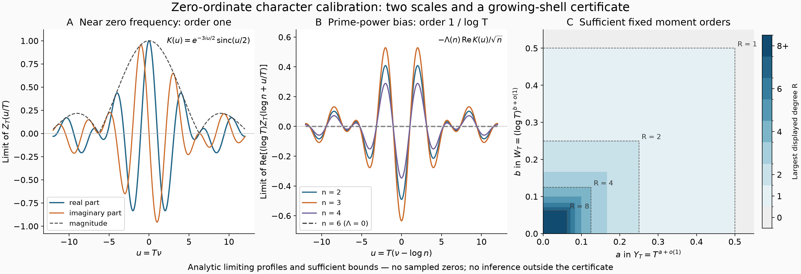

# Zero-ordinate characters have two different boundary layers

## Question

When can a growing Wang shell sampled at actual zeta-zero ordinates
depart from its prime-torus Haar baseline? The incoming
[character-tariff clue](../clues/CLUE-zero-ordinate-growing-shell-character-tariff.md)
requires a quantitative bound. This view separates two effects that
look similar after rescaling: failure to oscillate across the height
window near zero frequency, and classical lower-order prime-power bias.
It also displays the resulting sufficient moment certificate, so a
finite collection of moments is not mistaken for full path calibration.

## Construction

All mathematical claims and proofs are in
[VIS-462](../findings/VIS-462-zero-ordinate-shell-moments-pay-resonance-and-small-frequency-costs.md).
With all zeros counted with multiplicity, define
\[
Z_T(\nu)={1\over N(2T)-N(T)}\sum_{T<\gamma\le2T}e^{-i\nu\gamma},
\qquad K(u)=\int_1^2e^{-ius}\,ds
 =e^{-3iu/2}{\sin(u/2)\over u/2},\quad K(0)=1.
\]

Panel A plots the real part, imaginary part and magnitude of \(K\)
on 2,401 equally spaced points of \([-12,12]\). It is the proved
limit of \(Z_T(u/T)\), not a numerical zero sum. Panel B plots
\(-\Lambda(n)\operatorname{Re}K(u)/\sqrt n\) for
\(n=2,3,4,6\), the proved limit of
\(\operatorname{Re}[(\log T)Z_T(\log n+u/T)]\).
Here \(\Lambda(2)=\Lambda(4)=\log2\),
\(\Lambda(3)=\log3\), and \(\Lambda(6)=0\).
The displayed zero line is the non-prime-power control. The ordinates
in B have been multiplied by \(\log T\); A has no such factor.

For Panel C, the nonzero finite shell has arithmetic height \(Y_T\)
and normalized Wiener mass
\(W_T=(\sum_a|b_{T,a}|)/\|F_T\|_\infty\). In the parametrization
\[
Y_T=T^{a+o(1)},\qquad W_T=(\log T)^{b+o(1)},\qquad a,b\ge0,
\]
the sufficient error for fixed total squared-amplitude degree \(R\)
vanishes whenever
\[
2Ra<1,\qquad 2Rb<1.
\]
At 1,101 equally spaced values of each coordinate in \([0,0.55]\),
the color is the largest \(R\in\{1,\ldots,8\}\) passing both strict
inequalities, or zero if none passes. The color label `8+` means that
order eight passes and higher orders were not encoded. Dashed corners
mark the sufficient boundaries at \(R=1,2,4,8\). The white/gray
region and boundary lines mean **uncertified by this test**; they do
not assert non-Haar behavior. Subleading growth can matter on a line.

The image is 3,200 by 1,100 pixels, from a 16 by 5.5 inch Matplotlib
figure at 200 dpi. NumPy 2.5.4 and Matplotlib 3.11.2 were used.
The colormap is an ordered display of integer certificate depth, not
a probability or fitted significance scale. No zeta-zero dataset,
random sample, Monte Carlo null or estimated implied constant enters.

## Observation

The two oscillatory profiles share the same box transform because
they use the same dyadic height window. Their natural sizes differ:
small frequencies of order \(1/T\) can have order-one character
means, whereas the prime-power resonance has order \(1/\log T\).
Normalizing both panels to comparable visual heights would erase
precisely the distinction that a residual test needs to preserve.

The certificate map shrinks as the moment order grows. Any fixed
positive growth exponent \(a\) or \(b\) eventually leaves this
particular sufficient region as \(R\) increases. Controlling a few
moments therefore does not by itself justify a continuous persistence
statistic. Conversely \(a=b=0\), with the stated subpower meanings,
passes every fixed order. VIS-462 supplies actual coefficient regimes,
including all nonzero Wang shells with
\(\log Y_T=o(\log\log T)\), not only abstract axis coordinates.

## Robustness

The closed form of \(K\) was checked against independent 96-node
Gauss–Legendre integration on \([1,2]\) at
\(u=-12,-2\pi,-1,0,1,2\pi,12\); the maximum absolute discrepancy
was below \(3.7\times10^{-15}\). The removable singularity at zero
was evaluated as one, and \(K(-u)=\overline{K(u)}\) was checked on
the full plotted grid. Selected certificate cells were checked by
direct integer enumeration of the strict inequalities, independently
of the raster colors.

The conclusions do not depend on raster resolution: the profiles are
explicit functions, and the certificate boundaries are exact
inequalities. Reversing the Fourier sign conjugates both profiles;
their magnitude and the growth certificate stay unchanged. Changing
the height window would change \(K\), which is why its shape is
identified as a window effect. The non-prime-power control \(n=6\)
separates that shared shape from the arithmetic resonance coefficient.

The PNG was rendered outside the repository, closed, fully decoded
with Pillow verification and loading, and visually inspected before
atomic installation. Its staged and exact published Git blob must
match the validated local bytes. These checks establish artifact
integrity, not a numerical verification of the analytic theorem.

## Research consequence

The clue's quantitative prerequisite is resolved by VIS-462. A proposed
zero-sampled anomaly must pay the stated moment/coefficient costs and
retain the classical resonance term before interpreting a residual.
At fixed radius, all fixed moment orders together imply continuous
path calibration; threshold indicators still need Haar boundary-mass
control. Neither figure nor finding establishes an anomaly, a theorem
for an off-line subpopulation, or an RH consequence.

The analytic inputs are classical: Ford–Zaharescu,
[*On the distribution of imaginary parts of zeros of the Riemann zeta function*](https://arxiv.org/html/math/0405459v2),
§3, Lemmas 1–2, and the quantitative reconstruction already in
[WI-461](../../weil_inertia/findings/WI-461-fixed-scale-euler-peaks-have-positive-density-at-zeta-zero-ordinates.md).
The retained picture documents the transferred certificate and its
two distinct boundary layers. It is supporting context, not independent
mathematical evidence or a claim of a new general equidistribution theorem.
